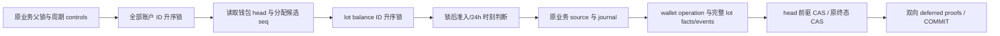

# 022-C0：全钱包序列与独立重放合同（根审候选）

2026-11-01。本文补齐 [lot 合同 §11](c0-lot-contract.md) 的缺口；**没有冻结生产 SQL、分配迁移号或授权生产实现**。两份隔离原型用于机制验证；后续真实001–022来源绑定、列ACL和维护的生产候选见§9，不修改已应用SQL、billing、main或既有业务钱包。原型中的 `c0p_*` witness 是受控测试输入，不能代替真实来源证明；所有原型结论均仅限所测机制。

依据：[HLD](../../docs/design/HLD.md)、[LLD](../../docs/design/LLD.md)、[C0 lot 合同](c0-lot-contract.md)、[B2](b2-funding-contract.md)、[023-B](../023-periodic-products/b-integration-contract.md)。此前接受的严格 FIFO、逆原 charged 边退款、历史全部 nonrefundable、显式空库初始化、不做到期或自动偿债保持成立。

## 1. 为什么需要全钱包序列

各 lot 的事件链只能证明自己的连续性。时钟可相等、事务可回滚、同一事务可有多次操作；`created_at`、`txid` 和最终 SUM 均不能证明当时是否跳过更老的可用 lot。为每个 tenant 建一条钱包序列，全部合法钱包写都在已经持有该 tenant AVAILABLE 账户行锁后追加。该账户是原有串行化点，不新增 tenant UPDATE/advisory gate。

序列证明的是所有已提交操作构成唯一前缀；不以开始时间或客户端时间定义顺序。事务回滚连同序号回滚，下一成功操作复用该未提交序号；不能使用 PostgreSQL sequence/identity 或 `MAX(seq)+1`。两次同事务操作仍须分别 CAS 尾并各有 source/journal，不按 xid 合并。



head 不再是额外并发入口。读取 head 时不先取独立 `FOR UPDATE`，更新 head 的行锁发生在账户之后；所有路径禁止 head/lot → AVAILABLE。账户/lot 等待之后才固定 request 的 `pb_admitted_at`，finish 的最终 DB clock 也在全部等待后取得。

## 2. 可直接编码的数据合同

保留 lot 合同五张维护表和全部 lot/分配表，追加以下事实；以下名称为生产候选，原型使用 `c0p_` 前缀。

### 2.1 `funding_wallet_operations`

列：`id TEXT PK`（规范非 nil UUID）、`tenant_id`、`epoch_id`、`seq BIGINT >= 0`、`kind`、`previous_id`、`source_id`、`journal_id`、`journal_operation_id`、`event_count BIGINT >= 0`、`available_delta NUMERIC`、`held_delta NUMERIC`、`consumed_delta NUMERIC`、`issued_delta NUMERIC`、`created_xid XID8`、`created_at TIMESTAMPTZ`。数值 delta 由来源重建，不作为可信输入；单笔 amount 仍 BIGINT，跨 lot/历史合计使用 NUMERIC。新增 UUID 不强转旧 source/reference ID。

唯一键 `(tenant_id,seq)`、`(tenant_id,id)`、`(tenant_id,kind,source_id)`、非空 `journal_id` UNIQUE、非空 `previous_id` UNIQUE。实际新增 `previous_seq BIGINT`，CHECK seq0时previous_id/previous_seq均NULL，seq>0时均非NULL且previous_seq=seq−1；FK `(tenant_id,epoch_id,previous_seq,previous_id)` → operations对应四列，DEFERRABLE INITIALLY DEFERRED。不是不存在的表达式FK。每个钱包 operation 只能有一个 successor，不能分叉。除 genesis 外一对一绑定原 journal，`journal_operation_id` 必须与原 `journals.operation_id` 相等，不能把新钱包 UUID 填到原 ledger operation 中。

kind 精确：`epoch_opening|tenant_genesis|manual_credit|voucher_grant|sandbox_capture|reserve|finish|consumption_refund|legacy_consumption_refund`。`finish` 由 settlement source 的 status 决定原 journal kind 是 settled 或 released；不按 HTTP reason 自报。`source_id` 对 genesis 为 tenant ID，其余见下一节。

事件保留原 `operation_id` 表示journal的原operation，另加`wallet_operation_id`、`wallet_seq`；生产候选实际FK为`(tenant_id,wallet_operation_id)`，`fl_guard_event`与`fl_check_wallet_operation`再逐条精确比较wallet_seq，连同kind/source/journal绑定；不声称有未创建的三元FK。operation的event_count必须等于全部对应事件，四个delta必须等于事件NUMERIC合计。lot event的前驱revision、桶变动、来源allocation仍逐条检查；全钱包seq不代替单lot链。

生产候选以`tenants.fl_created_xid xid8 NULL`区分真实旧/新集合：C0追加列不回填，旧行NULL；BEFORE INSERT无条件stamp top xid、UPDATE不可改变。新tenant_genesis的operation stamp必须等于tenant的非NULL stamp，旧epoch_opening必须对应NULL。全部NULL旧tenant必须与含0 available opening精确双向覆盖；既有tenant不能靠手填seq0新genesis略过开账。APP tenant INSERT收敛到原八列，UPDATE仅保持原六列`name,status,allowed_regions,price_group_id,pricing_revision,pricing_operation_id`；不新增`UPDATE(id,created_at)`，不授新stamp列，worker原SELECT/UPDATE(id)锁权保持；不使用xmin或created_at推断出生事务。

每个非genesis operation还必须与其原journal同一top事务：`journals.id=operation.journal_id`、tenant相等，且`journals.created_txid::numeric = operation.created_xid::text::numeric`。由operation通用checker在真实source绑定后验证，失败固定23514 `funding_lot_operation_transaction`。原002的完整journal lines INSERT guard要求journal.created_txid=txid_current()，其完整分录给出既有top事务见证；C0保护operation stamp再精确绑定两者，不给全部旧source增加birth列，不用xmin/时间推断。SAVEPOINT的subxid不同仍合法；epoch/tenant seq0独立走opening/birth证明，无journal且不套此式。

### 2.2 `funding_wallet_heads`

每 tenant 一行：`tenant_id PK,epoch_id,tail_seq BIGINT,tail_operation_id`，FK 同时含 tenant/epoch/seq/id，FK `DEFERRABLE INITIALLY DEFERRED` 供初始化交错。只有两个合法写：完整 seq0/genesis 的 INSERT；从 `(n,old_id)` 到 `(n+1,new_id)` 的 UPDATE。禁止 DELETE、tenant/epoch 改写或跳号。

UPDATE 的 BEFORE guard 要求新 operation 已由本事务 INSERT：BEFORE INSERT trigger **无条件覆写** `created_xid=pg_current_xact_id()`，在线列ACL不给该列INSERT/UPDATE，operation整体immutable；head guard只比较这份不可伪造stamp与当前top xid。不能用 `xmin=top xid`：A/B SAVEPOINT写入元组的xmin可能是subxid，`pg_current_xact_id()`仍为top xid，简单相等会错误拒绝合法资金。operation须在当前语句已存在可见；其他已提交事务stamp不同，source不可重绑。其前驱精确等于OLD head、seq=OLD+1、tenant/epoch相同。业务 SQL 必须 `UPDATE ... WHERE tenant_id=$tenant AND tail_seq=$old AND tail_operation_id=$previous` 并检查恰好一行；0行是 invariant，不重新读取尾重放 source。到 BIGINT MAX 时 fail closed，不wrap/换epoch；容量升级另行迁移。

DEFERRED head 与 operation guard 双向检查：最终 head 指向该 tenant 全部 operation 的唯一连续末尾；所有 INSERT operation 可沿前驱到唯一 seq0，且没有 seq 大于 head、没有 orphan/未推进的尾。同事务多次 CAS 允许旧 operation 已非最终 head，但必须有同 tenant 唯一后继。没有新 event 的零额操作也必须推进一次。

### 2.3 `funding_wallet_legacy_sources`

新增第六张维护表，精确记录 cutover 前每个**钱包业务源**：`epoch_id,tenant_id,kind,source_id,journal_id,journal_operation_id,amount,reservation_id?,request_id?,settlement_id?`；`(tenant_id,kind,source_id)` PK，journal_id UNIQUE，全部来源/原 journal 交叉核验。它覆盖旧 receipt、全部旧 reservation 的 reserve（包括已 terminal 和 R=0）、旧 settlement 的 finish（包括 C=0/R=0）、全部旧 approved refund。历史 reserve 不能因当前无 held 而消失。

此表给出历史 source↔journal 的精确 prefix，不能按 created_at 小于 epoch 推断。与原五表的 membership 必须等价：receipt 子集等于 legacy_receipts；finish 等于 legacy_settlements；approved refund 等于 legacy_approved_refunds；未 terminal reserve 等于 legacy_openings reservation，已 terminal reserve 关联 legacy_settlements 对应 reservation。任何缺/多/错租户/错 journal 都拒绝 init 和 VerifyLots。

维护后新 source 不能 INSERT 此表。旧源重复读只允许原完整 legacy membership，不创建新 operation/lot/event；缺图不能以幂等重读“补齐”。

## 3. 全部真实钱包路径映射

| 实际写入口 | operation kind/source | journal 绑定与精确 lot 效果 | 零额与重复 |
| --- | --- | --- | --- |
| `ApplyFundingTx` manual 分支（`ApproveCredit`） | manual_credit / funding_receipt.id | receipt.source_id=credit_order.id；原 journal.operation=credit_order.id、kind=credit、reference=credit_order.id；一新 lot/initial event；A/issued +amount | amount>0；原 approved 只重读完整 receipt+operation+lot 或精确 legacy |
| 同 helper voucher（`RedeemVoucher`） | voucher_grant / receipt.id | receipt→redemption；原 journal.operation=redemption.id、kind=voucher_grant、reference=voucher.id；一新 lot/event | amount>0；业务 savepoint 回滚也回滚序列与 head |
| 同 helper sandbox（Processor capture） | sandbox_capture / receipt.id | 仍完整 B2 source/identity/selection/processing；journal.operation=capture operation、kind=sandbox_capture、reference=order.id；一新 lot/event | amount>0；旧 receipt重读核完整图；最终 processing generation CAS 失败全回滚 |
| `Store.Reserve` | reserve / reservations.id | 原 journal.operation=reservation.id、kind=reserve、reference=request.id；按当时 FIFO，A−R/H+R；allocation_index 连续且 event恰覆盖正 allocation | R=0：一 operation+原零额journal，0 allocation/event，delta全0；仍验证来源和 tail |
| `finish`（Settle/Release/24h/recovery/Reconcile 所有释放） | finish / settlements.id | journal.operation=settlement.id、kind=status、reference=request.id；原 allocation 按 index正序收费prefix，全部边生成 settlement_lot/finish event；A+(R−C)、H−R、S+C | R=0仍 operation+零额journal，0 event；C=0/R>0仍逐 allocation 终态边；已有 settlement只重读完整图 |
| `ApproveRefund`，新 reservation 来源 | consumption_refund / refund_orders.id | journal.operation=refund.id、kind=refund、reference=settlement.id；按原charged边 index逆序扣除此前已退，S−F/A+F | F>0；approved重复只读原图；不恢复Key/周期spent |
| `ApproveRefund`，legacy terminal settlement | legacy_consumption_refund / refund.id | 同原 refund journal；恰一新的nonrefundable legacy refund lot，A/issued +F；指精确 legacy settlement 与本新批准refund | cutover approved不得重建；pending旧refund后批走此分支 |
| 维护 init，每个旧tenant | epoch_opening / tenant.id，seq0 | 没有新journal；恰覆盖该tenant所有opening，正amount各一lot/event，available opening→A、unfinished reservation→H+原allocation | 每tenant available opening必有（含0）；R=0 opening无lot；空库epoch无tenant时没有head |
| epoch后创建新tenant | tenant_genesis / tenant.id，seq0 | 无journal、lot/event、delta；tenant AFTER INSERT invoker trigger 同事务建genesis/head，要求当前新tenant tuple与active epoch | 不是首笔funding时补genesis；APP创建tenant必须一次成功；worker无tenant INSERT权 |

`markPending`、PrepareDispatch、attempt/evidence、reconciliation proposal、recovery job claim、采购预占/结算/更正、投影不改变客户钱包，不追加 wallet operation；它们仍按原合同验证已有 reservation 来源。创建 pending credit/refund、未入账 payment order/notification 也无钱包操作。不能用“无 operation”绕过 source 完整性：任何真实钱包 journal 必须反向落入精确 legacy_sources 或唯一新 operation，原子互斥、不可同时成立。

## 4. SQL 双向保护及顺序

不把大而全的 source SQL 给 worker。生产候选 invoker 函数签名固定如下；函数 body/oid、搜索路径、依赖、角色闭包须加入 runtime attestation，新增函数默认撤 PUBLIC EXECUTE：

```sql
fl_check_receipt(receipt_id text) returns void
fl_check_sandbox_receipt(receipt_id text) returns void
fl_check_reservation(reservation_id text) returns void
fl_check_settlement(settlement_id text) returns void
fl_check_refund(refund_id text) returns void
fl_validate_genesis(wallet_operation_id text) returns void
fl_check_wallet_operation(operation_id text) returns void
fl_check_lot(lot_id text) returns void
fl_check_wallet_head(tenant_id text) returns void
```

common operation check 先按持久 kind 分支，再调用最窄 source validator；worker只有 sandbox函数 EXECUTE，没有人工/券/请求/refund 函数 EXECUTE，且没有那些 source 表读权。SQL `CASE/OR` 中混读所有来源会造成不必要权限要求，禁止。tenant_genesis由租户创建trigger调用，不可给worker一个lazy genesis绕过。所有函数 `SECURITY INVOKER`，固定本schema+`pg_catalog,pg_temp`搜索路径，引用限定schema，不使用可变GUC承认owner/可信来源。

source INSERT/状态转为生效、wallet operation INSERT、对应 journal/line INSERT、lot/allocation/event INSERT、cache INSERT/UPDATE、head INSERT/UPDATE都须安排双向 deferred proof。顺序交错可满足FK，但单独省掉任一写入都不能COMMIT。guard检查源不是“传进来的金额”：从实际receipt/reservation/settlement/approved refund重建。已存在source且新事务试图追加另一operation必须被唯一键或源边界拒绝。

新 journal 要核其完整 lines，包括既有零额两行；不能只比较 sum=0。原 source/journal约束继续执行。非wallet采购journal不误要求lot，但其科目不允许伪装成AVAILABLE/HELD。对具有 AVAILABLE/HELD 任一 line 的journal，逐源反向核查即使其delta=0仍生效。

逐操作可在提交时依据 seq 之前事实重算选定的 lot prefix；实际生产SQL如果不承担完整历史重放，仍至少检查来源、全部边、event/cache/head与tenant当前守恒；**独立 VerifyLots 必须承担 §6 的全序重放，不能把该SQL简化表述成已证明FIFO**。原型用set-based历史before-state检查FIFO，性能不能直接外推生产。

## 5. Go 接缝与锁序

候选私有对象只绑定具体tx、tenant、epoch、head前驱与purpose，不持可被客户端信任的amount。使用 `txIdentity` 同时比较pgx wrapper、backend PID、`pg_current_xact_id()`；commit/rollback后或另一wrapper不可复用。

```go
type walletSequence struct { /* 私有 identity,tenant,epoch,previousID,seq,purpose */ }
func readWalletSequenceTx(ctx context.Context, tx pgx.Tx,
    tenantID string, accounts []lockedAccount, purpose string) (walletSequence, error)
func appendWalletOperationTx(ctx context.Context, tx pgx.Tx,
    sequence walletSequence, source walletSourceRef) (walletOperation, error)
func advanceWalletHeadTx(ctx context.Context, tx pgx.Tx, operation walletOperation) error
func verifyLotsTx(ctx context.Context, tx pgx.Tx, tenantID string) (LotCheck, error)
func (s *Store) VerifyLots(ctx context.Context, tenantID string) (LotCheck, error)
```

`walletSourceRef` 仅含kind/sourceID，不能含可信 amount/class/journal；append重读source推导完整值，record lots后advance。已有lot lock两阶段接口保留，但其lockedFundingLots也绑定钱包序列。read先核active epoch、head/genesis、accounts含本tenant AVAILABLE及本次全部所需科目，不能自行取前层锁；新 funding只锁新lot，不读取旧allocation。

| 文件/函数 | 直接实施顺序 |
| --- | --- |
| `funding.go / ApplyFundingTx` | 原所有来源/授权重读 → 一次 accounts 锁 → readSequence → 原锁后时刻/资格复验 → 原journal/source/receipt → appendOperation → create lot/event/cache → headCAS → 原credited；外层audit/终态继续同tx。B资金savepoint内全部覆盖 |
| `reserve.go / Reserve` | 原principal/pricing/periodic controls → accounts → readSequence → lockReserveLots（ID锁序、FIFO选择）→ **request/reservation INSERT**固定020时刻 → AdmitCustomerTx → 原reserve journal → appendOperation/全部allocation/event/cache → headCAS → periodic reserve/Key/recovery/audit/outbox。原Key expiry/deadline以admission.At再核 |
| `settle.go / finish` | 原request/reservation、必要model升级、周期controls → accounts → readSequence → lockFinishLots → 最终DB clock/24h判定 → 原journal/唯一settlement → append/全部终态边/events/cache → headCAS → 原Key/periodic/state/audit/outbox |
| `orders.go / ApproveRefund` | refund UPDATE → checker/maker → lockRequest → settlement UPDATE → 显式一次accounts锁（取代post隐藏锁）→ readSequence → lockRefundLots → 原postLocked/journal/approved source → append/逆序边/events/cache → headCAS → 原refunded累计/audit/outbox。无周期锁 |
| `settle.go`重复settlement、`orders.go`重复approved、`funding.go`重复receipt | 只读完整source/operation/lot链或精确legacy例外，不取新sequence、不推进head、不repair |
| `evidence.go / PrepareDispatch`、`markPending` | 原reservation根保护下普通读完整lot来源；不为检查先取lot/head锁，不形成lot→采购锁 |
| `recovery.go` | 保持claim短tx先提交，后续仅原Settle/finish；不新增allocation或重发模型 |
| `query.go / VerifyLedger` | 既有单RR READ ONLY中加入verifyLotsTx；不创建第二snapshot。Balanced同时要求ledger、funding、lots |
| `funding_verify.go / VerifyFunding` | receipt↔新lot/op或精确legacy全方向；只读同tx。不把funding_journal_valid递归改成lotvalidator |
| `rebuild.go / Rebuild` | 最终同一RR写tx中锁active projection，运行原ledger/funding/同步源总额+verifyLotsTx，再切projection；不修lot/head |

所有helper不Begin/Commit/retry/network，不取tenant/order/Key/model/periodic前层锁。CAS0行、来源不符、缺链是invariant；数据库取消/锁超时/权限/执行错误是unavailable，不持久为业务拒绝。未知COMMIT沿原Store/B规则不重放，也不根据无DTO自行重做。

## 6. 独立 VerifyLots 重放算法与权限

public VerifyLots：APP真实LOGIN的一个RR READ ONLY；核schema/active epoch、登录及最小读权、设置有界statement/lock timeout。内部verifyLotsTx接受caller已有RR（只读或Rebuild RR写）；不Begin/Commit、执行SET ROLE或写临时表。它与维护owner专用PB verifier职责分开。

全局核验先验证epoch/database/schema绑定、旧tenant/全部opening和legacy_sources membership双向关系、所有wallet源↔journal↔operation/legacy、所有operation↔全部事件/分配/lot缓存、head无洞无分叉。租户scope只裁剪本tenant，不比较共享clearing总额；全局scope必须对全部tenant做相同检查，包括仅有零额操作的tenant。

随后每tenant按 seq 从0起独立重放，不信任before/after/cache：

1. seq0按完整opening事实建内存lot状态；旧available正额lot A=P，旧unfinished每reservation专属lot H=R，零额无lot；建立旧reservation allocation。新tenant genesis仅空状态。
2. funding从真实receipt推导class、amount、FIFO time/id，新建一lot；已有同源/同lot立即mismatch。
3. reserve在**操作前**内存A>0集合按fifo_at/id排序，严格取R前缀，逐项比较持久allocation的index、lot、amount及本次全部events；不能以allocation自身重放来“验证”自身。R=0要求0边但仍核source/journal/seq。
4. finish只使用步骤3或旧opening得到的原allocation，按index正序分配C（C≤R）；比较每条charged/released和event，再移动H→A/S。每allocation恰被一次finish覆盖。当前source状态和原结算/退款累计独立比较，终态重复不能生成新操作。
5. consumption refund从原charged边按index逆序，以**此前seq的refund边**计算剩余，产生预期分配；比较全部实际边，S→A。F1/F2必须与一次累计相同。legacy refund先核旧settlement与cutover-refunded基线、先前新退款累计，再创建明确nonrefundable lot。
6. 每步以大整数检查桶、delta、event的声明before/after/prev/revision，最后比较每lot cache与event末尾、tenant AVAILABLE/HELD、原unfinished R、head。所有未被枚举的lot/event/分配/source计为orphan，不能忽略尾页。

查询用keyset（tenant,seq/lot_id/source_id），一次Rows完整关闭；同一RR保持全遍历快照。大库可按tenant分段内存，但不能跨snapshot分别证明一个tenant前缀；无总行数截断后判balanced。资源耗尽返回零结果和安全unavailable。counter只报告固定方向和数量，不泄漏外部原文或其他租户标识。

LotCheck新增 `WalletSequenceMismatches, WalletSourceMismatches, FIFOAllocationMismatches, RefundOrderMismatches, GenesisMismatches`，并保留lot合同十方向。任一不为0则Balanced=false。数据库/权限/取消/COMMIT失败返回**零LotCheck**，不能带部分balanced结果。owner只用于损坏fixture和维护，不替代APP独立验证验收。

## 7. 维护 plan/init：同一 RR 的全源 basis

plan/init各自有一个外层维护事务，不能复用两个命令之间的snapshot；两个命令重算同一规范化basis。plan RR READ ONLY；init RR写。二者均先在事务外取真实exclusive instance session gate、确认全部handler/worker/network cleanup停稳，并按已有迁移gate顺序。仅设置MAINTENANCE_MODE不算排空。

Init已实现的T1/T2前置为：固定SET后、第一次任何SELECT（包括catalog/身份查询）前，按**已受审125表静态清单**取得一条ONLY/全限定/C序SHARE ROW EXCLUSIVE锁；随后catalog及Attest内history/真实身份/前驱通过，才在同authority busy内锁全部账户，出口复核后发行Permit。RR首次数据快照在完整表锁之后固定。Plan不取写型表锁或账户行锁，依赖真实维护gate和停服边界；全来源及basis重算仍待T3/T4，catalog/schema/migration digest须纳入未来basis。

全源basis不只AVAILABLE：原ledger账户/全部journal+lines、tenant/user/member/Key与held、request/reservation/settlement/approved与pending refund、usage/finalization/attempt与recovery/reconciliation、三来源receipt/credited/audit及A人工/券命令、B environment/identity/revision/selection/order/notification/processing/audit/command/lease、采购account/binding/reservation/events/corrections、PB controls/windows/allocations/events/operation/version、active projection/outbox/report状态均在同一RR读取核验。使用§10的代码内静态名称与冻结列列表，不运行时按前缀猜；追加迁移新增表时basis清单与角色证明一并更新。敏感字段可作为内存规范化hash输入但不得输出正文，输出仅digest/计数。

规范化hash使用固定域/version、schema/database OID、按表/主键C序的有类型长度前缀字段；NULL与空字串、数值文本与时间UTC6明确区分。不能直接 `row_to_json`/不稳定默认格式或只hash总额。候选直接编码为受审builtin列的 `pg_catalog.record_send(ROW(冻结列列表))` 二进制，表名/列名/类型OID/attnum及每行长度/count前缀一并入hash；按主键对应record_send的hex字节C序排序，复合主键不会串接歧义。该候选把PostgreSQL major/version和type send函数OID/摘要绑定basis，禁止调用未知自定义send函数；不导出原始行bytea。读完所有来源、运行全部核验、生成opening与旧membership后计算basis；init比较plan提供的epochID+basis再写，任一变更拒绝而不是补差。

### 7.1 PB 的 actual LOGIN 接缝（T2授权已实现，T3维护scanner候选）

当前 [Verifier.Verify](../../internal/periodicbudget/verifier.go) 自行Begin RR READ ONLY，且 `verifierAuthority` 要求actual LOGIN拥有六张PB事实表；不能由APP调用，也不能用另连接结果拼进init。B3的app/mock/receiver由三个NOLOGIN owner拥有，安装连接通过SET ROLE安装，故不能要求安装LOGIN本身拥有六表；改变其owner又会破坏既有proof。新维护入口分两条受审信任路径，**不弱化原Verifier**：

```go
// 历史T3接口示意；正式实现见maintenancescan.VerifyMaintenance。
// ReadLease与PB/68表读取已实现，不接收裸tx或另一个caller context。
func VerifyMaintenance(lease *maintenancetrust.ReadLease) (Verification, error)
```

1. **普通生产维护**：连接Config().User=session_user=current_user，真实LOGIN且实际拥有六张PB表与目标schema；非SET ROLE、不是runtime APP。沿原owner检查，并核schema/完整对象摘要与manifest。此路径不要求superuser，不扩大在线权限。
2. **仅B3本机沙箱例外**：仅在固定TCP `127.0.0.1:55439`、数据库名`moni_test`、当前实际dbOID/endpoint与既有sandbox proof完全相符时，允许实际authenticated LOGIN `moni_test`，其`rolsuper=true`且database.datdba正好是该LOGIN OID、Config().User=session_user=current_user、未SET ROLE。三schema owner必须仍是proof固定OID的NOLOGIN角色；完整八角色无继承/成员/SET/ADMIN提升、全部schema/table/function/trigger/ACL/正文摘要和immutable attestation先按既有proof独立验证。不是只看用户名或superuser就通过。remote socket/localhost别名、其他数据库/端口/LOGIN、非DB owner superuser都拒绝。这个例外仅用于专用测试沙箱，不提供任意installer用户名或可配置trusted role。

`internal/maintenancetrust`依赖标准库、pgx/catalog及T2允许的migrations/paymentsandboxschema叶子，不import billing/payments/periodicbudget，避免循环。[T2根冻结](c0-authority-contract.md)已实现唯一二参 `Attest(ctx, snapshot)` 与 `Permit.Verify(ctx)`，全部字段私有、nil/零值永不有效；Snapshot内部owned installation为唯一安装输入，不接受caller proof、裸tx、observedConnection、trusted bool或skip flag。实际会话与配置由固定内部stage读取，不把struct自报当认证；[T2真实PG/race专项](../../docs/verification/maintenance-authority.md)已通过。

Permit绑定原pgx.Tx wrapper/conn指针、backend PID、top xid、dbOID/schemaOID、mode及完整proof事实；`Permit.Verify(ctx)`在新受控busy调用内再次核全部绑定和active RR（plan只读/init可写）。后续T3 scanner须全程持ReadLease，不能仅靠入口/出口两次Verify取得裸tx或绕过原总期限。Permit不接外部字面JSON、可伪造字段，不跨事务缓存；取消、失败和终结开始即共态撤销。gate attestation核本backend实际持有约定session advisory lock，不信环境变量。Init全部accounts锁在发行Permit之前完成；来源扫描、basis和epoch仍后续。

PB维护入口沿现有独立scanner/queries重用，不依赖runtime Reader/trigger、不Begin/Commit；通用核验core不内置宽松权限分支。原Verifier仍执行原actual LOGIN真owner规则，原APP失败的测试必须继续失败。普通serve没有permit构造入口/沙箱管理员DSN；维护凭据不保存在runtime proof或日志。更通用的非superuser installer授权闭包留后续，C0不设计新installer角色。

必要负例：APP/worker/projector即使全SELECT也拒绝；SET ROLE owner拒绝；superuser非DB owner/错误name/endpoint/dbOID/schemaOID拒绝；把三NOLOGIN owner换为LOGIN或同名新OID拒绝；任何八角色membership、grant option/函数正文/search_path/trigger/ACL改变拒绝；permit复用另一conn/PID/tx/保存点或commit后拒绝；原Verifier在B3 installer上仍拒绝而新的维护路径在完整proof下成功。plan/init全部核验同一RR的证据不能由这组身份测试替代。

已实现的 `migrations.VerifySnapshotTx(ctx, tx)`接受caller已有RR只读或读写事务并核完整checksum history；没有SnapshotRequirement参数。T2先服务端scalar guard再调用该helper，并从固定embed绑定manifest。对象/函数/trigger/列另由静态checker核验，不能误称旧VerifyReadOnlyTx已经核完整对象；后者强只读语义保持。未来ledger/funding/lot、B完整性和采购维护扫描须经同Snapshot的T3 ReadLease，不能各自开pool事务。pre-epoch源核验、post-init完整lot/genesis与basis均未实现，不要求未发行epoch时旧VerifyLots balanced。

维护身份只在离线命令持有，不由serve持有；普通APP VerifyLots不调用此入口，不获得PB owner/DDL权。B普通off的APP/projector/worker权限与role fingerprint不顺便扩张。新C0独立模式启动证明须另审。完整B3 proof目前含latest migration/权限摘要，追加C0必更换受审proof生成与校验版本；不能给旧proof一个ignore新表/新函数通道，也不能修改旧immutable attestation假装是原对象。追加版本/epoch的exact binding须随生产DDL冻结。

## 8. 最小角色矩阵

| 对象/能力 | APP | sandbox worker | projector | 维护owner |
| --- | --- | --- | --- | --- |
| epoch/六维护表 | SELECT（必要列） | epoch必要列、legacy receipt/source中sandbox必要列；不授整表A来源 | 无 | 维护DDL/首次INSERT |
| heads | SELECT、INSERT(genesis guard)、仅tail两列UPDATE | SELECT、仅tail两列UPDATE；不能INSERT genesis | 无 | init |
| operations/events/lots | SELECT、INSERT；immutable禁止改删 | 公共证明所需列SELECT、INSERT；kind分支sandbox validator，无其他sourcevalidator执行权 | 无 | init/只读预检 |
| balances | SELECT/INSERT；guard约束桶/revision/last_event列UPDATE | SELECT/INSERT；**零UPDATE**（sandbox仅新lot） | 无 | init |
| 三分配表 | SELECT/INSERT，无UPDATE/DELETE | 无 | 无 | init |
| source validators | 全APP路径函数EXECUTE | 只有sandbox+common最小函数 | 无 | 维护 |
| PB维护verifier所需表所有权 | 无 | 无 | 无 | 普通actual LOGIN真owner；固定B3测试例外按§7.1 |

worker验证自身初始图时不查询分配表；allocation/event的反向来源guard保证其他操作不能绑到sandbox初始operation，worker也无分配INSERT权。生产候选新增`funding_lot_legacy_sandbox_receipts`窄membership，精确等于总legacy_receipts的sandbox子集，避免授worker总A/请求历史读权；epoch/APP全局核验双向比较。common validator不以“遍历全tenant来源图”迫使worker读A或request。完整全路径APP VerifyLots读源图与PB独立维护核验明确分离。完整表/函数/实际列ACL以[生产SQL](c0-production-schema.sql)、[权限SQL](c0-production-permissions.sql)、[维护与proof-v2](c0-maintenance-contract.md)候选为准，尚未根冻结。

角色证明同时检查PUBLIC/继承/SET/ADMIN/grant option、函数owner/prosecdef/proconfig/签名/正文摘要与依赖。所有不在矩阵内的权都为0；permission denied是静态候选错误，不在运行时自动补grant。负测试用真实LOGIN，不用SET ROLE模拟实际连接。

## 9. 隔离原型与冻结门槛

[core原型](c0-core-prototype.sql)和[permissions原型](c0-permissions-prototype.sql)在随机schema装载，无迁移登记、无生产表依赖；测试source/journal witness由fixture建立。它们用于证明尾CAS/连续前缀、零额与source双向映射、事件对应、FIFO/逆退款检查以及APP/worker/projector实际LOGIN隔离，**不证明**生产A/B来源、权限attestation、维护全源basis、Go接线或真实供应商。

原型的进一步明确限制：其epoch可验证正额/零额available opening与空new-tenant genesis，但没有生产旧reservation/legacy_sources全部membership校验；其通用source/journal fixture列不构成真实A/券/支付读取隔离证据；没有模拟全部既有父锁/AVAILABLE行锁、020时间边界或资金savepoint的外层授权；函数search_path/manifest指纹由生产追加SQL另行冻结。生产合同要求的这些边界不能因原型通过而删除。

生产冻结前必须逐一提交：完整新表/函数/trigger DDL及正文摘要；所有真实source↔operation↔journal/lot双向guard；静态basis/表锁清单与规范化编码；独立VerifyLots全重放实现计划；owner同RR PB/migration接缝；全部实际LOGIN负矩阵；触发器/FK隐式锁审阅；init未知COMMIT只查原epoch不重试；1/128/129/1000+lot资源预算与24h/periodic等待反例。三来源资金、R=0/C=0、多lot部分settle/分次refund、旧未结/旧pendingrefund、owner损坏同额错序/漏尾/坏genesis与独立APP检出全部属于正式验收，不能拿本原型替代。

## 10. 当前静态 basis/维护表锁清单（含新 B3 022）

为避免遗漏非资金worker对来源/授权/证据的写，init锁定并hash目标app schema的**全部下列既有业务表**，不只名字含funding的表。此列表根据001–022逐项枚举，提交时固化为源码array；不在运行时用前缀/LIKE/所有catalog表替代。schema_migrations也在列表，先取现有迁移session gate再取表锁，防并发迁移。全列入basis；逐表列名/attnum/type/主键按受审embedded SQL生成的closed descriptor固化，catalog只用于比对描述符，不用于自动接纳新列。C0自身新表须全部为空且active epoch缺失；它们另受同事务表锁与空集断言，不混入旧basis回填。

```text
active_report_projection
alert_commands
alert_control
alert_episode_events
alert_episodes
alert_rule_runtime
alert_rules
api_keys
audit_events
billing_profile_blocks
channel_batch_operations
channel_credentials
channel_model_discoveries
channel_model_discovery_results
channel_version_credentials
channel_versions
channels
commerce_commands
commerce_operation_receipts
cost_versions
credential_procurement_bindings
credit_orders
delivery_observations
finalization_records
financial_idempotency
funding_receipts
identity_challenges
identity_initialization
identity_mail_outbox
identity_mail_subjects
journal_lines
journals
ledger_accounts
member_model_grants
memberships
metering_event_conflicts
metering_events
mfa_recovery_codes
model_bindings
model_capability_versions
models
payment_cancel_intents
payment_captures
payment_command_observations
payment_command_outbox
payment_effects
payment_event_conflicts
payment_evidence_processing
payment_inbox
payment_order_capture_selections
payment_orders
payment_policy
payment_provider_revisions
payment_query_attempts
payment_query_conflicts
payment_review_facts
payment_runtime_attestations
payment_sandbox_environment
payment_sku_changes
payment_sku_versions
payment_skus
payment_transaction_identities
payment_verified_evidence
payment_verified_queries
periodic_budget_allocations
periodic_budget_configuration_versions
periodic_budget_controls
periodic_budget_events
periodic_budget_operations
periodic_budget_windows
platform_probe_attempts
price_groups
price_versions
pricing_operations
procurement_accounts
procurement_balance_observations
procurement_budget_events
procurement_commands
procurement_cost_proposals
procurement_evidence_identities
procurement_reservations
projection_outbox
projection_receipts
provider_cost_corrections
reconciliation_cases
recovery_gate
recovery_jobs
refund_orders
report_totals
request_idempotency
request_records
reservations
route_binding_isolations
route_policy_versions
schema_migrations
session_families
sessions
settlements
tenant_model_grants
tenant_pricing_assignments
tenants
upstream_attempts
users
voucher_batches
voucher_policy
voucher_redemptions
voucher_revocation_decisions
voucher_revocations
vouchers
```

auth/session/identity的安全内容仅留在受控内存hash；不输出它们的正文、邮箱、password digest、MFA种子、恢复码、voucher或credentials。对表全集取锁可能增加维护等待，但比遗漏活跃writer安全；仍受维护总timeout，取锁失败整体退出、不换低隔离级别或删表。mock/receiver两个外部fixture schema不作为app钱包源，必须先停止各自服务；其冻结proof/catalog digest进入environment basis，不读取外部消息正文替代app持久证据。
