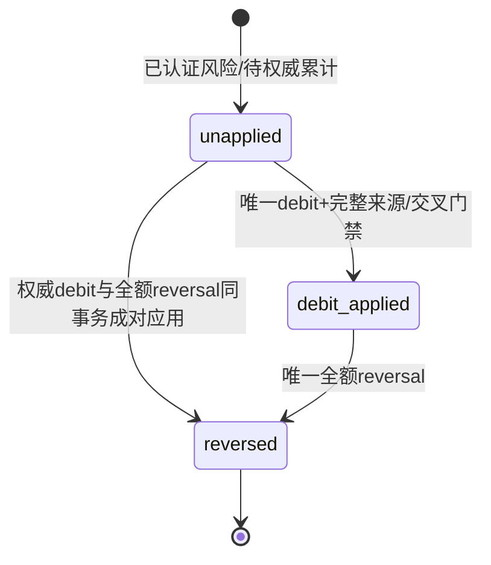

# 022-C2：争议、确认拒付、来源偿付与反转合同（设计候选）

2026-11-01。**独立设计候选，未冻结生产SQL、协议版本或资金实现，未执行任何拒付/债务处理。** 依据[022总规格](spec.md)、[总合同§9](contract.md#9-c争议拒付和独立债务)、[C0完整来源](c0-lot-contract.md)、[C0钱包序列](c0-sequence-contract.md)、[C0维护](c0-maintenance-contract.md)、[C1原路退款](c1-refund-contract.md)。C0只有纯分配算法已实现，不具备本片资金前置；现有P协议的争议通知仍是unsupported_effect_review，不能直接改分支应用资金。

本稿仅针对本地sandbox原capture，不将模拟争议称为真实银行拒付。正式PSP的争议、暂扣、最终扣回、仲裁、费用、部分撤销与账户负余额均须独立认证。没有真实协议证据时保留未验收，不要求生产客户或真实支付凭据参与本地设计。

## 1. 最小范围和前置门禁

首片选择一个sandbox capture最多一个**可自动应用**case；该case至多一次正额扣回、一次同额全额反转。支持事件逆序、同事实多event ID和重复投递；部分扣回金额B可小于P，但部分反转、多次增量扣回、同capture第二case、手续费及不同币种先保留为review，不猜分摊。本限制是首片明确合同，不能把这些证据丢弃或忽略其风险。

实施顺序为：C2-P新版事件/查单/最终性/累计关系协议 → C2-M mock case事实与原交易串行 → C2-S完整SQL/角色/证明与独立核验 → C2-I全钱包及准入门禁 → C2-R精确原来源偿付命令 → HTTP/UI和C3退款交叉/实际故障验收。每片另附全文根冻后编码，生产路径不从本稿直接开放。

必须先实际验收C0全部资金写路径、维护epoch/来源/序列、C1退款Q/F及新版运行证明。C2与C1共用原order根、扩展同一个钱包/lot/Verifier，不能各写一套新余额。023商品若有钱包支出，024向量计量若已接线，也必须一并进入门禁和最终资金重放，不能只认证旧Token路径。

## 2. 通知、权威事实、业务效果是三层

签名正确只证明来自配置的密钥，不证明对应本tenant、原capture、case最终性或本地可以扣钱。inbox先按固定协议严验并持久后durable ACK；业务worker再从当前运行证明和不可变capture/receipt/lot推导tenant，不接受外部自报tenant、journal、可信标志或债务额。

| 外部含义 | 证据必须表达什么 | 本地允许动作 |
| --- | --- | --- |
| `dispute.opened` | 原capture/交易、稳定case、所述争议及供应商case revision；金额仅争议主张，不是已扣现金 | 建立原order退款限制和tenant风险屏障；无资金journal/债务 |
| case仍在调查/临时资金hold/任意未认证状态 | 当前状态的原始认证范围 | 保留证据与风险，不按“closed”字面猜最终无扣回 |
| `dispute.closed_no_debit`（新版新增语义候选） | 同case最终关闭且无已确认扣回，并保证旧command/旧case不会迟到产生扣回；需稳定finality/tombstone绑定 | 仅在完整查询一致、无其他风险/债务/冲突时解除对应风险；无资金journal |
| `chargeback.debited` | 供应商确认已从原商户资金扣回B，稳定provider debit ID、case及原capture；B为明确CNY正额，不是暂扣/索赔额 | 完整原交易累计和交叉门禁通过后，原lot可用回收与独立债务；一次效果 |
| `chargeback.reversed` | 明确指向已确认debit ID的供应商返还，稳定reversal ID，首片金额恰为原B；不是新的capture/用户充值 | 仅反转该debit的真实回收/偿付/未偿债关系；一次效果 |
| case最终关闭且扣回保留 | 明确最终case结论，原debit及净扣回不变 | 只结束争议调查状态；尚有债务/冲突时tenant继续受限，不免债 |

当前P v1没有上述完整finality/反转绑定和原交易累计语义；C2-P必须显式追加版本，旧capture证据按原版本核验，新C2使用追加的签名用途域、schema inventory、typed角色/函数及不可变attestation。不得原地重解释旧`amount`、添加宽松可选字段或把旧`dispute_unsupported` fixture当认证。

所有可用证据均完整绑定environment、merchant/payee、merchant order、provider transaction、原capture effect、本地order和不可变金额/CNY；外部case/debit/reversal/event各有受控稳定ID。查询有原持久query ID、supervisor和参数摘要、原generation/签名snapshot；查询结果须是有明确provider revision的完整原交易视图，包括成功退款、尚可能生效的原退款命令、扣回/反转及引用关系。查询404、not_seen、空列表或没有某event的一个分页不证明最终不存在。

`closed_no_debit`必须阻止旧事实迟达，不以“截至当前未查到”命名最终。若PSP不能提供这种承诺，case保持风险，等待有权威证据的另行处理合同；不能管理员点“已处理”或TTL到了就关闭。查询仅确认/收集原事实，不发送模型，不重建或重发支付/退款mutation。

## 3. 风险屏障和资金阶段分开

tenant风险聚合至少区分`open_dispute/pending_authoritative/review_conflict/outstanding_debt`；原order单独保留退款restriction。它们是受来源约束的DB投影，不是可由管理员任意toggle的布尔值。不可变原因事件和revision支撑每次变更；不修改lot原origin/refund_class/fifo_at。

第一次合法、能映射原capture的风险证据由worker提交**风险阶段事务**：原order → case/selection → tenant UPDATE屏障，持久case/原因/安全audit；它不应用客户资金。随后独立资金事务处理已认证扣回/反转。这样金额处理溢出、SQL/权限/资金故障或待交叉核查不会把已落地风险一起回滚。证据选取失败、未知交易或错环境不能拿外部tenant ID限制任意客户；保留未映射review供平台核查。

风险线性化点是该tenant UPDATE事务成功COMMIT，供应商`occurred_at`不是本地历史准入的撤销点。inbox已ACK但worker尚未应用风险时，应展示处理积压/新鲜度；不能声称在收到网络包瞬间已停准入。COMMIT未知先查原operation，不能认为风险未生效并换ID写第二份。

Reserve和最终PrepareSending持tenant SHARE，在全部等待后以新的语句读取同一DB restriction。风险先提交则拒绝`payment_restricted`；sending先提交则请求继续原结算/释放，不追撤或重发。已预占但尚未sending的请求按原无消费/未知证据收尾，不绕过已有硬预占或采购独立unknown。未来商品钱包支出须同样受限，不能通过商品分支绕过暂停。

已有sending、证据接收、唯一结算、24h释放、消费退款、C1已授权原路退款终态及对客户有利的历史收尾继续；不恢复Key.spent/周期spent，不停止账号登录/看账/联系财务。后续正常资金入账可以保留本来来源，但不因此自动抵债，也不因总AVAILABLE变正绕过restriction。

风险只能从原case权威终态及完整债务/冲突关系派生关闭：所有case已权威关闭、全部debt余额0、无pending/review原因才能解除tenant新准入限制。已结束且扣回保留的原order在首片仍禁止新C1批准，直到C3明确认证剩余可退边界；全租户门禁与原order退款restriction是两个不同条件。管理员“确认已看到”不消除任一条件。

## 4. 扩展lot与独立债务守恒

沿C0/C1记原lot本金P、可用A、推理held H、净消费S、原路退款held Q、已确认原路退款F。C2追加当前`chargeback_recovered_amount=C`和`debt_repaid_amount=T`，所有lot桶非负：

```text
每lot：P = A + H + S + Q + F + C + T
tenant.AVAILABLE             = SUM(A)
tenant.HELD                  = SUM(H)
tenant.PAYMENT_REFUND_HELD    = SUM(Q)
tenant.PAYMENT_DEBT          = -SUM(每个case未偿债D)
```

C/T是有来源的**当前净用途**，反转可以通过新事件减少，不能当作只增不减计数或重写旧事件。普通消费退款仍S→A；释放仍H→A；不自动把该A当新capture、返现权或无来源偿债。issued P不因拒付、反转、偿付增加；F只对应C1外部成功，不把C/T塞入payment_refunded或消费refunded指标。

在单case扣回应用时，已确认扣回额B，原lot当时A为a：

```text
R = min(B, a)             # 仅原lot当前可用，不碰其他lot
D0 = B - R               # 首次独立债务
A -= R ; C += R
case.B = B ; case.R = R ; case.original_debt = D0
```

若后续已经合法偿付E，则当前未偿D=D0−E，未反转时`B=R+E+D`。所有累计、中间合计和公开债务展示用NUMERIC/大整数十进制string，不用float或对负余额先取int64绝对值。单事件B/q为正int64；新`PAYMENT_DEBT`账户只允许非正余额，普通AVAILABLE/HELD/Q仍不得负；checkedAdd不能表达的负余额或正向恢复进入核查，不能饱和或截断。

PAYMENT_DEBT必须追加账户allowlist/CHECK、创建规则、源码Money边界、安全DTO、所有账本/lot/债务核验和Rebuild；它不是共享清算科目，也不是从AVAILABLE中隐藏的负数。多租户的debt claim及账户都复合隔离，不拿某tenant小计与平台clearing全额比较。

## 5. 精确资金效果与原来源偿付

下表每一行都是独立immutable wallet operation，推进同一个tenant seq；不能把净额合并到原入账journal，或只改债务cache。

| 操作 | lot/claim | 平衡CNY journal |
| --- | --- | --- |
| 应用确认扣回B | 原lot A−R/C+R；建唯一claim D0=B−R | AVAILABLE−R / PAYMENT_DEBT−D0 / SANDBOX_FUNDING_CLEARING+B |
| 明确原来源偿付q | 原lot A−q/T+q；精确claim D−q，保留唯一偿付allocation | AVAILABLE−q / PAYMENT_DEBT+q |
| 全额反转B | 原lot C−R/A+R；每笔原偿付lot T−e/A+e；原claim尚未偿D归零 | AVAILABLE+(R+E) / PAYMENT_DEBT+D / SANDBOX_FUNDING_CLEARING−B |
| 风险打开/关闭、尚未确认/金额冲突/待交叉 | 不变 | 无钱包journal；有不可变风险/证据/处理记录 |

首片偿付只能使用**被拒付原lot后来确实恢复的A**，明确关联同一个case。平台operator制单，独立当前approver审批；两人、当前角色、近期再认证及原金额/理由/operation回执精确固定。批准时重读原lot A、claim D和完整seq，q≤min(A,D)；不允许选择其他voucher/manual/legacy/另一支付lot、任意改债、豁免或退款到别的目的地。不提供自动“吞掉新入账”路径。以新现金来源偿债必须另有事先告知的商品/客户确认合同和来源分配，未冻前不开放。

偿付不改原capture/credit receipt、客户消费账单、Key/周期spent或原累计入账。对同claim多次偿付，按wallet seq、allocation index追加，合计E≤D0；重复批准只读完整原source/seq/lot图。反转逐笔退回每个偿付allocation来源，不按当前FIFO选来源，不生成新的可退cash lot，也不只加AVAILABLE而漏T用途减少。

例：P=100，扣回时A=20/H=30/S=50，B=100：回收R=20、债务80。原推理后来收费10、释放20，使S=60/A=20；明确偿付20后T=20、债务60。全额反转恢复R+E=40至原lot A，并抵消债务60；A=40/S=60、C=T=0，P仍100，反转journal总恢复恰100。原H或S从未被拒付直接挪走。

worker不能按“tenant钱包看起来足够”用其他lot代偿；赠额100不能替现金欠款100，也不能换取原路退款权。债务全部清偿但case仍在争议/存在冲突时不解除风险；case已关闭但尚有债务时也不解除。

## 6. case、资金与证据状态机

case身份为environment+merchant+原capture+provider case ID，首次绑定后不可改。业务观察状态可为`observed/open/closed_no_debit/closed_debited/closed_reversed/review_required`；资金状态独立为`unapplied/debit_applied/reversed`，未偿D另由claim/repayment事实派生，不用一个case字符串表示全部钱。



closed_no_debit不产生资金状态迁移。任何终态后矛盾新事实都追加review原因，不回写旧资金效果、不再次扣客户；原tenant屏障重新/继续存在，独立事故处理合同才能进一步消解。不提供直接把review改成“已解决”的资金接口。

事件按真实接收顺序保留；provider发生时间和revision只用于认证规则，不改wallet seq历史。case/交易revision旧且同事实可标stale，不重复效果；同revision不同body、同event ID异体、同debit ID异额/错case都持久冲突。不能用“revision更大”静默覆盖已应用debit、旧claim或原journal。

反向去重分三层：inbox `(environment,merchant,event_id)`；业务扣回效果 `(environment,merchant,provider_debit_id)`并绑定case/capture；反转效果 `(environment,merchant,provider_reversal_id)`且对原debit最多一份首片全额反转。不同event ID引用同debit/reversal只可一次效果；另一个case的reversal不能归到本claim。反转不依赖某一notification恰好先送达。

先到reversal而本地无debit时：只保存pending/review风险、查原case/交易，**不加余额、不免债**。若权威完整视图证明原B和恰B反转且满足交叉门禁，可在同一资金事务中顺序追加debit及reversal两份operation/journal/seq，整个事务不对客户暴露中间余额/债务。R按本次锁后的当前A计算，并立即精确反转；不伪造供应商历史时刻的wallet可用余额。缺任一事实不应用任何一半；不能把最终净0当作省略来源/核验的理由。

## 7. C1交叉和外部累计：不能用钱包猜支付商

每个order根统一核原capture P、全部已确认退款F_ext、仍可能生效的原退款命令及case debit/reversal；当前本地Q/F不是供应商全部外部事实的替代。完整权威snapshot和本地原命令逐一对齐，不能只核一个“total”就允许错绑refund。

首片准则：

1. 原order有C1 proposed尚未批准时，合法dispute先落风险；之后审批重查风险并拒绝。若C1 hold先提交，Q保留，caseopened不撤销原命令，也不凭争议到来返还A。
2. C1 held/unknown/review的命令与扣回重叠，一律先case review，不扣A、不改Q、不新建debt。完整外部最终关系及C3交叉验收通过后才能裁决，不能因`Q+B≤P`自行猜互不重叠。
3. 已授权C1退款的权威成功/最终no_effect依原source收尾；C2不得阻止有利收尾或代它改Q。C1成功Q→F后，若`F_ext+B>P`、退款身份无法逐一映射或存在迟到命令可能再生效，case继续review。原no_effect必须有永久拒绝/tombstone，不允许旧请求之后迟达成功。
4. 对无在途退款、已确认退款完整一致的首片，`F_ext + B ≤ P`才可应用debit。超过P的外部事实不是“不可能所以丢弃”，而是外部损失/重复扣回待审；保留全部证据、风险及已有资金，不盲目再扣客户。全额反转不能抹掉曾出现的累计矛盾，先查明。
5. C1已经succeeded或failed_no_effect后收到矛盾的成功/失败或新provider transaction，不改终态/不复用Q，先共用本片风险阶段设tenant屏障。不能只有一个“review”提示而继续放行新Reserve/sending。
6. debit应用后若H释放/消费退款使原lot A增加，先普通原来源收尾；只允许§5明确偿付，绝不后台在finish里偷加debt journal或改变原settlement。另一个支付、券、人工余额不参与；债务减少需唯一偿付事实。
7. 同capture第二case、多次/部分reversal或外部refund与扣回重复身份先review；不把一case恢复的钱用于关闭另一case债务。新C1提案、债务偿付与reversal共用原order根，竞争时重新核当前完整图，旧审批快照不能过锁继续。

因此C1/C2各自通过仍不等于可开放完整退款/拒付商业闭环；C3必须用实际mock/provider新版本、真实PG/进程故障认证此矩阵。尚无C3精确消解协议时，重叠case保持review，没有自动收款/退款、任意改债或TTL解冻后门。

## 8. 锁、来源、seq与故障边界

每笔作用只涉及一个原payment order/case和同tenant；首片不支持跨order债务归并或多tenant批处理。共同候选锁序：原order NO KEY UPDATE → 本次case/退款/偿付提案子根（同order串行，禁止先子根回锁order）→ 需要时双审user的固定顺序/证据selection → tenant UPDATE → 本次全部账户按ID → 相关原lot按ID → 最新DB时刻及来源复验 → 原journal/source/钱包operation/全部lot events/cache/head → 外部effect/业务终态/generation CAS、audit/outbox 同COMMIT。

风险阶段只到tenant屏障，不取账户/lot。资金阶段重新核风险与完整可信图。C1现有候选使用tenant SHARE；其原order和子根仍须在tenant之前，不在持SHARE后升级UPDATE。C2系统worker不取得任意人类maker/checker权限；人工偿付双审必须在tenant之前完成原角色锁与最新资格重检。实际身份更新/外键隐式锁仍须与C0/C1最终SQL合并画完整有向锁图，不能只凭此文字冻结。

Reserve/商品扣款不回锁来源payment order；finish/消费退款继续原父锁→账户→lot，不反向取case或debt。它们只按普通来源恢复A，避免lot→order反序。tenant门禁改变使用UPDATE与已有准入SHARE同步；历史结算/释放不会因支付风险被拒，可能短暂等待同tenant锁，仍受原超时和最终24h判定。

所有资金helper只接caller同一RC事务/实际锁token，不Begin/Commit、不取遗漏前层锁、不联网。新源kind/负债科目/lot桶/seq重放/归档维护/报表Rebuild必须同片扩全路径；旧event不可原地加造历史值，追加迁移对C0/C1旧图核后初始化C/T=0并保留旧schema mode。没有完整来源/role attestation就不启动C2资金worker或路由。

只有已明确识别的账户checkedAdd溢出可持久为相应金额review；权限、缺source、缺seq/edge、SQL/取消/COMMIT未知是integrity/unavailable，不伪装“无资金效果”。风险阶段已提交时资金失败保留restriction；资金source/journal/seq/lot/claim/effect/终态任一点失败则整笔回滚，不能留半debit或半reversal。未知COMMIT销毁连接、返回零结果，原operation只读核查；404不能允许换ID重复应用。

关闭新支付/新退款/新债务偿付只挡新意图；已有capture及风险/证据接收、原授权退款和本片合法反转继续按原合同。Recovery更强：仅持久证据/原query与只读核验，不mutation、不应用新资金、也不清除restriction；退出后按已核对离库事实显式恢复，不从旧备份重放扣回/返还。

## 9. 数据、权限与独立核验出口

拟追加`payment_dispute_cases`、`payment_case_observations/selections`、不可变`payment_chargeback_effects`、`payment_chargeback_reversal_effects`、`payment_debt_claims`、`payment_debt_repayment_proposals/allocations`、原order/tenant风险事件与受控投影。具体表名、CHECK/FK/唯一键/deferred双向证明与invoker函数全文仍须C2-S另冻；这里只固定必须闭合的关系：

- case→原capture→receipt→C0原lot的environment/payee/transaction/tenant/CNY精确相等；无新钱来源、无错绑等额payment；原capture在legacy opening时只review，不自动追溯债务或把旧lot升级现金。
- 每份applied debit恰一份source/journal/wallet op/claim，R与原lot事件精确相符；D0=B−R；不允许D0=0就省略唯一claim及反向关联。每份reversal必须指原debit且完整反转原R、逐笔E及当前D。
- 原lot每个C/T增减都有原effect/repayment/reversal来源和精确seq；新账户余额等于全claim未偿债合计的负数；claim的原amount不改，当前余额由immutable repayment/reversal事实重建，不只是cache。
- 没有资金journal的风险事件也必须双向指原case/证据/终态，tenant restriction当前revision由全部未终结原因推导。无活跃原因仍restricted或有原因却未restricted都检出，不能只核金额守恒。
- 末尾source/事件/偿付边缺失、分叉、同operation异体、反转超额、其他lot替偿、跨tenant/case解除都必须COMMIT保护并由独立Verifier重放检出；NUMERIC累计，不忽略尾页。

worker仅可处理已经验证并选择的证据、风险屏障和唯一系统资金作用；不能制单/双审偿付、选任意lot、直接改债、读A券秘密或获取owner权限。普通APP的人工入口只经固定制单/批准helper；projector只读安全投影不拿case原始正文/签名/keyset，不可写任何资金/风险源。运行前核actual LOGIN、完整最新迁移、typed OID/owner/ACL/body摘要、固定search_path和新环境attestation；新PSP版本不能沿旧manifest悄悄运行。

VerifyLots/VerifyFunding/VerifyLedger及Rebuild在同一快照加入新模式。独立按tenant wallet seq从真实source重放C/T/Q/F、扣回R选择、偿付及反转，不调用运行时planner自证。Risk核验另从原case语义/外部selection重建，不以当前布尔cache当依据。无权威最终证据的金额单列pending/review，报表不能按0当成“无坏账/全额利润”。显示原始充值、消费退款、原路退款、确认扣回、已回收、当前债务、偿付、反转分别有意义，不重写历史credited/refunded。

## 10. HTTP/UI及不可缩减验收

精确DTO/command/cursor/准入矩阵需另稿冻结。平台财务与admin按当前读权限看到安全case、原order、B/R/E/D、阶段/证据新鲜度和review原因；tenant owner/billing_viewer仅本tenant安全摘要，member不可枚举平台case/其他tenant。页面不显示“签名已验=已扣款”，不把opened当债务，不把query submitted当已关闭，不以总AVAILABLE推导偿付或退款额度。

偿付使用独立operation kind、actor/scope/target journal和跨tab未知保护，不复用消费退款或C1现金退款操作。Cookie/CSRF/当前角色/可选个人MFA/近期再认证、严格JSON/大小/无损值沿原合同；客户界面没有PSP模拟器、改债或解除限制按钮。风险和金额查询可用不表示新模型准入已开放。

| 验收反例 | 必须成立 |
| --- | --- |
| opened/临时hold/签名有效但错原交易 | 只有合法映射的风险影响原tenant，不造债务/钱包扣款，不由外部tenant选客户 |
| 风险门禁与Reserve/PrepareSending争tenant锁 | 先提交者明确；已sending继续，新Reserve/sending被挡；账户资金终态/24h与采购unknown保持独立 |
| 原lot A不足但其他券/支付余额充足 | 只回收原A，差额独立D，其他lot不动，HELD/Q不被侵占，账户不负AVAILABLE |
| 同debit/reversal多event ID、乱序、冲突或第二case | 原effect一次；reversal未取得debit不加钱；需完整成对时同tx两seq全有或全无；新矛盾保留风险 |
| H释放/消费退款/明确偿付/reversal各种顺序 | 原来源恢复、精确R+E+D=B；偿付不碰其他lot/旧Key或周期spent；反转逐边恢复非新赠额 |
| C1 Q未知/成功/永久no_effect及外部累计>P | 原Q与命令保持，C3未认证不猜重叠；迟到成功不再次扣客户，风险先落地，无TTL释放 |
| 每个source/seq/lot/cache/claim/effect/CAS失败、COMMIT丢回复 | 原子回滚/原回执核查，无半钱；资金失败不会解除已提交风险，未知不换ID重做 |
| 新科目余额/大整数/跨tenant与直接SQL反例 | checkedAdd/NUMERIC正确，debt不正数、普通桶不负；缺尾/孤儿/错case/假legacy全部独立核验失败 |
| 默认off/Recovery/Guard失权、真main SIGKILL/SIGTERM | 只处理已授权证据边界，Recovery无资金/外部mutation，旧generations不能重复作用，资源取消并join |
| 真实受限角色/浏览器多tab/窄屏/离库恢复 | 无越权/串租户/秘密泄漏，未知原操作保留；恢复后先核PSP和离库事实，不用旧库清债/重发 |

本稿没有任何生产/PG/main/浏览器或供应商通过声明。根可先审财务方向与首片范围，再分别冻结P/M/S/I/R及C3；与其他并行任务汇总后才由集成人更新统一架构/HLD/LLD/路线图和reviewed manifest。不得因候选设计齐全把退款/拒付/HA标成已实现。
