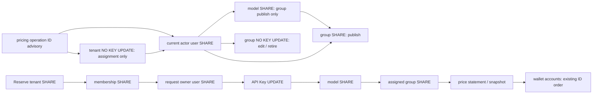

# 023-A0 单租户价格组实施契约（A0已冻结）

2026-11-01。**A0已冻结；A1/A2/A3已实现并通过限定本地验收。** 证据见[阶段验证](../../docs/verification/tenant-pricing.md)。本文只细化 A；B 周期预算与 C 期限商品继续按[总合同](contract.md)、[计划](plan.md)与[设计复核](review.md)各自过关。A 独立于 022 资金分片。实施迁移为018_tenant_pricing.sql；以下保留冻结时的精确设计，“拟”不表示尚未实现。

## 1. 对真实源码的裁决

已审阅[规格](spec.md)、[总合同](contract.md)、[计划](plan.md)、[验收](acceptance.md)、[模块设计](../../docs/design/periodic-products.md)，以及下表全部生产价格 SQL。`rg price_versions internal cmd --glob '*.go' --glob '!**/*test.go'` 没有发现表外缓存或另一条生产售价选择路径。以下是拟实施后的行为，不是当前已有能力。

| 实际位置 | 当前行为 | A 必须改成 |
| --- | --- | --- |
| [billing/reserve.go](../../internal/billing/reserve.go) | 授权锁后、钱包锁前从全表选有效价 | 从锁住的 tenant 取得组/revision，model 锁后取得 group SHARE；单语句 DB 时刻、精确域选价，写完整请求快照 |
| [catalog/public_catalog.go](../../internal/catalog/public_catalog.go) | 匿名 020 目录全局选价 | 显式 `price_group_id IS NULL`；字段、可见性、过滤、020 游标及 Cookie 无关性保持原合同 |
| [catalog/store.go / PublishPrice](../../internal/catalog/store.go) | 默认价 INSERT，model SHARE，输入计费输出价校验 | 原 API 仍只发公共默认价，INSERT 显式写 `price_group_id=NULL,pricing_operation_id=NULL`；不能接受组字段 |
| [server/queries.go / modelSelectFor](../../internal/server/queries.go) | 客户与平台共用全局 latest price | 客户在单 SQL 当前授权 tenant 域选价；平台模型管理页固定默认域；拆分 SQL，不能通过 bool 隐含选任意组 |
| 同文件 `/api/prices` admin 分支 | 枚举全部历史价 | 原接口固定默认域，保持原字段/envelope；分组历史只走新的显式平台组路径 |
| 同文件 `/api/prices` customer 分支 | 授权模型的全部历史价 | 单 SQL 当前 tenant 域、当前成员/模型授权、有效版本历史；不枚举他组，不展示未来生效的运营计划价 |
| [operations/operations.go](../../internal/operations/operations.go) | 全表初授后撤回不可变表 UPDATE/DELETE | 将新历史、组/tenant 列权限加入后置收紧；投影角色不获得新表权限 |

[gateway.go / `/v1/models`](../../internal/server/gateway.go) 和 `catalog.AuthorizedModel` **没有价格投影**。保留其 OpenAI 模型结构与 Key scope/当前授权语义，不凭缺价隐藏模型，不增加 `price_group_id` 或售价字段。API Key 通过实际调用取得最终计费；本片不新开 Key 报价查询接口。若以后要提供，须独立设计 Key 的当前授权与限流，不能复用 Cookie 报价接口。

### 1.1 保留的旧接口

- 原默认发布 body 仍为 `{model_id,input_rate,output_rate,effective_at}`；原 `effective_at=""` 使用 DB 当前时刻的行为、现有成功形状与既有金额解析兼容性保持。新分组发布走严格新 schema，不趁 A 改写旧 body。原入口不获得 `operation_id` 或选择组的能力。
- `/api/platform/models` 的旧 `input_rate/output_rate` 始终是公共默认域的当前报价；没默认价就是 NULL，即使某组有价。运营查看组价使用新的组页面/接口。
- `/api/models` 的旧 `input_rate/output_rate` 字段改为当前 tenant 域，类型仍为字符串或 NULL；可追加 `retail_price` 安全对象用于明确状态、来源与观察时间，不能删除旧字段。它与同一行 RetailPriceView 来自同一 SQL/时刻。
- 旧客户价格历史只查当前组，不提供“本 tenant 以前曾经属于的组”的组历史查询。已发生请求的原价格通过本 tenant 请求/账单权限展示其请求快照；不能借历史 tenant 关系遍历原组的全部客户价。
- 旧列表末页仍为字符串 `next_cursor=""`。新的 A 列表也统一空字符串；020 匿名目录继续自己的已冻结 envelope，不在 A 顺便改版。

### 1.2 缺价错误提案：保留 HTTP 503

[billing_handlers.go](../../internal/server/billing_handlers.go) 已明确把 `price_unavailable` 放在 503 分支，402 目前用于余额与 Key 累计预算不足。因此**本文提案将总合同 2.2 的 402 修正为 503**；须由集成人接受后同步原草案，不能由 A2 随意选码。

Reserve 缺精确域有效价时不建 request/reservation/journal，不发上游，返回既有 `price_unavailable`。OpenAI 路径保留 `error.code=price_unavailable`；Gemini 路径沿现有 `s.fail` 返回相同 code/503；Anthropic `/v1/messages` 沿现有 nativeErrorType 的 5xx 映射，保留 503 与通用安全 message，不额外泄漏组。具体协议 envelope 沿[server.go / fail](../../internal/server/server.go)，不重写协议适配器。报价 GET 缺价是成功的 `status=unavailable`，不是 503；供应商/数据库故障仍按实际错误返回。

## 2. 价格域、观察与请求事实

单 tenant 单组；NULL 是公共默认。价格组不是模型授权、Key scope、供应商池或预算。所有分组价格均为 CNY 微元/百万 Tokens 的绝对整数：`0..9223372036854775807`，HTTP 为规范十进制字符串。`openai_embeddings` 与 `jina_rerank` 的输出费率必须为 `"0"`，并沿当前 provider.Profile 校验其输入计费能力；不能仅凭 output_limit=0 判断所有生成协议为输入计费。

精确选择式统一为：

```sql
WITH instant AS MATERIALIZED (SELECT clock_timestamp() AS at)
SELECT instant.at AS priced_at,p.id,p.input_rate,p.output_rate,p.effective_at
FROM instant LEFT JOIN LATERAL (
 SELECT id,input_rate,output_rate,effective_at
 FROM price_versions
 WHERE model_id=$1 AND price_group_id IS NOT DISTINCT FROM $2::text
   AND effective_at<=instant.at
 ORDER BY effective_at DESC,created_at DESC,id DESC LIMIT 1
) p ON true;
```

无有效价返回一行 `priced_at` 加 NULL 价格，合法零价不等于缺价。组缺价不回落默认价。`effective_at=priced_at` 已生效；之后的微秒尚未生效。观察语句可见的已提交版本决定本次选择：允许发布过去生效的后继版本，但**晚提交或后补的版本不重写先前观察事实**。`priced_at` 不是 PostgreSQL 历史 MVCC 快照令牌，也不保证未来重查仍得到同一条。插入完整性 guard 校验原版本/域/费率/生效关系，不重新查询“现在的 latest”来否决原观察。

Reserve 在当前 tenant→membership→user→Key→model 锁和授权校验之后，非 NULL 组再取得 SHARE。组的 retired 状态在调用选价时不构成拒绝，现有 tenant 可继续。取得所有这些锁后才执行选价语句，之后进入现有钱包等待。钱包锁后仍以新 DB 时刻校验 Key/request 截止，但不重新选价。后续 RecordAttempt、PrepareDispatch、Settle、Release、Refund、Recover 不读取当前组，也不重新读零售价；采购 per-attempt 成本仍独立沿 018/019。

新 request 固定：`price_version_id,input_rate,output_rate,pricing_group_id,tenant_pricing_revision,retail_priced_at`。其中组可 NULL，但 revision/时刻必须有值。原有 request 新增三列全部 NULL 是 `legacy`；不能把它标为“已证明当时默认价”，不能补写成当前 tenant 组。新报价/账单 DTO 可以显式显示 `retail_snapshot_status=legacy|recorded`，legacy 的原 version/两维价依然有效，不影响有利收尾。

## 3. 追加 DDL 提案

部署 [compose.yaml](../../compose.yaml) 使用 PostgreSQL 16；A 最低要求 PostgreSQL 15（`UNIQUE NULLS NOT DISTINCT`），迁移前检查版本，不能静默退回普通 nullable UNIQUE。表 ID 沿既有 TEXT UUID；新 HTTP 只接受小写非 nil 规范 UUID。以下 SQL 放入**未来一份追加迁移**，不要修改 001/002。迁移在正常维护/应用未运行时执行，先验证原唯一约束确为 `price_versions_model_id_effective_at_key`，否则停止而不是猜名 DROP。

### 3.1 表、列、唯一性与索引

```sql
-- 新命令仅供 A，不为尚未冻结的 B 抢占 policy_operations schema。
CREATE TABLE pricing_operations (
 operation_id TEXT PRIMARY KEY,
 kind TEXT NOT NULL CHECK(kind IN
  ('price_group.create','price_group.update','group_price.publish','tenant_pricing.assign')),
 actor TEXT NOT NULL REFERENCES users(id),
 scope TEXT NOT NULL,
 scope_tenant_id TEXT REFERENCES tenants(id),
 target TEXT NOT NULL CHECK(octet_length(target) BETWEEN 1 AND 200),
 resource_id TEXT NOT NULL,
 revision BIGINT CHECK(revision>0),
 safe_input JSONB NOT NULL CHECK(jsonb_typeof(safe_input)='object'),
 input_fingerprint TEXT NOT NULL CHECK(input_fingerprint ~ '^[0-9a-f]{64}$'),
 result_schema SMALLINT NOT NULL DEFAULT 1 CHECK(result_schema=1),
 result_snapshot JSONB NOT NULL CHECK(jsonb_typeof(result_snapshot)='object'
  AND octet_length(result_snapshot::text)<=8192),
 created_txid BIGINT NOT NULL DEFAULT txid_current(),
 created_at TIMESTAMPTZ NOT NULL DEFAULT clock_timestamp() CHECK(isfinite(created_at)),
 CHECK((kind='tenant_pricing.assign' AND scope_tenant_id IS NOT NULL
    AND scope=scope_tenant_id AND resource_id=scope_tenant_id)
   OR (kind<>'tenant_pricing.assign' AND scope='platform' AND scope_tenant_id IS NULL)),
 CHECK((kind='group_price.publish' AND revision IS NULL)
   OR (kind<>'group_price.publish' AND revision IS NOT NULL))
);
CREATE TRIGGER immutable_pricing_operation BEFORE UPDATE OR DELETE ON pricing_operations
 FOR EACH ROW EXECUTE FUNCTION reject_history_mutation();

CREATE TABLE price_groups (
 id TEXT PRIMARY KEY DEFAULT gen_random_uuid()::text,
 label TEXT NOT NULL CHECK(octet_length(label) BETWEEN 1 AND 100
  AND label=btrim(label) AND label !~ '[[:cntrl:]]'),
 state TEXT NOT NULL DEFAULT 'active' CHECK(state IN ('active','retired')),
 revision BIGINT NOT NULL DEFAULT 1 CHECK(revision>0),
 last_operation_id TEXT NOT NULL REFERENCES pricing_operations(operation_id)
  DEFERRABLE INITIALLY DEFERRED,
 created_at TIMESTAMPTZ NOT NULL DEFAULT clock_timestamp() CHECK(isfinite(created_at))
);
CREATE INDEX price_groups_time ON price_groups(created_at DESC,id DESC);
CREATE TRIGGER no_delete_price_group BEFORE DELETE ON price_groups
 FOR EACH ROW EXECUTE FUNCTION reject_history_mutation();

ALTER TABLE tenants
 ADD COLUMN price_group_id TEXT REFERENCES price_groups(id),
 ADD COLUMN pricing_revision BIGINT NOT NULL DEFAULT 1 CHECK(pricing_revision>0),
 ADD COLUMN pricing_operation_id TEXT REFERENCES pricing_operations(operation_id)
  DEFERRABLE INITIALLY DEFERRED;

CREATE TABLE tenant_pricing_assignments (
 operation_id TEXT PRIMARY KEY REFERENCES pricing_operations(operation_id)
  DEFERRABLE INITIALLY DEFERRED,
 tenant_id TEXT NOT NULL REFERENCES tenants(id),
 before_group_id TEXT REFERENCES price_groups(id),
 after_group_id TEXT REFERENCES price_groups(id),
 before_revision BIGINT NOT NULL CHECK(before_revision>0),
 after_revision BIGINT NOT NULL CHECK(after_revision=before_revision+1),
 actor TEXT NOT NULL REFERENCES users(id),
 created_txid BIGINT NOT NULL DEFAULT txid_current(),
 created_at TIMESTAMPTZ NOT NULL DEFAULT clock_timestamp() CHECK(isfinite(created_at)),
 CHECK(before_group_id IS DISTINCT FROM after_group_id),
 UNIQUE(tenant_id,after_revision)
);
CREATE INDEX tenant_pricing_assignments_time
 ON tenant_pricing_assignments(tenant_id,created_at DESC,operation_id DESC);
CREATE TRIGGER immutable_tenant_pricing_assignment
 BEFORE UPDATE OR DELETE ON tenant_pricing_assignments
 FOR EACH ROW EXECUTE FUNCTION reject_history_mutation();

ALTER TABLE price_versions
 ADD COLUMN price_group_id TEXT REFERENCES price_groups(id),
 ADD COLUMN pricing_operation_id TEXT REFERENCES pricing_operations(operation_id)
  DEFERRABLE INITIALLY DEFERRED,
 ADD CONSTRAINT price_versions_group_operation CHECK
  ((price_group_id IS NULL AND pricing_operation_id IS NULL)
   OR (price_group_id IS NOT NULL AND pricing_operation_id IS NOT NULL)),
 DROP CONSTRAINT price_versions_model_id_effective_at_key,
 ADD CONSTRAINT price_versions_domain_effective_key
  UNIQUE NULLS NOT DISTINCT(model_id,price_group_id,effective_at);
CREATE INDEX price_versions_domain_lookup
 ON price_versions(model_id,price_group_id,effective_at DESC,created_at DESC,id DESC);
CREATE UNIQUE INDEX price_versions_pricing_operation
 ON price_versions(pricing_operation_id) WHERE pricing_operation_id IS NOT NULL;
-- 001 的 immutable_price 原封保留；不 UPDATE 原价格行。

ALTER TABLE request_records
 ADD COLUMN pricing_group_id TEXT REFERENCES price_groups(id),
 ADD COLUMN tenant_pricing_revision BIGINT,
 ADD COLUMN retail_priced_at TIMESTAMPTZ,
 ADD CONSTRAINT request_retail_snapshot_shape CHECK
  ((pricing_group_id IS NULL AND tenant_pricing_revision IS NULL AND retail_priced_at IS NULL)
   OR (tenant_pricing_revision IS NOT NULL AND tenant_pricing_revision>0
       AND retail_priced_at IS NOT NULL AND isfinite(retail_priced_at)));
```

此迁移不 UPDATE 已有 tenant/price/request，不发资金分录、不改已存在 FK，不要求推理旧请求重建价格证据。tenant 初值是新增规则的默认归属 revision1，不声称过去已使用该规则。约束添加与原约束撤下在同一事务，不能留一个普通 NULL 可重复的部署窗口。

### 3.2 状态、assignment 与请求快照 guard

```sql
CREATE FUNCTION guard_price_group_change() RETURNS trigger LANGUAGE plpgsql AS $$
BEGIN
 IF TG_OP='INSERT' THEN
  IF NEW.state<>'active' OR NEW.revision<>1 THEN
   RAISE EXCEPTION 'invalid initial price group';
  END IF;
 ELSE
  IF ROW(NEW.id,NEW.created_at) IS DISTINCT FROM ROW(OLD.id,OLD.created_at) THEN
   RAISE EXCEPTION 'immutable price group identity';
  END IF;
  IF OLD.state='retired' AND NEW.state<>'retired' THEN
   RAISE EXCEPTION 'price group cannot be restored';
  END IF;
  IF ROW(NEW.label,NEW.state) IS DISTINCT FROM ROW(OLD.label,OLD.state) THEN
   IF OLD.revision=9223372036854775807 OR NEW.revision<>OLD.revision+1
      OR NEW.last_operation_id=OLD.last_operation_id THEN
    RAISE EXCEPTION 'invalid price group revision';
   END IF;
  ELSIF ROW(NEW.revision,NEW.last_operation_id)
        IS DISTINCT FROM ROW(OLD.revision,OLD.last_operation_id) THEN
   RAISE EXCEPTION 'price group no-op changed revision';
  END IF;
 END IF;
 RETURN NEW;
END $$;
CREATE TRIGGER price_group_change BEFORE INSERT OR UPDATE ON price_groups
 FOR EACH ROW EXECUTE FUNCTION guard_price_group_change();

CREATE FUNCTION guard_tenant_pricing_change() RETURNS trigger LANGUAGE plpgsql AS $$
DECLARE gstate TEXT; op pricing_operations%ROWTYPE;
BEGIN
 IF TG_OP='INSERT' THEN
  IF NEW.price_group_id IS NOT NULL OR NEW.pricing_revision<>1
     OR NEW.pricing_operation_id IS NOT NULL THEN
   RAISE EXCEPTION 'new tenant must start with default pricing';
  END IF;
  RETURN NEW;
 END IF;
 IF NEW.price_group_id IS NOT DISTINCT FROM OLD.price_group_id THEN
  IF ROW(NEW.pricing_revision,NEW.pricing_operation_id)
    IS DISTINCT FROM ROW(OLD.pricing_revision,OLD.pricing_operation_id) THEN
   RAISE EXCEPTION 'tenant pricing no-op changed revision';
  END IF;
  RETURN NEW;
 END IF;
 IF OLD.pricing_revision=9223372036854775807
    OR NEW.pricing_revision<>OLD.pricing_revision+1
    OR NEW.pricing_operation_id IS NULL
    OR NEW.pricing_operation_id IS NOT DISTINCT FROM OLD.pricing_operation_id THEN
  RAISE EXCEPTION 'invalid tenant pricing revision';
 END IF;
 -- 在线 service 已按 tenant -> actor -> group 取得同一行锁。
 IF NEW.price_group_id IS NOT NULL THEN
  SELECT state INTO STRICT gstate FROM price_groups WHERE id=NEW.price_group_id FOR SHARE;
  IF gstate<>'active' THEN RAISE EXCEPTION 'price group retired'; END IF;
 END IF;
 SELECT * INTO STRICT op FROM pricing_operations WHERE operation_id=NEW.pricing_operation_id;
 IF op.created_txid<>txid_current() OR op.kind<>'tenant_pricing.assign'
    OR op.resource_id<>NEW.id OR op.revision<>NEW.pricing_revision THEN
  RAISE EXCEPTION 'tenant pricing operation mismatch';
 END IF;
 INSERT INTO tenant_pricing_assignments(operation_id,tenant_id,before_group_id,after_group_id,
  before_revision,after_revision,actor,created_txid,created_at)
 VALUES(op.operation_id,NEW.id,OLD.price_group_id,NEW.price_group_id,
  OLD.pricing_revision,NEW.pricing_revision,op.actor,txid_current(),op.created_at);
 RETURN NEW;
END $$;
CREATE TRIGGER tenant_pricing_change BEFORE INSERT OR UPDATE ON tenants
 FOR EACH ROW EXECUTE FUNCTION guard_tenant_pricing_change();

CREATE FUNCTION guard_group_price_insert() RETURNS trigger LANGUAGE plpgsql AS $$
DECLARE protocol TEXT; gstate TEXT; op pricing_operations%ROWTYPE;
BEGIN
 -- 先 model 再 group；旧默认发布也显式取得 model SHARE。
 SELECT profile->>'protocol' INTO STRICT protocol FROM models WHERE id=NEW.model_id FOR SHARE;
 IF protocol IN ('openai_embeddings','jina_rerank') AND NEW.output_rate<>0 THEN
  RAISE EXCEPTION 'input-only price requires zero output rate';
 END IF;
 IF NEW.price_group_id IS NOT NULL THEN
  SELECT state INTO STRICT gstate FROM price_groups WHERE id=NEW.price_group_id FOR SHARE;
  IF gstate<>'active' THEN RAISE EXCEPTION 'price group retired'; END IF;
  SELECT * INTO STRICT op FROM pricing_operations WHERE operation_id=NEW.pricing_operation_id;
  IF op.created_txid<>txid_current() OR op.kind<>'group_price.publish'
     OR op.resource_id<>NEW.id OR op.actor<>NEW.created_by THEN
   RAISE EXCEPTION 'group price operation mismatch';
  END IF;
 END IF;
 RETURN NEW;
END $$;
CREATE TRIGGER group_price_insert BEFORE INSERT ON price_versions
 FOR EACH ROW EXECUTE FUNCTION guard_group_price_insert();

CREATE FUNCTION guard_request_retail_snapshot() RETURNS trigger LANGUAGE plpgsql AS $$
DECLARE gid TEXT; rev BIGINT; p price_versions%ROWTYPE;
BEGIN
 IF TG_OP='UPDATE' THEN
  IF ROW(NEW.tenant_id,NEW.key_id,NEW.owner_id,NEW.model_id,NEW.price_version_id,
     NEW.input_rate,NEW.output_rate,NEW.pricing_group_id,NEW.tenant_pricing_revision,NEW.retail_priced_at)
   IS DISTINCT FROM ROW(OLD.tenant_id,OLD.key_id,OLD.owner_id,OLD.model_id,OLD.price_version_id,
     OLD.input_rate,OLD.output_rate,OLD.pricing_group_id,OLD.tenant_pricing_revision,OLD.retail_priced_at) THEN
   RAISE EXCEPTION 'immutable request retail snapshot';
  END IF;
  RETURN NEW; -- legacy NULL 也不能被补写；正常 status/finalization 更新仍允许。
 END IF;
 IF NEW.tenant_pricing_revision IS NULL OR NEW.retail_priced_at IS NULL THEN
  RAISE EXCEPTION 'new request requires retail snapshot';
 END IF;
 SELECT price_group_id,pricing_revision INTO STRICT gid,rev
  FROM tenants WHERE id=NEW.tenant_id FOR SHARE;
 IF gid IS DISTINCT FROM NEW.pricing_group_id OR rev<>NEW.tenant_pricing_revision THEN
  RAISE EXCEPTION 'request tenant pricing mismatch';
 END IF;
 SELECT * INTO STRICT p FROM price_versions WHERE id=NEW.price_version_id;
 IF p.model_id<>NEW.model_id OR p.price_group_id IS DISTINCT FROM NEW.pricing_group_id
    OR p.input_rate<>NEW.input_rate OR p.output_rate<>NEW.output_rate
    OR p.effective_at>NEW.retail_priced_at OR NOT isfinite(NEW.retail_priced_at) THEN
  RAISE EXCEPTION 'request price version mismatch';
 END IF;
 RETURN NEW;
END $$;
CREATE TRIGGER request_retail_snapshot BEFORE INSERT OR UPDATE ON request_records
 FOR EACH ROW EXECUTE FUNCTION guard_request_retail_snapshot();
```

request 更新 guard 不查当前 tenant/group，所以调组、停用、组退休后的原请求可以正常结算。price INSERT 的 guard 对默认域不要求 pricing operation，保留原默认发布行为；分组发布必须有同事务命令。完整 provider.Profile 结构校验仍在服务内持 model SHARE 时执行，SQL 的 protocol 检查是第二道约束，不能代替它。

### 3.3 不可变成功结果与延迟完整性

`result_snapshot` 保存完整安全 DTO，不保存资源 ID 后在 GET 时重建。数据库 JSONB 丢失输入键顺序并不影响响应字段的语义一致；**同一个 receipt 的 operation/result 值恒定**，外围 request_id 属于本次 HTTP。金额/revision/时间 JSON 值按第 4 节编码。

三个 SQL 安全投影函数用来同时校验快照，不能 SELECT `row_to_json(table.*)` 泄露内部列：

```sql
CREATE FUNCTION pricing_time(t TIMESTAMPTZ) RETURNS TEXT LANGUAGE sql IMMUTABLE STRICT AS $$
 SELECT to_char(t AT TIME ZONE 'UTC','YYYY-MM-DD"T"HH24:MI:SS.US"Z"')
$$;
CREATE FUNCTION pricing_group_result(g price_groups) RETURNS JSONB LANGUAGE sql IMMUTABLE STRICT AS $$
 SELECT jsonb_build_object('id',g.id,'label',g.label,'state',g.state,
  'revision',g.revision::text,'created_at',pricing_time(g.created_at))
$$;
CREATE FUNCTION pricing_assignment_result(t tenants) RETURNS JSONB LANGUAGE sql IMMUTABLE STRICT AS $$
 SELECT jsonb_build_object('tenant_id',t.id,'price_group_id',t.price_group_id,
  'pricing_revision',t.pricing_revision::text)
$$;
CREATE FUNCTION pricing_price_result(p price_versions) RETURNS JSONB LANGUAGE sql IMMUTABLE STRICT AS $$
 SELECT jsonb_build_object('id',p.id,'model_id',p.model_id,'price_group_id',p.price_group_id,
  'currency',p.currency,'input_rate',p.input_rate::text,'output_rate',p.output_rate::text,
  'effective_at',pricing_time(p.effective_at),'created_at',pricing_time(p.created_at))
$$;

CREATE FUNCTION pricing_frame(parts TEXT[]) RETURNS BYTEA LANGUAGE plpgsql IMMUTABLE STRICT AS $$
DECLARE v TEXT; b BYTEA; raw BYTEA;
BEGIN
 b:=convert_to('moni-aigate/pricing-command/v1','UTF8')||decode('00','hex')
    ||int4send(cardinality(parts));
 FOREACH v IN ARRAY parts LOOP
  IF v IS NULL THEN b:=b||int4send(-1);
  ELSE raw:=convert_to(v,'UTF8'); b:=b||int4send(octet_length(raw))||raw;
  END IF;
 END LOOP;
 RETURN b;
END $$;
CREATE FUNCTION pricing_fingerprint(k TEXT,a TEXT,s TEXT,t TEXT,j JSONB)
 RETURNS TEXT LANGUAGE sql IMMUTABLE STRICT AS $$
 SELECT encode(sha256(pricing_frame(ARRAY[k,a,s,t] || CASE k
  WHEN 'price_group.create' THEN ARRAY[j->>'label']
  WHEN 'price_group.update' THEN ARRAY[j->>'expected_revision',j->>'label',j->>'state']
  WHEN 'group_price.publish' THEN ARRAY[j->>'model_id',j->>'input_rate',j->>'output_rate',j->>'effective_at']
  WHEN 'tenant_pricing.assign' THEN ARRAY[j->>'expected_revision',j->>'price_group_id']
  ELSE ARRAY[]::text[] END)),'hex')
$$;

-- 在任何 cast / 比较前验证 JSON 类型；SQL NULL 与 JSON null 均不能作为 revision。
CREATE FUNCTION pricing_json_uint(j JSONB,positive BOOLEAN) RETURNS BOOLEAN
 LANGUAGE plpgsql IMMUTABLE AS $$
DECLARE v TEXT;
BEGIN
 IF jsonb_typeof(j) IS DISTINCT FROM 'string' THEN RETURN false; END IF;
 v:=j#>>'{}';
 IF positive THEN
  IF v !~ '^[1-9][0-9]*$' THEN RETURN false; END IF;
 ELSE
  IF v !~ '^(0|[1-9][0-9]*)$' THEN RETURN false; END IF;
 END IF;
 IF octet_length(v)>19 THEN RETURN false; END IF;
 RETURN v::numeric<=9223372036854775807::numeric;
END $$;
CREATE FUNCTION pricing_json_uuid(j JSONB) RETURNS BOOLEAN
 LANGUAGE sql IMMUTABLE AS $$
 SELECT coalesce(jsonb_typeof(j)='string'
  AND (j#>>'{}') ~ '^[0-9a-f]{8}-[0-9a-f]{4}-[0-9a-f]{4}-[0-9a-f]{4}-[0-9a-f]{12}$'
  AND (j#>>'{}')<>'00000000-0000-0000-0000-000000000000',false)
$$;
CREATE FUNCTION pricing_json_time(j JSONB) RETURNS BOOLEAN
 LANGUAGE plpgsql IMMUTABLE AS $$
DECLARE v TEXT; t TIMESTAMPTZ;
BEGIN
 IF jsonb_typeof(j) IS DISTINCT FROM 'string' THEN RETURN false; END IF;
 v:=j#>>'{}';
 IF v !~ '^[0-9]{4}-[0-9]{2}-[0-9]{2}T[0-9]{2}:[0-9]{2}:[0-9]{2}[.][0-9]{6}Z$' THEN
  RETURN false;
 END IF;
 BEGIN t:=v::timestamptz;
 EXCEPTION WHEN invalid_datetime_format OR datetime_field_overflow THEN RETURN false;
 END;
 RETURN isfinite(t) AND pricing_time(t)=v;
END $$;
CREATE FUNCTION assert_pricing_safe_input(k TEXT,j JSONB) RETURNS VOID
 LANGUAGE plpgsql IMMUTABLE AS $$
DECLARE shape JSONB; label TEXT;
BEGIN
 IF jsonb_typeof(j) IS DISTINCT FROM 'object' THEN
  RAISE EXCEPTION 'pricing safe input must be object';
 END IF;
 CASE k
 WHEN 'price_group.create' THEN
  shape:=jsonb_build_object('label',j->'label');
 WHEN 'price_group.update' THEN
  shape:=jsonb_build_object('expected_revision',j->'expected_revision','label',j->'label','state',j->'state');
  IF NOT pricing_json_uint(j->'expected_revision',true)
     OR jsonb_typeof(j->'state') IS DISTINCT FROM 'string'
     OR (j->>'state') NOT IN ('active','retired') THEN
   RAISE EXCEPTION 'invalid group update input';
  END IF;
 WHEN 'group_price.publish' THEN
  shape:=jsonb_build_object('model_id',j->'model_id','input_rate',j->'input_rate',
   'output_rate',j->'output_rate','effective_at',j->'effective_at');
  IF NOT pricing_json_uuid(j->'model_id')
     OR NOT pricing_json_uint(j->'input_rate',false)
     OR NOT pricing_json_uint(j->'output_rate',false)
     OR NOT pricing_json_time(j->'effective_at') THEN
   RAISE EXCEPTION 'invalid group price input';
  END IF;
 WHEN 'tenant_pricing.assign' THEN
  shape:=jsonb_build_object('expected_revision',j->'expected_revision','price_group_id',j->'price_group_id');
  IF NOT pricing_json_uint(j->'expected_revision',true)
     OR NOT (j ? 'price_group_id')
     OR (jsonb_typeof(j->'price_group_id') IS DISTINCT FROM 'null'
         AND NOT pricing_json_uuid(j->'price_group_id')) THEN
   RAISE EXCEPTION 'invalid tenant pricing input';
  END IF;
 ELSE RAISE EXCEPTION 'unknown pricing operation kind';
 END CASE;
 IF j IS DISTINCT FROM shape THEN RAISE EXCEPTION 'pricing input keys mismatch'; END IF;
 IF k IN ('price_group.create','price_group.update') THEN
  IF jsonb_typeof(j->'label') IS DISTINCT FROM 'string' THEN
   RAISE EXCEPTION 'pricing label must be string';
  END IF;
  label:=j->>'label';
  IF octet_length(label) NOT BETWEEN 1 AND 100 OR label<>btrim(label) OR label ~ '[[:cntrl:]]' THEN
   RAISE EXCEPTION 'invalid pricing label';
  END IF;
 END IF;
END $$;

CREATE FUNCTION guard_pricing_operation_insert() RETURNS trigger LANGUAGE plpgsql AS $$
BEGIN
 PERFORM assert_pricing_safe_input(NEW.kind,NEW.safe_input);
 NEW.created_txid:=txid_current();
 NEW.created_at:=clock_timestamp();
 NEW.input_fingerprint:=pricing_fingerprint(NEW.kind,NEW.actor,NEW.scope,NEW.target,NEW.safe_input);
 -- 新资源的 created_at 取 receipt 插入的 DB 时间；service 用 RETURNING 后建资源。
 IF NEW.kind IN ('price_group.create','group_price.publish') THEN
  NEW.result_snapshot:=jsonb_set(NEW.result_snapshot,'{created_at}',to_jsonb(pricing_time(NEW.created_at)),true);
 END IF;
 RETURN NEW;
END $$;
CREATE TRIGGER pricing_operation_insert BEFORE INSERT ON pricing_operations
 FOR EACH ROW EXECUTE FUNCTION guard_pricing_operation_insert();

CREATE FUNCTION require_pricing_operation_result() RETURNS trigger LANGUAGE plpgsql AS $$
DECLARE g price_groups%ROWTYPE; t tenants%ROWTYPE; p price_versions%ROWTYPE;
 e tenant_pricing_assignments%ROWTYPE; expected JSONB; prior BIGINT; has_event BOOLEAN;
BEGIN
 IF NEW.created_txid<>txid_current() THEN RAISE EXCEPTION 'pricing operation not current transaction'; END IF;
 PERFORM assert_pricing_safe_input(NEW.kind,NEW.safe_input);
 IF NEW.kind='price_group.create' THEN
  SELECT * INTO STRICT g FROM price_groups WHERE id=NEW.resource_id;
  expected:=jsonb_build_object('label',g.label);
  IF NEW.target<>'/api/platform/price-groups' OR g.last_operation_id<>NEW.operation_id
     OR g.revision<>1 OR g.state<>'active' OR g.created_at<>NEW.created_at
     OR NEW.revision<>1 OR NEW.result_snapshot<>pricing_group_result(g) THEN
   RAISE EXCEPTION 'price group create result mismatch';
  END IF;
 ELSIF NEW.kind='price_group.update' THEN
  SELECT * INTO STRICT g FROM price_groups WHERE id=NEW.resource_id;
  prior:=(NEW.safe_input->>'expected_revision')::bigint;
  expected:=jsonb_build_object('expected_revision',prior::text,'label',g.label,'state',g.state);
  IF NEW.target<>('/api/platform/price-groups/'||g.id) OR NEW.revision<>g.revision
     OR NEW.result_snapshot<>pricing_group_result(g)
     OR NOT ((g.last_operation_id=NEW.operation_id AND prior<9223372036854775807 AND g.revision=prior+1)
       OR (g.last_operation_id<>NEW.operation_id AND g.revision=prior)) THEN
   RAISE EXCEPTION 'price group update result mismatch';
  END IF;
 ELSIF NEW.kind='group_price.publish' THEN
  SELECT * INTO STRICT p FROM price_versions WHERE id=NEW.resource_id;
  expected:=jsonb_build_object('model_id',p.model_id,'input_rate',p.input_rate::text,
   'output_rate',p.output_rate::text,'effective_at',pricing_time(p.effective_at));
  IF p.price_group_id IS NULL OR p.pricing_operation_id<>NEW.operation_id OR p.created_by<>NEW.actor
     OR p.created_at<>NEW.created_at
     OR NEW.target<>('/api/platform/price-groups/'||p.price_group_id||'/price-versions')
     OR NEW.result_snapshot<>pricing_price_result(p) THEN
   RAISE EXCEPTION 'group price result mismatch';
  END IF;
 ELSE
  SELECT * INTO STRICT t FROM tenants WHERE id=NEW.resource_id;
  prior:=(NEW.safe_input->>'expected_revision')::bigint;
  expected:=jsonb_build_object('expected_revision',prior::text,'price_group_id',t.price_group_id);
  SELECT * INTO e FROM tenant_pricing_assignments WHERE operation_id=NEW.operation_id;
  has_event:=FOUND;
  IF NEW.target<>('/api/platform/tenants/'||t.id||'/pricing') OR NEW.revision<>t.pricing_revision
     OR NEW.result_snapshot<>pricing_assignment_result(t) THEN
   RAISE EXCEPTION 'tenant pricing result mismatch';
  END IF;
  IF t.pricing_operation_id=NEW.operation_id THEN
   IF NOT has_event OR e.created_txid<>txid_current() OR e.tenant_id<>t.id OR e.actor<>NEW.actor
      OR e.after_group_id IS DISTINCT FROM t.price_group_id OR e.before_revision<>prior
      OR e.after_revision<>t.pricing_revision OR e.created_at<>NEW.created_at THEN
    RAISE EXCEPTION 'tenant pricing event mismatch';
   END IF;
  ELSIF has_event OR t.pricing_revision<>prior THEN
   RAISE EXCEPTION 'tenant pricing no-op mismatch';
  END IF;
 END IF;
 IF NEW.safe_input IS DISTINCT FROM expected OR NEW.input_fingerprint IS DISTINCT FROM
    pricing_fingerprint(NEW.kind,NEW.actor,NEW.scope,NEW.target,expected) THEN
  RAISE EXCEPTION 'pricing command input mismatch';
 END IF;
 RETURN NULL;
END $$;
CREATE CONSTRAINT TRIGGER pricing_operation_result AFTER INSERT ON pricing_operations
 DEFERRABLE INITIALLY DEFERRED FOR EACH ROW EXECUTE FUNCTION require_pricing_operation_result();

CREATE FUNCTION require_price_group_operation() RETURNS trigger LANGUAGE plpgsql AS $$
DECLARE op pricing_operations%ROWTYPE;
BEGIN
 IF TG_OP='UPDATE' AND ROW(NEW.label,NEW.state) IS NOT DISTINCT FROM ROW(OLD.label,OLD.state) THEN
  RETURN NULL;
 END IF;
 SELECT * INTO STRICT op FROM pricing_operations WHERE operation_id=NEW.last_operation_id;
 IF op.created_txid<>txid_current() OR op.resource_id<>NEW.id OR op.revision<>NEW.revision
    OR op.kind<>(CASE WHEN TG_OP='INSERT' THEN 'price_group.create' ELSE 'price_group.update' END)
    OR op.result_snapshot<>pricing_group_result(NEW) THEN
  RAISE EXCEPTION 'price group operation required';
 END IF;
 RETURN NULL;
END $$;
CREATE CONSTRAINT TRIGGER price_group_operation AFTER INSERT OR UPDATE ON price_groups
 DEFERRABLE INITIALLY DEFERRED FOR EACH ROW EXECUTE FUNCTION require_price_group_operation();

CREATE FUNCTION require_tenant_pricing_assignment() RETURNS trigger LANGUAGE plpgsql AS $$
DECLARE t tenants%ROWTYPE; op pricing_operations%ROWTYPE;
BEGIN
 SELECT * INTO STRICT t FROM tenants WHERE id=NEW.tenant_id;
 SELECT * INTO STRICT op FROM pricing_operations WHERE operation_id=NEW.operation_id;
 IF NEW.created_txid<>txid_current() OR op.created_txid<>txid_current()
    OR op.kind<>'tenant_pricing.assign' OR op.actor<>NEW.actor OR op.created_at<>NEW.created_at
    OR op.resource_id<>NEW.tenant_id OR op.revision<>NEW.after_revision
    OR t.pricing_operation_id<>NEW.operation_id OR t.pricing_revision<>NEW.after_revision
    OR t.price_group_id IS DISTINCT FROM NEW.after_group_id THEN
  RAISE EXCEPTION 'assignment event without same transaction change';
 END IF;
 RETURN NULL;
END $$;
CREATE CONSTRAINT TRIGGER tenant_pricing_assignment_link AFTER INSERT ON tenant_pricing_assignments
 DEFERRABLE INITIALLY DEFERRED FOR EACH ROW EXECUTE FUNCTION require_tenant_pricing_assignment();
```

一条新管理命令独占一个事务；不能在同事务改两次同资源后只留最后 receipt。操作行先于资源 mutation 插入，`RETURNING` 给出 DB 时间和最终 result；资源随后写入，所有延迟检查在 COMMIT 一次闭合。任一校验、audit 或 COMMIT 确认失败须回滚整个命令，不得留下“成功 receipt 但资源未改”。成功 receipt 不替代现有安全审计：同 tx 追加 `pricing.group.create|update|price.publish|tenant.assign`，仅含安全 before/after、operation_id、target；不记请求原始任意 JSON。

上述 DDL 检验归属与结果，不把 app 数据库角色视为 HTTP admin。当前 admin 与 ready/CSRF/可选 MFA/再认证检查仍是服务层职责。新 UUID、金额、时刻、label、input object 的严格校验见第 4 节；DB 延迟检查同样拒绝未知 safe_input 字段和不规范 revision/rate（必须精确等于安全投影的规范字符串）。

### 3.4 角色收紧

在 `ProvisionFor` 的全表初授**之后**执行以下规则；实际角色/表标识必须沿当前 `pgx.Identifier` 引用，以下用部署默认名说明。不能只做 GRANT 列权限而遗留原表级 UPDATE：

```sql
REVOKE UPDATE,DELETE ON pricing_operations,tenant_pricing_assignments FROM moni_app;
REVOKE UPDATE,DELETE ON price_groups FROM moni_app;
GRANT UPDATE(label,state,revision,last_operation_id) ON price_groups TO moni_app;
-- 保留 tenants 原业务会改的列；新增 pricing 列由 guard 限制完整协议。
REVOKE UPDATE,DELETE ON tenants FROM moni_app;
GRANT UPDATE(name,status,allowed_regions,price_group_id,pricing_revision,pricing_operation_id)
 ON tenants TO moni_app;
REVOKE UPDATE,DELETE ON price_versions FROM moni_app;
-- request 生命周期照常写，价格与身份列不再有 UPDATE 权限。
REVOKE UPDATE ON request_records FROM moni_app;
GRANT UPDATE(status,billing_status,latest_finalization_id) ON request_records TO moni_app;
REVOKE ALL ON price_groups,pricing_operations,tenant_pricing_assignments FROM moni_projection;
```

历史表的 UPDATE/DELETE 同时由原/新增 trigger 拦截，包括 owner 的普通 SQL；迁移 owner 可显式停 guard 的维护能力不被当作在线入口。保留 app 必要 SELECT/INSERT；不加 SECURITY DEFINER 或新 projector 数据通路。实施前再次核对所有生产 `UPDATE request_records/tenants`，若未来新片增加真实生命周期列，必须显式增加对应列权限，不能恢复表级 UPDATE。恢复/rebuild 不许改历史价或给 legacy request 补组证据。

## 4. Go 边界与 wire DTO

新增 `internal/pricing` 只持价格选择值/安全投影及接受现有 Tx 的 helper，不依赖 billing、catalog 或 server；billing/catalog 向下依赖它，避免环。管理 service 留在 catalog，当前身份/HTTP decoder 留在 server。所有报价 SQL 使用同一审核过的精确域谓词/排序；不能通过一个接受原始 SQL alias 的公共字符串拼装接口接收外部输入。

```go
// internal/pricing；业务值均已由调用方从锁住的 tenant 取得。
type Domain struct { GroupID *string; TenantRevision int64 }
type Selection struct {
    VersionID string; GroupID *string
    InputRate, OutputRate int64
    EffectiveAt, PricedAt time.Time
}
// 新语句 clock_timestamp，非 nil selection 不可能是半个价格；无价返回 nil,pricedAt,nil。
func SelectEffectiveTx(ctx context.Context, tx pgx.Tx, modelID string, domain Domain) (*Selection, time.Time, error)
// 只取指定组 SHARE，不读 tenant、不拒绝 retired、不读钱包；nil组不查表。
func LockAssignedGroupTx(ctx context.Context, tx pgx.Tx, domain Domain) error

// internal/catalog；Go money/revision 内部 int64，HTTP decoder 不直接绑定 int64。
type PricingActor struct { UserID string }
type GroupCreateCommand struct { OperationID, Label string }
type GroupUpdateCommand struct {
    OperationID, GroupID, Label, State string
    ExpectedRevision int64
}
type GroupPriceCommand struct {
    OperationID, GroupID, ModelID string
    InputRate, OutputRate int64
    EffectiveAt time.Time // 新接口必须提供明确UTC微秒，不用Go zero代表now。
}
type TenantPricingCommand struct {
    OperationID, TenantID string; ExpectedRevision int64; GroupID *string
}
type PricingOperationResult[T any] struct { Operation PricingOperationView; Result T; Replayed bool }
func (s *Store) CreatePriceGroup(ctx context.Context, a PricingActor, c GroupCreateCommand) (PricingOperationResult[GroupView], error)
func (s *Store) UpdatePriceGroup(ctx context.Context, a PricingActor, c GroupUpdateCommand) (PricingOperationResult[GroupView], error)
func (s *Store) PublishGroupPrice(ctx context.Context, a PricingActor, c GroupPriceCommand) (PricingOperationResult[GroupPriceView], error)
func (s *Store) AssignTenantPricing(ctx context.Context, a PricingActor, c TenantPricingCommand) (PricingOperationResult[AssignmentView], error)
// GET按kind严格解码result_schema=1 union，不从当前资源拼回；未知schema fail closed。
func (s *Store) GetPricingOperation(ctx context.Context, actorID, operationID string) (PricingOperationReceipt, error)
```

`billing.authState` 增加从第一条 tenant SHARE 读取的 `PriceGroupID *string,PricingRevision int64`。`ReserveInput` **不增加**调用方可选组字段。调用 helper 前已完成现有授权/模型 profile 校验；helper 不创建事务、操作回执、资金分录或网络。`Reservation` 内部/需要展示的返回增加组/revision/pricedAt，不以调用者提供值填充。历史查询结构用 nullable 字段区分 legacy；只读模型列表不要为了复用 Tx helper变成每模型一次 SQL。

wire schema 精确如下；不得对 nullable 字段用 `omitempty`。下面的 `string` 费率/revision 使用专用校验类型或显式严格 decoder，不能让 `json.Number`/float64 经通用 map 再转换。

| DTO | 精确字段及类型 |
| --- | --- |
| GroupView | `id:string,label:string,state:"active"|"retired",revision:decimal-string,created_at:utc-string` |
| AssignmentView | `tenant_id:string,price_group_id:string|null,pricing_revision:decimal-string` |
| GroupPriceView | `id,model_id,price_group_id:string,currency:"CNY",input_rate/output_rate:decimal-string,effective_at/created_at:utc-string`；group 永不 NULL |
| RetailPriceView | `model_id:string,source:"default"|"group",status:"available"|"unavailable",price_group_id:string|null,price_version_id:string|null,currency:"CNY",input_rate/output_rate:decimal-string|null,effective_at:utc-string|null,as_of:utc-string` |
| PricingOperationView | 原 metadata 的 `operation_id,kind,scope,actor,resource_id,revision,created_at`；**提案额外加入** `target:string,input_fingerprint:string`，revision 仅 group_price.publish 为 NULL |
| PricingOperationReceipt | `{operation:PricingOperationView,result:GroupView|AssignmentView|GroupPriceView}`，按 operation.kind 区分，不能接受任意额外 JSON |

新增 `target/input_fingerprint` 是对总合同 metadata 的显式补充，已由集成人确认：只返回 ID/revision 无法核对未知 COMMIT 的原 `expected_revision`。输入指纹第 3.3 节以有长度的 UTF-8 framing 定义：4-byte 大端 signed 长度，NULL 为 -1，非 NULL 为字节长；数组总数同样 4-byte；无浮点、无平台 JSON 转义差异。fingerprint 绑定 `kind,actor,scope,target` 和规范参数的固定序列，故不同 URL 目标、不同 actor、NULL/空串都不同。operation_id 自身不进 fingerprint；全局主键唯一地绑定它。不是 022 财务指纹，也不因 HMAC 轮换而失去原回执核对能力。

新 body≤8192字节，单个严格 UTF-8 JSON object；拒重复键、大小写别名、未知/遗漏/尾 JSON、非法代理字符/控制字符；必要 nullable 字段必须显式出现。label trim 后1..100 UTF-8字节；revision为 `1..MaxInt64`、费率为 `0..MaxInt64` 的规范字符串，不接受 number、正号、指数、小数或前导零。新时间只接受 UTC `Z`、0..6位小数，校验有限有效历日，规范成固定6位微秒再摘要/入库；不接受零时间、时区 offset 或超过微秒后悄悄舍入。全部新资源 UUID 为规范小写非nil；服务器生成新资源 ID，客户端不能通过 operation ID 指定资源 ID。

available 报价 version/rates/effectiveAt 齐全；unavailable 时这四项全部 NULL。无价仍保留本 tenant 组/null、currency CNY 和 observation as_of，不伪造零价。source 由 tenant 域决定，不由版本存在与否决定。

## 5. 管理命令、当前读权限和故障

| kind / HTTP | 精确 safe_input（不含 operation_id） | target / scope / CAS与成功 |
| --- | --- | --- |
| price_group.create；POST `/api/platform/price-groups` | `{label}` | target 为该 collection 路径，scope platform；active/rev1，201 |
| price_group.update；PUT `/api/platform/price-groups/{id}` | `{expected_revision,label,state}` | target 为规范资源路径，scope platform；完整CAS；变更rev+1，完全同值rev不变，200 |
| group_price.publish；POST `/api/platform/price-groups/{id}/price-versions` | `{model_id,input_rate,output_rate,effective_at}` | target含组和子路径，scope platform；active组、合法profile、精确域唯一，201 |
| tenant_pricing.assign；PUT `/api/platform/tenants/{id}/pricing` | `{expected_revision,price_group_id}` | target含tenant，scope该tenant；NULL明确默认；变组rev+1、事件一条；同值rev不变无事件，200 |

所有写只能当前 active platform admin。当前 finance_operator/finance_approver/admin 可读平台 group详情/列表、组价格历史、tenant assignment、原 operation 与缺价预览；客户无平台读权。没有泛称 `finance` 的数据库角色。owner/billing_viewer 只能 GET `/api/tenant/pricing` 的自己当前 tenant；member 无此配置 GET，但可通过已授权模型 RetailPriceView 了解报价。GET `/api/models/{id}/retail-price` 接受 Cookie 当前有效成员，单 SQL 重查 user/tenant/membership active、tenant_model_grants、member_model_grants，未授权/不存在统一404；不能先读取组再判断模型授权。只返回本 tenant 域，不接受 tenant/group query/header/body。

平台资源的未知 UUID 在通过当前平台权限后返回404；没有平台权限直接403，不通过差异暴露资源存在。原 operation GET 即便 actor 已不是原写者，只要当前为上述平台读角色仍可读安全运营回执；原写者失去当前读权限则拒绝。目标 tenant 归属不把历史 receipt 变成客户可读接口。

命令处理顺序：严格语法→HTTP session/CSRF/再认证/ready门禁→新独立管理准入→同一事务操作ID锁→查原receipt→当前写权限→新命令父行/目标锁与CAS→DB命令时刻/构造安全result→插入receipt RETURNING→资源mutation→安全audit→COMMIT。原ID同actor/scope/kind/target/fingerprint返回**原**operation/result，HTTP200、无新audit/事件/revision；先验证当前写权限，不能以重放绕过撤权。原ID异体409 `policy_operation_conflict`，不返回他人的原body/result。GET原receipt只需当前读权，不要求再认证或MFA挑战。

同值也比较 expected_revision。retired 组不能恢复，但可修改 label；既有 tenant 再提交同一 retired 组的同值CAS是无变更，允许，不能借它换入另一个 retired 组。新分配和新组价发布即便 effective_at 在过去/未来，只要组已 retired 就409。任何 label/state/归属实际变化到 MaxInt64 revision 均409 `pricing_revision_exhausted`，不能溢出；无变更仍可读回该 revision。

| 失败 | HTTP / effect |
| --- | --- |
| body/query/cursor/schema/UUID/费率/日期非法 | 400 `invalid_request` 或 `invalid_cursor`；无成功receipt |
| 已有身份门禁 | 原401/403/503；不创建新成功receipt |
| 未授权客户模型/未知平台资源 | 按上文404 `not_found`；无receipt |
| 旧CAS | 409 `pricing_revision_conflict`；不回显他组参数 |
| retired新配置 / 默认或组内同生效时刻冲突 | 409 `price_group_retired` / `price_effective_conflict`；无receipt |
| operation ID异体 / revision耗尽 | 409 `policy_operation_conflict` / `pricing_revision_exhausted`；原事实不变 |
| 目标model profile非法/输入计费输出不为0 | 400 `invalid_price`；不发版 |
| 准入不足 | 429 `rate_limited`，Retry-After为整数秒；不进入DB |
| 锁/statement/查询截止 / DB不可用 | 503 `pricing_busy` 或既有服务不可用；不返回伪成功；COMMIT可能未知 |
| guard完整性/schema不支持 | 503 `pricing_invariant`；安全日志带request_id/operation_id，不返回SQL/原JSON |

前端将网络丢失、5xx、非法成功 schema、客户端取消或 COMMIT错误记为 unknown，只 GET `/api/platform/pricing-operations/{operation_id}`，核对当前身份epoch及原 kind/actor/scope/target/fingerprint、严格 result_schema DTO。404 只表明当前查询没看到回执，不能证明提交失败；不自动重发原命令、不换ID、不拿当前资源相同值冒充原结果。已确认的语法/CAS失败允许用户重新编辑并显式发新操作，不能自动“修正版本后重试”。没有 pending receipt 表示成功，只有提交后的 immutable row。

内部只有 PostgreSQL 明确的 `40P01/40001` 整个事务已回滚，且请求截止未到，才可最多3次执行同DB closure；不包含网络、COMMIT未知或已提交同ID异体。服务不得把 generic timeout 当回滚证据。全部回滚重试不发模型/邮件/外部网络。

## 6. 缺价预览、单SQL报价、分页及准入边界

新增只读 `GET /api/platform/tenants/{id}/pricing-preview?price_group_id={uuid|default}[&cursor=...]`。query 必须且只出现一次 `price_group_id`；字面 `default` 明确 NULL，不接受空字符串/隐含当前组。平台admin/finance当前读权限；tenant不存在404，指定组不存在404。retired组可预览并显示不可新分配；default不查组表。scope 是目标 tenant 的**当前有效、已授予模型**：`models.enabled=true` 且 tenant grant存在，不按操作员的 membership 过滤，不包括未授权/禁用/仅public可见模型，不联表钱包或采购价。tenant suspended仍可供平台预览，响应如实标 status；预览不激活tenant。

每页一个 SQL snapshot/MATERIALIZED DB时刻，同时读取当前 actor、目标 tenant/revision、目标组/state、授权模型和该域价。禁止先查价格再独立做权限。结果精确：

```text
{data: [
 {model_id,public_name,protocol,retail_price:RetailPriceView}
], request_id, next_cursor,
 context: {tenant_id,tenant_status,current_price_group_id,current_pricing_revision,
           target_price_group_id,target_group_state,assignable,as_of}}
```

`target_group_state=null` 表示default，其他active/retired；`assignable` 仅表示目标组当前可新分配（default/active为true），不表示 tenant 可调用、价格完整、CAS未来仍匹配或余额足够。每行 retail_price.as_of 与 context.as_of 相同；全无模型时依然返回 context/DB时刻。缺价只通过每行 `status=unavailable` 展示，不用当前页缺价数冒充全租户总数；无 total/汇总成功宣称。客户没获得指定任意组的 preview 接口。

预览与 PUT assignment分开。管理员可接受存在缺价的分配；本片不提供“所有模型有价才允许分配”的原子条件，也不暗示预览是准入令牌。分配前后 grant、enabled、未来价格生效、退休或另一管理员调组都可能变化；提交只按实际CAS/当前active组校验，真实调用仍以Reserve为准。UI必须逐页给出范围与时刻，并说明缺价调用将拒绝，不能用一次绿勾承诺无损迁移。

新只读完整集合：groups列表/详情、group price列表、platform tenant pricing、own tenant pricing、retail-price、operation GET、preview。group price历史包含该组未来/已生效版本，仅平台可见，不含created_by、operation internal body、供应商成本；详情集合没有任意组列表的客户出口。

所有新列表固定50，SQL取51：groups与group history按 `(created_at DESC,id DESC)`；preview按 `(public_name COLLATE "C" ASC,model_id ASC)`。next_cursor 是不透明、无padding的规范 base64url；解码JSON≤768字节/编码≤1024字节，严格字段、一次出现，拒未知/重复query、limit/offset；末页 `""`，空data仍有完整context。cursor v1绑定接口、actor、scope、target、规范筛选与排序边界：

```text
groups/history: {v:1,endpoint,actor,scope,target,created_at,id,filter_digest}
preview: {v:1,endpoint,actor,scope:tenant,target:group-or-default,name,id,filter_digest}
```

filter_digest 用上述 framing 的独立 `moni-aigate/pricing-cursor/v1` 域加规范filter做SHA-256；不能用 cursor 当权限凭据，每页重查当前身份与资源。无filter列表也绑定固定空filter；history target明确组ID，preview target明确目标组/default，不能将一个组游标移去另一个组。`name`沿模型现有合法public_name校验并限定≤768 UTF-8字节；时间固定UTC6微秒；ID规范UUID。游标不维持跨页事务：并发新增/改名/撤权可能使列表变化，客户/平台每页必须以当前权限为准，不提供“一个静态全量快照”保证。旧 `/api/prices` 保留旧cursor编码，但客户SQL每页重查当前域，调组后旧cursor只作为时间边界，不可继续读取旧组。

**独立有界准入提案**（同一实例、在现有全局HTTP/DB池边界之内，不宣称集群硬限额）：

| 类别 | token bucket / 并发 / 时限 |
| --- | --- |
| 新管理写 | 全局10/s burst10，actor 2/s burst2；全局并发4、actor1；端到端8s |
| 平台新详情/列表/operation读 | 全局30/s burst30，actor5/s burst5；全局并发8、actor2；端到端4s |
| preview | 额外全局4/s burst4、actor1/s burst1；全局并发2、actor1；端到端4s |
| own pricing/单模型retail-price | 全局50/s burst50，tenant10/s burst10、actor5/s burst5；全局并发12、tenant4、actor2；端到端3s |

没有无界等待队列；permit不足立即429，退出必释放。身份桶/计数表最多4096条，idle10分钟回收；满时拒绝新key，不驱逐仍活跃桶来重置配额，后台回收不调用模型。cursor≤1024、原URL query≤4096字节、HTTP body≤8192；header沿现有服务器上界。所有新DB事务本地 `lock_timeout=2s,statement_timeout=3s`，只读statement_timeout=2s；ctx总截止更短者优先，连接归还前清理本地配置。preview额外预算与平台读预算均满足，不共享推理token bucket。原默认发布与旧列表沿既有准入，A不偷偷改变旧速率合同。

## 7. 完整锁图与反向边界

同层多行按规范ID升序；A管理命令只操作一个tenant/一个group/一个model，不提供批量跨tenant调组。操作ID使用 `pg_advisory_xact_lock(hashtextextended('pricing-op:'||operation_id,0))`，在任何父行锁之前取得；64位hash碰撞只额外串行，不改变fingerprint/唯一主键判定。该锁有既定lock_timeout；不得持父行后再等待operation ID。先读取已有receipt，重放只锁当前actor并验证权限，绝不再次锁资源/写audit。



| 路径 | 完整显式顺序 / 不允许的后续锁 |
| --- | --- |
| 创建组 | operation advisory→current admin user SHARE→receipt INSERT→新group INSERT→audit→COMMIT；无tenant/model/accounts |
| 修改/退休组 | advisory→admin user SHARE→group **FOR NO KEY UPDATE**→CAS→receipt INSERT→group非键UPDATE→audit；**从不查/锁所有已分配tenant** |
| 组价发布 | advisory→admin user SHARE→model SHARE/profile校验→group SHARE/active校验→receipt INSERT→price INSERT→audit；无tenant/accounts |
| 调tenant组 | advisory→target tenant **FOR NO KEY UPDATE**→admin user SHARE→目标group SHARE（非NULL、实际变组时active）→CAS→receipt INSERT→tenant非键UPDATE/自动assignment事件→audit；不锁模型或钱包，不先锁group后回tenant |
| 原默认发布 | 现有model SHARE→默认price INSERT→created_by FK KEY SHARE→audit；不加group/tenant锁、不接新operation命令 |
| 新Reserve | 现有inference idempotency claim→tenant SHARE→membership SHARE→user SHARE→Key UPDATE→model SHARE→assigned group SHARE→选价→request/reservation INSERT→钱包账户ID序→最终DB截止→既有写入；无新pricing operation advisory |
| 历史request/dispatch/finish | 沿现有tenant SHARE→membership SHARE→Key UPDATE→model SHARE→可选channel SHARE→reservation UPDATE→attempt等；finish必要时原model升级UPDATE→账户；**不取当前group锁** |
| tenant状态/grant更新 | 原tenant UPDATE→grant FK model KEY SHARE→audit；不读group，pricing_revision不变 |
| public visibility | 原admin user SHARE→model UPDATE→audit；不读group/tenant |
| route/model发布 | 原model UPDATE→channels SHARE→credentials SHARE→版本/绑定INSERT；无group/tenant回边 |

### 7.1 外键和 trigger 的隐式锁

- 新price INSERT 引用 model、created_by(user)、group、operation，PG参照完整性取 KEY SHARE。service已持 model/group SHARE、actor SHARE，operation是自身当前事务新行；不引入后段首次的冲突父行锁。旧默认 publisher 的 user KEY SHARE 与其他用户 SHARE/非键 UPDATE兼容；现有身份密码/MFA `FOR UPDATE` 可使它等待，但身份写者不回锁model/group。
- tenant UPDATE 新组 FK 是group KEY SHARE，service先取得group SHARE；旧组被FK解除时不为此锁旧组。assignment事件 before/after的group FK可能首次取得**旧组 KEY SHARE**；它与group的非键label/state UPDATE兼容；退休仅改非键列，group禁止DELETE/ID UPDATE。事件中的tenant/actor/operation FK是已持父行/自身行，不能在trigger里升级旧组为SHARE/UPDATE。因此不把“解除旧组”变成两个group交叉SHARE的顺序。
- **身份session FK也属于图。** [identity/store.go / Login](../../internal/identity/store.go) 先取user FOR UPDATE，随后issueSession插sessions会隐式取得tenant KEY SHARE。调组若用tenant FOR UPDATE→同一admin user SHARE，会与该登录形成双向等待；因此本片tenant调组必须精确用 **FOR NO KEY UPDATE**，它仍阻塞Reserve tenant SHARE，但兼容session FK KEY SHARE。组编辑/退休也用FOR NO KEY UPDATE，保持旧组FK兼容。不得把表中泛指的UPDATE写锁误实现为FOR UPDATE；实际不得更新id/唯一键。现有tenant状态/grant路径的FOR UPDATE是旧路径，没有本片新增的admin user锁，不在本片顺带改动。
- request新增group FK KEY SHARE为已持group SHARE；原tenant/user/model/Key FKs为已持父行或兼容KEY SHARE。快照guard只重取自己已持tenant SHARE，读取不可变price无FOR锁；不因“latest校验”进入价格发布锁。历史request UPDATE guard仅比较OLD/NEW，不重新取tenant/group。
- pricing receipt actor/scope tenant FK在上述父行锁后插入；它的target/resource是多态安全值，由deferred结果guard关联，不用一个会对多种资源尝试FK的通用表。group/price/tenant引用receipt的DFK在COMMIT检查自己新行，deferred checker只普通SELECT已持资源，不用 FOR UPDATE。
- 安全audit的actor/tenant_scope是现有TEXT而非FK；不会隐藏锁user/tenant。未新增outbox、projector或资金账户依赖。
- 不能把现有全系统描述成无环总序：旧finance `credit UPDATE→finance user SHARE→tenant SHARE→accounts`、既有model升级以及多请求SHARE升级仍按现有回滚重试处理。本片须证明**新增**group/assignment/operation没有加入tenant/group/user/model的逆向等待环；真实PG门槛不能由图替代。

### 7.2 PostgreSQL 屏障反例与验收要求

1. **错误的group→tenant退休**：T1 Reserve持tenant SHARE、等group SHARE；T2退休持group UPDATE、回等tenant UPDATE会成环。正确退休不枚举tenant，所以T2提交后T1读取retired既有组原价继续，不触碰tenant归属。
2. **调组先锁tenant**：T1 Reserve已持tenant SHARE并停钱包；T2调组先等tenant UPDATE，不得先持目标group再阻断另一tenant Reserve。T1快照保持旧组/rev，T2之后改组/rev+1；反序先完成则T1只看新组，不可能混合旧价/新revision。
3. **退休与发布/新分配**：active校验的group SHARE若先取得，退休UPDATE等待其事务结束；若退休先完成，后来的发布/实际变组取得SHARE后见retired并409。既有tenant Reserve不检查active，退休后的未来预发版本也可按原effective_at继续生效。
4. **交叉旧组FK**：tenant1从A→B、tenant2从B→A，目标group SHARE及旧组隐式KEY SHARE并行，group label非键UPDATE不与旧组KEY SHARE构成反锁；group ID改写/DELETE必须由guard/权限拒绝。
5. **发布与观察**：T1价格SQL完成后停钱包；T2提交更近/补历史价。T1继续按已记录version/rates收费，snapshot guard不重查latest；新请求T3看新价。两域同effective允许，同域含NULL重复effective唯一拒绝。
6. **组/用户/模型组合**：public visibility(user SHARE→model UPDATE)、组发布(user SHARE→model SHARE→group SHARE)、Reserve(tenant→user SHARE→model SHARE→group SHARE)、用户密码reset(user UPDATE→session等)并发；所有新增路径没有group→user/model或user→tenant UPDATE回边。撤销角色正在等待时，管理tx取得user SHARE后必须重新判定active/admin，不沿旧HTTP缓存写。
7. **历史收尾**：原request录组A后调B、退休A、停tenant/会员，再Settle/Release/Refund/Recover；不读当前域，价格元组UPDATE和legacy补证据都被DB拒绝，status/finalization正常变更且客户只结算一次。
8. **receipt原结果**：操作1标签/组/归属成功后操作2再改；GET操作1返回原result，不是新资源。相同ID换target/expected/NULL为异体409；CAS、audit插入、DFK失败时receipt/资源/事件全无；COMMIT丢响应只读原ID。
9. **私有与匿名隔离**：默认缺价而组有价、组缺价而默认有价、未来组价、Cookie/admin/finance/owner/member/Key、换tenant和撤权；匿名永远默认，旧admin历史只默认，客户历史只当前域且生效，不可借cursor读他组/未来计划。
10. **有界查询**：51/100/空数据、name同值排序、非法/跨actor/scope/接口cursor、末页空串、preview无模型、分页间授权/组状态变化；到期/取消/permit释放/桶满都不占住连接、不返回误导完整性统计。
11. **普通SQL NULL反例**：`safe_input={"expected_revision":null,...}`、遗漏expected_revision、JSON number/string空串/`"01"`/`"0"`/超int64都须在cast前拒绝，不能依赖`prior<>...`或`NOT(...)`（SQL NULL不会使IF成立）判错；group.update与tenant.assign同值分支分别测试。分组发布model_id/rates/effective_at的SQL缺键/JSON null/错误类型同样拒绝；tenant.assign的price_group_id只有显式JSON null或规范UUID合法。request新快照约束的recorded分支显式要求revision IS NOT NULL，不能让CHECK的UNKNOWN接受孤立priced_at/group。
12. **登录与调组**：同一admin是目标tenant成员，T1 Login已持user FOR UPDATE暂停issueSession，T2调组取得tenant FOR NO KEY UPDATE后等actor SHARE，T1 INSERT sessions的tenant FK KEY SHARE必须可取得并提交，随后T2继续。把T2改成FOR UPDATE应能复现循环等待，正确实现禁止该替换。

## 8. A0 复核出口

本文件逐项对应[review A0](review.md)：实际读取点见1；原唯一约束/NULL域/历史guard与legacy见3；锁与FK反例见7；preview与当前读权限见5/6；精确命令/target/原result/unknown与分页末尾见3.3/4/5/6；HTTP503兼容裁决见1.2。没有用B/C草案替代A的精确合同。

**集成人已冻结的显式增补**：保留 `price_unavailable` HTTP503；PricingOperationView增加target/fingerprint及safe_input/result_snapshot不可变与当前权限语义；旧客户价格历史隐藏未来生效版本；平台preview允许缺价分配但不给准入承诺；独立限流/并发/截止数值。NULL防绕过与session隐式FK的NO KEY UPDATE锁修正已落实。冻结记录见第9节，真实源码与PostgreSQL验收见[023-A证据](../../docs/verification/tenant-pricing.md)。

A1/A2/A3实施后必须跑专用PG真实app/projection/owner角色、并发屏障与race、必要HTTP协议兼容、严格web构建/身份epoch/unknown交互及实际main浏览器；记录pass/fail/skip与环境，不以fixture代替价格/资金验收。最后由集成人汇合变更，复核HLD/LLD/统一架构正文后执行仓库显式reviewed refresh和只读检查。A已实现，B/C保持未实现。


## 9. 根冻结与原型边界

根已逐段复核全部实际选价读取、隐式FK锁、NULL安全、不可变原结果、权限与有界准入，接受第8节所有裁决。专用PostgreSQL16.15随机schema原型（001–017后抽取本稿DDL）普通2.529s/race3.657s通过6组反例，临时schema全部清理；原型发现CASE表达式缺括号的42601已在本稿修正。NO KEY UPDATE登录屏障通过，故意替换FOR UPDATE实际复现40P01；原型不是生产迁移或Reserve端到端验收，后续必须在真实源码重跑。A1/A2/A3授权和文件归属由根分派，B/C尚未冻结。

## 10. 2026-11-03：并发验收的数据库屏障

分组分配先持有 tenant 的 NO KEY UPDATE 再等待管理员锁时，Reserve 的 pgx principal batch 必须真实阻塞于同一 tenant 的 SHARE，释放管理员屏障后才观察已提交的新分组和 revision。验收不能把 `pg_stat_activity.query` 与 `pg_blocking_pids` 当作同一时刻的执行证据：extended batch 的 Parse/Bind 及活动采样可让该文本仍为另一条语句。

本场景改用 PostgreSQL 实际锁标记（同一 materialized pg_locks 采样，绑定当前 database OID）：Reserve backend 持有精确 tenant tableoid/ctid 的 tuple RowShareLock，同时未获授的 transactionid ShareLock 对应分配 backend 已获授的 ExclusiveLock，且 `pg_blocking_pids` 包含分配 backend。屏障未释放时轮询这一完整条件，仍使用原8秒总期限；时间流逝不代表屏障成立。tuple 排队锁已获授不表示 tenant 行 SHARE 已获授；等待原分配 XID 的证据不可省略。保留最终分组/价格/revision快照、钱包守恒和禁止自动重试掩盖死锁的全部断言。此修订仅校准测试观察器，不修改生产锁序、SQL、超时或重试。

该单一屏障场景使用可选的空 IdempotencyKey，避免此前幂等 INSERT 的 tenant FK 先取得 KEY SHARE；PG16 在升级自身已有行锁时可以省略 heavyweight tuple lock，不能把该合法路径误判为没有等待。真实生产幂等路径及其专门回归保持，本场景只隔离并证明 tenant SHARE 与已提交售价域。
