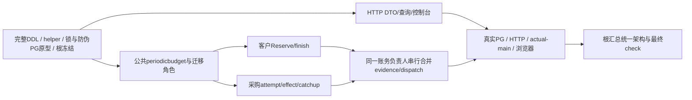

# 023-B0 周期预算精确合同工作稿

2026-11-01。**核心SQL及billing接线按[核心集成切片](b-integration-contract.md)冻结实施；HTTP/UI与完整产品验收仍独立推进。** 独立纯DTO/cursor、Tx helper、Reader及Commander各有冻结合同。本稿保存产品裁决、实际事务审计、状态与接口；核心/命令/角色SQL经真实PostgreSQL反例修订和独立审查后进入020追加迁移。不得把设计或 `.local` 原型列为已交付能力。

适用基线为已经存在的 `018_tenant_pricing.sql` 和 023-A 实现。这里的 018/019 **规格编号**分别指采购单价与采购账户；迁移序号不与规格编号一一对应。下一应用迁移名由根集成人分配，**不占用迁移 019**。本稿不改写已应用迁移、旧规格、HLD/LLD 或统一架构。

上位方向见 [spec](spec.md)、[contract §3–4](contract.md)、[plan](plan.md)、[根复核](review.md)和[模块设计](../../docs/design/periodic-products.md)。本文的“已接受”仅表示本轮根集成人在协作消息中裁决该语义；整份 B0 仍须逐项复核、补齐 SQL 并冻结。

## 1. 边界与已接受裁决

1. 只提供 UTC 自然日/月：`utc_day|utc_month`，区间 `[start_at,end_at)`。不支持任意时区、DST、滚动窗口、手动 reset 或 cron 清零。
2. 客户按最终 Reserve 准入期归属，tenant 与 Key 各计一次相同 R；钱包只预占一次。采购按每个实际 supplier attempt 的 RecordAttempt 准入期归属，预占 U；安全第二 attempt 不产生第二个客户 allocation。
3. 已启用且首个完整周期已开始时，准入公式为 `current.spent + control.total_held + extra <= limit`。这里 `control.total_held = current.held + 所有旧期held + legacy held`。历史 spent 不占新期，全部未决 held 持续占用。
4. 原 allocation/原窗口永久不迁移。客户结算/释放、采购证据/双审绝对成本更正回原事实；自然换期不复制 held，不发重置事件。
5. 首次配置建立永久 calendar 和持续跟踪；初始 cap 从**下一完整 UTC 周期**生效。首次配置 `enabled=false` 也固定同一个 `effective_from`，边界前打开仍为 scheduled，不能绕开首个完整周期。
6. 配置关闭立即停止该周期 cap 门禁，持续记录新 allocation 和收尾；边界后再次开启立即检查现有占用。关闭/开启、调大限额、重启、升级都不清零。
7. `period_kind` 初配后不可改，无删除/recreate 接口。降低限额到 occupied 以下可以保存，但后续新准入与未获 sending 许可的派发被阻断；不撤销既有 held，不阻断已发请求的有利收尾。
8. 未配置不持久化空 control；GET 的 revision 为字符串 `"0"`，首次 PUT 必须 `expected_revision="0"`。已配置 revision 为正 int64 字符串。
9. 在线首配在源同步屏障下查询未决源，`LIMIT 1001`；最多 1000 条，超过返回 409 `periodic_legacy_import_requires_maintenance` 并回滚全部效果。独立维护导入合同尚未设计，不能静默分页提交、部分启用或扩大上限。
10. 首配只引入旧未决 held。采购旧行可能已有 spent，需冻结 `source_spent_baseline`，不猜测历史消费属于哪个窗口。此后 legacy 采购预算 spent 为 `max(source_spent - baseline,0)`，仅为 legacy 审计事实，不加入当前窗口 spent。
11. 首配时已结束的旧采购 attempt 之后仍可能由争议重新产生 held 或被双审更正。因此允许严格受控的 `legacy_catchup`，见第 4 节；不能漏掉这类 carry，也不能任意创建 legacy。
12. 客户消费退款不减少 Key lifetime spent 或客户周期 spent，不因退款恢复额度。客户 24 小时释放不证明供应商未消费，不减少采购 carry。
13. 数据库时钟退行时，拒绝新 Reserve、RecordAttempt 和 PrepareDispatch；已发收尾、释放、采购更正继续只用原 allocation，不创建/重新打开当前窗口，不调用当前 cap。无进程时间兜底或自动 reset。
14. tenant 首配同步点使用 `FOR NO KEY UPDATE`，足以阻塞运行路径的 tenant `FOR SHARE`，同时兼容 Login 创建 session 的 tenant FK `KEY SHARE`。不能改成 tenant `FOR UPDATE` 而重新引入用户/tenant 隐式 FK 反环。
15. allocation 的业务 subject 使用不可变逻辑 UUID，**不新增回锁 request/attempt/reservation 的业务外键**。数据库 guard 必须证明 source、tenant/account、金额、唯一性、创建事务及来源事件；不能只靠 Go 约定。control/window 之间仍使用真实 FK。
16. 预算事件驱动原子投影；在线提交只核验受影响 subject，不逐请求扫描全系统/全 control 历史 SUM。全量守恒由独立只读核验器完成。此取舍的精确 SQL 和 PG 防伪证明仍未完成。

周期预算不是现金、订阅权益，也不是供应商真实账单月的严格封顶认证。例如月末 R=100 未决，新月 cap=100 无新可用额度；旧请求后来结算 70 计旧月，新月即可重新承诺 100。这不承诺“新月实际输出/供应商账单总额必不超过 100”。

## 2. 时间、金额和控制状态

金额单位沿现有账务整数最小单位。单笔 R/U、配置 limit 为非负 int64；累计 held/spent、事件差额采用与 019 一致的 `NUMERIC(100,0)`，不得浮点、截断、饱和或把溢出当零。任何超过精确列范围的写整体失败并保留旧事实。

公共 ID 为小写规范、非 nil UUID。金额为 `0|[1-9][0-9]*` 字符串；revision 初配 sentinel 可为 `"0"`，已配置仅正 int64；拒绝 JSON Number、指数、正号、前导零和空白。时间响应统一 RFC3339 UTC `Z`、六位微秒，拒绝无穷、超范围和非 UTC 形式；日期演算在数据库显式 UTC 下进行，不依赖连接 TimeZone。

`tracking_started_at` 为首配取得源屏障和 control 后的新数据库时刻；`effective_from` 为该时刻所在 UTC 日/月的下一边界，二者配置后不可变。月的 end 是下一自然月首，不用 30 天替代。只有新准入/派发观察可以惰性建立当前窗，GET 不创建窗口。

唯一时间来源是无参 `pb_now()`：线上定义始终为 invoker、VOLATILE 的 `pg_catalog.clock_timestamp()`，固定 search_path 为实际 schema、pg_catalog、pg_temp，不读 GUC、请求参数或客户端时间，APP 没有创建/替换函数权限。一次准入在所有父/control/ledger/account 等待后创建原源，由 BEFORE INSERT 无条件写权威 `pb_admitted_at`，Go 从 RETURNING 读取；原窗口、两个客户 scope、cap 资格复用这一个时刻。不能让 APP 填旧 admitted_at 绕过换期；触发器会覆盖其输入。PrepareDispatch在全部锁后执行prepared→sending UPDATE，由BEFORE guard一次取得派发权威时刻并派生全scope检查，写入不可由APP回填的`pb_dispatch_checked_at`；Go从UPDATE RETURNING取得该同一时刻，执行截止/原quote复验，失败整tx回滚（详见§6.2）。操作回执一次取 created_at，result.as_of 复用它。完整性 guard 可读取当下时间检查“不在未来”，不得借该二次读取重新决定原期或售价。

```text
unconfigured: 无 control，revision=0，calendar/limit/时间均 null
scheduled:    enabled=true 且 as_of < effective_from
active:       enabled=true 且 as_of >= effective_from
disabled:     enabled=false，无论是否跨过 effective_from
```

`scheduled/disabled` 都持续跟踪。首次不完整窗口可以记录，但 UI 必须由 `start_at < effective_from` 明确标为“首次跟踪的不完整周期”；不得宣称从该月月初完整计量。

control 持久保存 `max_observed_window_start`。在所有相应锁和资金账户锁等待结束后，重新取得数据库时刻 `admitted_at`；派生 start 小于该高水位则 fail closed。候选窗在等待中跨界必须重派生，不沿用预读 now。观察与 window 创建不得回退高水位。高水位仅为防重开门禁，不代替业务事件或金融账本。

本文“时钟退行门禁”精确指**派生UTC窗口start小于已观察高水位**，不能宣称检测同一天/月内任意壁钟回拨。同窗内的新源与派发时刻仍以数据库clock为权威；本稿没有跨所有请求的单调wall-clock序列，也不以进程时间修正数据库时刻。

GET 当前预算若数据库当前窗早于高水位，返回 503 `periodic_clock_regression`；历史 windows/allocations 和已成功原操作回执仍可在当前权限下只读核查。新失败事务无法同时提交其异常审计，故先输出有界结构化错误/指标；不能宣称该回滚事务已持久记录“异常事件”。是否另设运维异常事实属于后续独立设计。

## 3. 数据合同：必须由后续完整 SQL 落实

下列是字段/约束合同，**不是已完成迁移**。当前精确原型按顺序为 [核心 SQL](b-core.sql)、[配置与回执 SQL](b-commands.sql)、[角色与固定 search_path SQL](b-permissions.sql)。第三份以 psql 标识符变量 app_role/projection_role 渲染，Go 原型用 pgx.Identifier 进行同等替换；不可把角色名当 SQL 值拼接。实际应用迁移仍待根分配，独立审查前不得视为冻结。

| 对象 | 必须保存的事实/约束 |
| --- | --- |
| `periodic_budget_controls` | 稳定 id、scope、tenant/key/account 归属、immutable period_kind、enabled、limit、独立 config revision、tracking_started_at/effective_from、高水位、total_held/total_spent、事件序号、最后事件、初配与最后配置 operation、数据库不可伪造 creation transaction stamp |
| `periodic_budget_configuration_versions` | `(control_id,revision)` 唯一；immutable enabled/limit/calendar、actor、operation、DB 时间；仅真实配置变化增加版本；首配为 1 |
| `periodic_budget_windows` | id、control、UTC start/end、held/spent、局部投影 revision、最后事件；`UNIQUE(control_id,start_at)`；canonical calendar、非负精确金额；禁止 DELETE/改变边界/归属 |
| `periodic_budget_allocations` | id、control、subject_type/customer_request 或 supplier_attempt、subject_id、origin/new 或 legacy_import 或 legacy_catchup、原 window nullable、原 admitted_at nullable、upper、source_spent_baseline、当前 source_held/source_spent、预算 held/spent、预算 state、局部 revision/最后事件、origin_source_id、DB creation stamp |
| `periodic_budget_events` | immutable id、唯一 effect source、control/allocation/original window、kind、source_kind/id、before/after 源金额与预算金额/状态、held/spent delta、control 全序号、allocation/window 前版本、DB creation stamp/时间；不得追加进已提交的旧 effect |
| `periodic_budget_operations` | 全局 operation_id、kind、actor、scope、target、规范 safe_input、SHA-256 input_fingerprint、resource_id、result_revision、不可变完整安全 result_snapshot、DB creation stamp/时间；只保存成功回执 |

scope 唯一身份分别是 `tenant:<tenant_id>`、`key:<key_id>`、`procurement:<account_id>`。Key control 必须用真实 composite tenant/Key FK 保证归属；tenant control 无 Key/account，采购 control 无 tenant/Key。control 无 DELETE、无身份/日历替换。配置与流量分离版本，流量事件不增加 config revision；客户端不能写 spent/held、高水位或任意 window id。

所有 allocation 采用 `UNIQUE(control_id,subject_type,subject_id)`，不能用 legacy/new 四种展示类型绕过唯一性。普通 customer 和 supplier allocation 的 window 非 null，且该窗口 control 与 allocation control 完全一致；legacy 两种 origin 永久 window=null。`upper_amount` 是源冻结上界，采购后续合法成本可能超 upper，不能用 upper CHECK 截断采购已知成本。

`subject_kind` 是 DTO 派生值：普通客户/采购分别 `customer_request|supplier_attempt`，两种 legacy origin 分别显示 `legacy_customer|legacy_supplier`；不暴露内部创建事务 stamp。

数据库金额关系：

```text
customer: held = 源reservation未终结时R，否则0
          spent = 原唯一settlement.charged_amount（已释放为0）
supplier: held = procurement_reservation.held_amount
          source_spent = procurement_reservation.spent_amount
          spent = new ? source_spent : max(source_spent - baseline,0)
control.total_held = 所有allocation.held
control.total_spent = 所有allocation.spent（包括legacy审计增量）
window.held/spent = 仅绑定该原窗的allocation金额
carry_held = control.total_held - 当前window.held（当前窗不存在时减0）
```

事件唯一键必须绑定原权威 effect，不能只用随机事件 UUID 保证唯一。客户初占绑定 reservation、收尾绑定唯一 settlement；采购绑定当前事务新建的精确 `procurement_budget_event.id`；legacy_import 绑定 control+subject，legacy_catchup 的初始证明绑定触发它的采购事件。重复 effect 同体只读原结果，异体或不同来源复用冲突，不产生第二份投影。

2026-11-01独立APP反例修订（本稿仍未冻结）：`revision=0`的普通客户allocation只能接收它原reservation的初占事件，`origin=legacy_import`的allocation只能先接收legacy_import事件。不得先完成真实资金结算，再以settlement作为allocation首事件；否则`held_delta=0`会跳过R的cap准入，甚至使active limit=0提交spent=70。客户settlement必须要求allocation revision≥1、当前held/source_held等于原R、spent/source_spent为0，并存在**同control、同allocation**且`allocation_before_revision=0`的真实原初占事件：new精确绑定原reservation.id，legacy_import精确绑定原subject；初始before held/spent=0、after held=R/spent=0、state=held。事件不可变及allocation投影guard共同保存该证明，不接受其他allocation/其他source的初占代替。

同一事务Reserve→finish仍须先追加原初占事件并以完整R通过cap，再追加settlement回原窗；最终charge<R不豁免初占，active cap=0时不能用同事务快速结算绕过，cap=R时允许两事件后held=0/spent=charge。已有成功初占后的有利收尾、legacy收尾和时钟退行下原窗结算不重新检查当前cap，不受此修订阻断。

采购普通新源同样必须先完整U初占：B安装后的procurement reservation INSERT仅允许prepared、held=upper、spent=0、anomaly=false；普通new allocation只能在源仍为该初始状态时创建，首事件必须绑定当前事务精确019 `type=reserved`、`event_key=reserve:<attemptUUID>`、held_delta=U/spent_delta=0，且源仍prepared。必须以完整U通过周期准入后才能在同事务收尾；不得直接INSERT settled，或先prepared→settled再以净spent作为首事件。U=0的真实免费报价仍可按同一规则初占0。legacy_import/catchup不改原基线与有利收尾，后续合法成本超过U仍完整记录，不用U截断已知成本。

`total_held` 包含全部旧窗和 legacy，因此准入可在已持 control 的常数数量行上检查，不在热路径 SUM 所有历史窗口。窗口/control/allocation 投影由新事件的 AFTER INSERT 原子应用；BEFORE UPDATE guard 必须要求对应当前事务新事件、正确旧版本与精确 delta，拒绝直接改汇总、重用旧事件或二次应用。事件插入 guard 从源事实派生金额与状态，不接受 caller 任意指定“新的余额”。全量重建只读比较，不自动调平。

源关系为逻辑引用时，追加 BEFORE UPDATE/DELETE guard 必须保护**已经被 allocation 引用**的 request/attempt 的 tenant/Key/request 身份。客户 reservation 的原 id/tenant/request/amount/deadline/created_at 在 B 安装后统一不可替换，避免按旧 scope 取得首配屏障后把同一源搬到未同步的新 scope；现有合法收尾只改 status，不受影响。已有 allocation 的 reservation 不能删除。历史无周期关系的源仍允许原有 status、最终证据、成本、退款等合法收尾。采购 reservation 已有不可变身份/绑定 guard，继续保留。

源当前金额与 allocation 的 deferred 核验按受影响 subject 执行。客户 reservation UPDATE 和采购 reservation/预算事件 INSERT/UPDATE 提交时若该 scope 已配置，必须证明应有 allocation 存在且与原源一致，不能只验证“已经存在的 allocation”。首配 control 的 deferred 核验还须证明所有该屏障下未决源均已导入，且总数没有超过 1000。完整触发器/调用矩阵仍待 SQL 审查。

## 4. 首配与旧采购再打开

### 4.1 互斥首配

- tenant：operation advisory → tenant **NO KEY UPDATE** → 当前 admin user SHARE → 首配 scope 独占 advisory → 新 control。根行锁阻塞任何受支持客户 Reserve/lockRequest 的 tenant SHARE；不枚举/锁每个 model、Key、reservation 或账户。
- Key：operation advisory → tenant SHARE → actor membership SHARE → actor user SHARE → 目标 Key UPDATE → 首配 scope 独占 advisory → 新 control。原 Reserve、finish、RecordAttempt 对该 Key 的同步锁与之互斥。
- 采购：operation advisory → 当前 admin user SHARE → procurement account **NO KEY UPDATE** → 首配 scope 独占 advisory → 新 control。受支持 019 金额变更已先持相同 account 锁，零金额状态变化仍按下面 scope 屏障同步。

取得根同步点后再查询是否已配置、比较 expected_revision，再取新的 tracking 时刻。未决客户为 `reserved|pending_reconciliation`；未决采购为 `prepared|sending|unknown|disputed`，包括 held=0 的未决源。最多取 1001 条，稳定按 subject id 排序。超过 1000 先返回明确业务冲突，不建立 control、版本、任何 legacy allocation/事件、操作回执或成功审计。

每条客户 legacy upper=R、baseline=0、held=R、spent=0；每条采购 legacy upper=原U、baseline=屏障下当前源spent、held=当前源held、预算spent=0。既有客户截止和采购 source state 不改。其后配置 disabled 仍持续创建正常新 allocation。

#### 4.1.1 数据库首配完整性与 Go 授权的责任

仅靠前层业务根锁不足以证明任意 APP SQL 的首配完整性：APP 可以省略 Go 的 tenant/Key 根锁；零金额采购 reopen 甚至不需要更新 account 金额。真实 PG 已复现双方提前 `SET CONSTRAINTS ALL IMMEDIATE` 后，首配与旧客户完整资金释放、采购零金额 released→disputed、旧 request 迟建 reservation 各自双提交，造成陈旧 held 或漏 allocation。deferred 检查本身不能填补双方不可见的写偏差。

因此增加**仅用于源与首次配置同步**的 transaction advisory 层：两整数键空间第一键固定 `23023023`，第二键是 `hashtext(actual_schema || ':' || scope || ':' || canonical_uuid)`；数据库本身已隔离 advisory 域，schema/scope/UUID再隔离对象。它与已有单 bigint operation 锁键空间分离；hash碰撞只增加等待，不改变真实 scope 查找/唯一约束/来源证明。函数固定实际 schema 搜索路径，APP不能改变算法或触发器。

- control 的 BEFORE INSERT 在既定前层根锁后取本 scope **独占**事务锁，再做1001扫描、创建时刻与 control 插入。首配检查只读源，不回锁 request/attempt/reservation 或其他 scope control。
- 新客户 request 的 BEFORE INSERT 已先取 tenant SHARE、Key UPDATE，再按 tenant→Key 为**尚无可见 control**的 scope 取共享事务锁，随后生成 at-creation marker/权威时间。新客户 reservation 必须证明父 request 真实在当前事务创建（含 active/RELEASED 子事务）且 tenant 相同；B 创建的 request 无论是否已有 controller，缺 reservation 一律不能提交。迁移前 request-only 不能事后伪装一次新 Reserve。
- 旧客户 reservation 的 BEFORE UPDATE/DELETE 在查询 allocation 前，按 tenant→Key 为尚无可见 control 的 scope 取**共享**事务锁。采购 reservation BEFORE INSERT 在既有 account 根锁后、BEFORE UPDATE 在修改源前，为尚无可见采购 control 取同一共享锁；held/spent 不变的零金额状态变化也覆盖。取得共享锁后才继续源变更和局部核验；首配若先提交，等待者后续语句必须看见它，并补精确 mirror，否则整笔资金/source 变更回滚；源先提交，首配等待后扫描最新状态并精确导入。
- 派发 prepared→sending 的 BEFORE guard 也先按 tenant→Key→实际采购account，为尚无可见 control 的 scope 取共享锁，再查询/锁定实际controls并取得唯一权威派发At。它不回锁前层根；首配先行而在等待中跨首个完整UTC边界时，派发必须看见刚提交的新control并以新At命中active cap；派发先行时，首配等待该已许可事实提交后再建立tracking。
- 已可见 control 的源路径不新增这层共享锁，仍由既有 control/event/source 局部完整性核验闭合。同步函数始终不取 tenant/Key/user/model/account 等前层业务锁；受支持 Go 仍先按§6取得全部前层锁，再进入预算/control层。任意 APP SQL自行颠倒其他业务/跨scope锁时，PostgreSQL可以死锁/超时回滚，本稿不承诺其活性，也不允许 Go 借此省略原锁合同。

上述写路径限定 `READ COMMITTED`；新源、客户/采购源 UPDATE、control INSERT/UPDATE及派发许可的数据库 guard 拒绝 `REPEATABLE READ|SERIALIZABLE`。这是明确兼容边界：advisory 等待不能刷新旧 RR 快照，不能把仅在RC下成立的“等待后看见首配”宣称适用于所有隔离级别。只读重建/审计另有只读事务合同，不被强制改成RC。

**用户当前权限仍由受支持 Go 服务验证。** APP 是共享数据库身份，并不是最终用户身份；数据库 operation guard 对 actor/target/scope/CAS 的检查是完整性和误用防护，不能证明调用者就是其声称的 actor。Key命令在 control 前依次持 tenant、actor membership SHARE、actor user SHARE、目标 Key UPDATE，并在所有等待后用新语句重读 active tenant/member/user、当前角色/owner及 Key 未撤销；撤权先持相应行写锁则命令等待后拒绝，命令先持锁则撤权等待其提交。不得在持 control 后临时给 operation guard 回补 membership/user/Key 锁。平台 admin同理沿既定前层锁复验；operation 中已有 admin SHARE 不代替完整 Go 当前权限合同。HTTP/session认证、回执重读授权仍待生产 Go 接线验收。

### 4.2 legacy_catchup

只针对**首配前已经存在且首配时无未决占用、未被导入的旧 supplier attempt**。未来下列 019 effect 可能触发：settled/released → disputed 恢复 held、双审成本绝对更正。catchup 不适用于客户，不适用于首配后新建 attempt。

必须在同一个已持 account→control 的事务证明：

1. 当前账户已配置且该 attempt 尚无 allocation；immutable source creation stamp 证明其早于 control 创建，或其为 B 迁移前 stamp=null 的旧源，不能仅比较可能退行的 wall clock。
2. effect 是当前数据库事务新建的精确 019 `procurement_budget_event`，account/attempt 与真实采购 reservation 完全一致。
3. source **before held=0**。before spent 由权威旧投影和该 attempt 的不可变事件链闭合；不能使用 account 总计、当前 spent 估算或随意提交 baseline。
4. 验证 `before + 019 delta = 当前真实采购reservation after`；allocation baseline 冻结为该 before spent，初始预算金额为0，再应用这一个精确新事件。
5. 新 held 全部进入 legacy carry；预算 spent 为 `max(after spent-baseline,0)`，无当前窗写入。后续始终保留这个原 baseline。
6. 唯一约束和 current-tx source guard 防止两个并发 effect 各建一份；在同账户锁下首配/更正两种先后均要 PG 证明不漏、不重算。

精确实现可对这个**单独旧 attempt**读取已有 019 事件求权威 before，并补 `(attempt_id,id)` 访问索引；不能把全账户/全历史 SUM 放进每次新准入。当前核心 SQL 在 catchup 时只 SUM 该 attempt 除当前新 event 外的 019 事件，取得 before held/spent，要求 before held=0 且 before+当前 delta=真实采购 reservation。当前 event 必须通过完整 creation stamp+tuple 同事务证明、account/attempt 匹配。只读 SUM 不取业务行锁；同 account 屏障串行采购变化。未决 import 直接在屏障下冻结当时 spent，避免扫描全部历史 source。019 事实不守恒由原 deferred guard 和 B 源 guard 整 tx 拒绝，没有近似 baseline 兜底。第12节已经验证两种并发先后，仍待独立读审。

### 4.3 创建事务证明与首个原型结论，尚未整体冻结

优先追加不可由调用方设置/更新的 `XID8` creation stamp，由 BEFORE INSERT 无条件写 `pg_current_xact_id()`，旧行保留 null。完整 stamp 避免把相同低32位 xmin 当作同一历史事务；单独比较 xmin 或 created_at 不足以防伪。

首个原型复用008已经审查的完整stamp+MVCC算法：stamp必须等于当前完整XID8；可见tuple的xmin若由当前backend持transactionid ExclusiveLock则接受；RELEASE后子锁已释放时，在顶层epoch重建完整子xid并处理低32位wrap，只接受晚于父事务且`pg_xact_status='in progress'`的可见tuple。实际PG16已验证顶层、active SAVEPOINT与RELEASE后的子tuple均可通过；已提交旧source不能改stamp后冒充当前新源。

但**xid先后不等于源创建先后**：长事务可以较早取得xid，等待首配后才创建源。后续精确SQL因此不以`source_xid < control_xid`决定legacy资格，而由数据库在创建源时沿原屏障保存不可变controller标记：request保存当时tenant/key control id，采购reservation保存当时account control id。旧源与未配置时创建的源为null；正常new allocation要求其标记精确等于该control，legacy要求标记null。每个源的标记和creation stamp都由BEFORE INSERT无条件生成，UPDATE不可伪造。这个实现细化仍须根集成人审查。

## 5. 状态与事件矩阵

预算 allocation 的 state 表示预算事实，不复制所有传输状态：

| 源 | allocation.state | 金额 |
| --- | --- | --- |
| 客户 reserved / pending_reconciliation | `held` | held=R、spent=0 |
| 客户 settled | `settled` | held=0、spent=唯一charge |
| 客户 released | `released` | held=0、spent=0 |
| 采购 prepared / sending / unknown | `held` | 真实source held/spent，按baseline投影 |
| 采购 disputed | `disputed` | 已知spent保留、保守held按019恢复 |
| 采购 settled | `settled` | held=0、真实绝对cost按baseline投影 |
| 采购 released | `released` | held=0、源spent=0 |

因此客户 `markPending` 不需要新增客户预算锁/事件；采购 `prepared→sending`、`sending→unknown` 若金额及上述预算状态未变也不需要为状态复制取得额外客户锁。019 已有 zero-delta 事件可以镜像为可审计预算事件，但不得由此进入客户预算控制层。

正常客户为 `held→settled|released`，终结后不能再恢复 held 或改变预算 spent；消费 refund 只在原账务/来源链生效。采购沿 019 接受 `held→settled|released|disputed`、`settled|released→disputed`、`disputed→settled` 及合法绝对更正；金额可能降低，精确负 delta 只来自权威新采购 effect。

收尾路径不检查当前 enabled/limit、客户当前权限、Key expiry、组价、当前成本报价或当前窗口。客户 24 小时截止仍在全部客户账户锁后检查，归零 charge 的最终唯一 settlement 决定预算 spent；不能先按拟收费写预算再被 deadline 释放钱包。

## 6. 实际源码审计与完整目标锁层

已逐路径阅读 [Reserve](../../internal/billing/reserve.go)、[store](../../internal/billing/store.go)、[evidence](../../internal/billing/evidence.go)、[settle](../../internal/billing/settle.go)、[orders](../../internal/billing/orders.go)、[procurement](../../internal/billing/procurement.go)、[recovery](../../internal/billing/recovery.go)，并核对 [002](../../migrations/002_billing.sql)、[014](../../migrations/014_procurement_accounts.sql)、[018](../../migrations/018_tenant_pricing.sql) 和 [roles](../../internal/operations/operations.go)。下表中的新增锁仍待 PG 证明。

| 路径 | 现有事实与必须采用的 B 接入 |
| --- | --- |
| Reserve | 原 tenant SHARE→membership SHARE→user SHARE→Key UPDATE→model SHARE→已分配价格group SHARE；价格在钱包等待前冻结。新增客户 controls **按control id排序**→客户 ledger accounts按id排序→所有等待后取得新admitted_at→当前窗/新allocation/原资金与预算事件同tx。需拆开现有post的账户取得与postLocked，不可让已创建的request/预算窗用旧时刻冒充最终准入。 |
| lockRequest | 先plain读原request，再tenant SHARE→membership SHARE→Key UPDATE→model SHARE→可选channel SHARE→客户reservation UPDATE，之后新语句重读原证据。不得把reservation搬到tenant前，收尾不新增user活跃验证。 |
| finish / Settle / Release | 原lockRequest→必要model UPDATE升级（raw超过R时）→客户controls同序→客户ledger accounts同序→最后clock/24h判定→唯一settlement→源状态及预算事件。model升级必须在control/account之前。重复settlement只读原结果，不应用第二次预算事件。 |
| Refund | 现有refund_order UPDATE→当前双审角色→lockRequest→settlement UPDATE→ledger accounts；不改变周期事实，故**不新增control锁**，也不让返款变成额度reset。若022来源后续改此路径，由同一资金负责人合并。 |
| RecordAttempt | lockRequestWithChannel→资格/凭据成员/成本检查→新attempt（并非另一次客户预占）→采购account NO KEY UPDATE→采购control→采购reservation/窗口→全部等待后的单DB时刻与完整报价/时限/累计+周期准入。无managed account不创建采购周期allocation。 |
| PrepareDispatch | lockPrincipal(keyWrite=false，即Key SHARE)→channel SHARE→credential SHARE→客户reservation UPDATE→attempt UPDATE→客户controls同序→采购account NO KEY UPDATE→采购control→采购reservation UPDATE→UPDATE attempt prepared→sending（BEFORE guard取一次权威At、全scope current cap extra=0及原allocation完整性）RETURNING At→Go以同At复验Key/request/24h截止和原quote→request dispatching→COMMIT；任一步失败sending及窗口/高水位一并回滚。 |
| 普通/冲突Finalization | lockRequest→attempt的UPDATE或既有UPDATE语句同步→采购account→采购control→采购reservation→019事件+预算事件。之后的markPending只改客户pending事实，**不得再取customer control或ledger**。RecordFinalization提交后客户Settle用独立事务。 |
| 采购Propose/ApproveCost | 保留operation advisory及当前角色校验，随后lockRequest→attempt UPDATE→account→采购control→采购reservation；Approve最后再proposal UPDATE与evidence/revision复验。预算只在真正批准的新019 effect同tx改变；提案本身不改金额。 |
| RecoverProcurement | bounded plain候选读结束后，每个独立tx沿lockRequest→attempt→account→采购control→采购reservation；未许可prepared可释放，sending只转unknown。不得从worker发provider HTTP。 |
| 客户Recover / Reconcile | recovery_jobs的SKIP LOCKED租约是先提交的短tx，不带入客户收尾；后续沿原lockRequest/finish。Reconcile调用recordFinalization时不传attempt，不能在已持supplier锁后进入客户finish；未来若添加attempt必须重新审锁。 |
| 配置/首配 | 第4.1节根屏障→目标control；不能在control/account后回锁model/channel/Key/user等前层。后续配置仍持相同源根屏障，便于CAS、首配/持续流量一致。 |

同一客户请求中 tenant/Key 两个 control 处于相同层，按稳定 id 全序；采购 control 始终在其 account **之后**，不能为了“全control排序”放到 account 前。持采购锁不得进入客户预算或钱包。control 保护其全部窗口/allocations；事件 helper 不自开事务、不异步 emit、不访问网络。

### 6.1 隐式 FK 锁必须计入

- request→tenant/Key/user/model/price 的 FK，以及 session→tenant 的 FK，继续保留；已有父行锁先取得。023-A group SHARE位于model后，B不在持control时反向访问当前组。
- control→tenant / composite tenant+Key / procurement account 的 FK 为 KEY SHARE；对应源根锁已先持有。tenant/account **NO KEY UPDATE**与KEY SHARE兼容，禁止无理由升级到UPDATE。
- window→control、allocation→control及同control原window、event→allocation/control/window、configuration_version→control/operation、control→初配/最后operation均是拟新增FK。目标先由控制事务锁住/创建；operation若在末尾插入，反向存在关系必须采用明确deferred FK，不能产生中途缺行。
- command.actor→users 为KEY SHARE，必须在当前角色SHARE校验后插入；不能在持预算根锁后升级 actor user UPDATE。
- **禁止 allocation→upstream_attempts/reservations 的业务FK**：采购首配持account后遍历旧attempt插入allocation，会请求attempt KEY SHARE；已有finalize持attempt UPDATE再等account，构成 `attempt→account→attempt` 反环。logical引用需要第3/4节的数据库防伪/身份删除guard替代。
- 019 procurement_reservation→attempt/account/binding、采购event→account/attempt/reservation、proposal→user/attempt/reservation的现有FK仍在；新B helper不得重新获取一个较前层尚未持有的业务行锁。具体SQL原型必须包含真实014触发器，不能用简化表演示就宣称整个产品无死锁。

### 6.2 数据库派发许可与旧时刻防伪

2026-11-01独立APP反例修订：`pb_gate(control,at_time,0)`或`pb_observe(control,at_time)`接受旧但非未来时刻，单独调用成功不能证明当前期具备派发资格；没有跨期高水位时可能选择旧scheduled期，跳过当前active cap。二者只作为已验证原admitted_at/内部权威时刻的SQL组件，**不是派发许可或security boundary**，不对外提供接收at_time的Go/HTTP派发接口。

唯一新许可入口为真实`upstream_attempts.delivery_state`的prepared→sending UPDATE：

1. 调用者沿§6全部前层锁、客户controls同序、采购account/control/reservation完成所有等待；trigger不回锁tenant/Key/model/channel/credential/account或业务reservation。guard从NEW的真实tenant/request、request的Key及该attempt真实procurement reservation推导完整tenant/Key/procurement scope，不接受caller传控制器列表或时间。真实客户源须仍未终结；当前credential已绑定managed account时必须存在匹配该binding的真实采购reservation，状态仅prepared/sending；不能以漏建采购source伪装为无采购scope。尚无可见controller的scope先加入§4.1.1专用共享屏障；既有control由外层持有，guard复用该控制层并创建/读取其当前窗，不新增前层锁反环。
2. BEFORE INSERT无条件初始化checked_at为null，并拒绝delivery_state不为prepared的全新attempt（包含直接INSERT sending）；不追改B追加前的历史sending/terminal。BEFORE UPDATE仅prepared→sending能生成新checked_at；任何其他状态→sending、sending/terminal→prepared均拒绝。非许可UPDATE必须保持原checked_at，防止覆盖/清空。许可UPDATE无条件以DB值覆盖caller输入，不能回填旧checked_at。
3. guard先核验原customer/supplier allocation完整性，再调用一次pb_now作为权威At，全部scope的当前窗、clock高水位与extra=0 cap复用它；无控制器不创建空control。disabled仍执行原allocation/clock验证，不执行cap。任一scope失败则整个UPDATE及同tx变化回滚；单独旧pb_gate成功、只检tenant、漏Key或漏采购均不能绕过该状态门禁。
4. checked_at是同tx尚未提交的许可事实，不是可跨事务重用的token。Go必须用`UPDATE ... WHERE delivery_state='prepared' RETURNING pb_dispatch_checked_at`取得非null At；零行视为无新许可。之后Key expiry、request deadline、24小时窗口和原成本报价有效区间均以相同At复验，不用先前预读时刻；失败ROLLBACK，成功再更新request并COMMIT。checked_at不改变原retail_priced_at、admitted_at或allocation归属。
5. 旧sending/unknown或COMMIT未知不能重新取得许可、不能换新ID重放生成；后台收尾可更新cost/终态但不能回写checked_at。source/guard/窗口写均invoker，所有pb函数固定实际namespace；APP须保留trigger内部调用所需EXECUTE，不能以撤掉helper EXECUTE假称“仅trigger可调用”。现有upstream_attempts列权限可保留，由BEFORE guard覆盖或拒绝checked_at输入，避免误伤合法cost/finalization列。

原型验收包括：active cap0下单独旧pb_gate成功后prepared→sending仍被拒、分别仅Key和仅采购cap不足仍拒、合法全scope成功返回同At、caller旧checked_at被覆盖、直接INSERT sending/反向复活/metadata篡改拒、真实锁屏障后跨UTC边界以新At评估及状态/高水位回滚。首配/源的任意APP省略前层锁边界由§4.1.1的独立scope屏障闭合，不把“受支持Go锁合同”当成数据库已证明所有业务锁持有或最终用户授权的凭证。尚未运行的完整业务交叉继续列为未完成。

## 7. Go 事务接口合同

拟新增 `internal/periodicbudget`，与业务源接入集中在账务模块。下面八个Tx API已在[b-tx-contract](b-tx-contract.md)冻结为独立实现切片；不授权billing/迁移/HTTP接线。纯DTO/cursor已实现；不得由实施者自行改变语义、签名或锁所有权。

```go
type ScopeKind string // tenant | key | procurement
type Scope struct { Kind ScopeKind; ID string }
type Subject struct { Kind string; ID string } // customer_request | supplier_attempt
type Amount struct { Decimal string }          // 已验证非负整数，非float/JSON Number

type CustomerLocks struct { /* unexported: locked tenant/key controls sorted by id */ }
type SupplierLocks struct { /* unexported: locked account's one control */ }
type Admission struct {
    At time.Time          // DB最后准入时刻，独立于retail priced_at
    WindowIDs []string    // 与已锁controllers一一对应；无配置为空
}
type Effect struct { SourceKind, SourceID string }

// 前置：Reserve原principal/model/group锁，或lockRequest及必要model升级。
// 只按稳定id取control锁；不得读当前group、取ledger/account或创建tx。
func LockCustomerTx(context.Context, pgx.Tx, tenantID, keyID string) (CustomerLocks, error)

// 前置：全部客户controls与全部相关ledger account锁已经取得。
// 当前tx request/reservation已创建，从数据库BEFORE INSERT自动写入的
// pb_admitted_at派生原窗/时钟门禁/tenant+Key extra=R，不接受调用者时刻。
// cap失败时尚未commit的源与整个资金事务共同回滚。
func AdmitCustomerTx(context.Context, pgx.Tx, CustomerLocks, requestID string, Amount) (Admission, error)

// 前置：当前tx新request/reservation与Admission一致；原资金预占尚在同tx。
// 从源派生R，创建应有allocation并追加原reservation唯一effect，不接受任意delta。
func RecordCustomerReserveTx(context.Context, pgx.Tx, CustomerLocks, Admission, requestID string) error

// 前置：原request/reservation、controls、ledger锁；最后deadline判定和唯一settlement已完成。
// 从settlement读最终charge与源终态，只改原allocation/window，无当前cap/clock门禁。
func FinishCustomerTx(context.Context, pgx.Tx, CustomerLocks, requestID, settlementID string) error

// 前置：父行/reservation/attempt锁，且此account NO KEY UPDATE已经持有。
func LockSupplierTx(context.Context, pgx.Tx, accountID string) (SupplierLocks, error)

// 前置：所有采购等待均已结束；同时复验019累计、原quote和全部源时限。
// 新采购reservation已在当前tx建立，从数据库自动写入的pb_admitted_at
// 派生原窗；本helper只管周期extra=U/时钟，不接受客户端时刻。
func AdmitSupplierTx(context.Context, pgx.Tx, SupplierLocks, attemptID string, Amount) (Admission, error)

// 前置：真实采购reservation与当前tx精确019 event均已建立。
// 新attempt创建普通原窗allocation；旧已跟踪沿原allocation；必要时严格legacy_catchup。
func ApplySupplierEffectTx(context.Context, pgx.Tx, SupplierLocks, attemptID string, Effect) error

// 前置：PrepareDispatch所有客户+采购锁全部持有；本函数不再取前层锁。
// UPDATE真实attempt prepared→sending，由BEFORE guard推导完整scope并以DB一次At
// 检查全部current cap(extra=0)、原allocation与clock，RETURNING checked_at。
// 不接受调用者At或scope子集；零行不能当成功，不自行commit。
// 调用方随后以返回At复验全部期限/原quote；失败必须回滚整个tx。
func PermitDispatchTx(context.Context, pgx.Tx, CustomerLocks, SupplierLocks,
    requestID, attemptID string) (time.Time, error)
```

`CustomerLocks/SupplierLocks` 必须为包内构造的不透明令牌，不能由HTTP传任意控制id或把零值冒充“已锁”。账务整合者拥有pgx.Tx，helper不得调用Commit/Rollback或偷偷使用pool。所有效果与ledger/019事件/审计/outbox同事务；任一失败整体回滚。

原 `Store.transaction` 只对真实40P01/40001在已知回滚后重试closure，现有lock_timeout=3s、statement_timeout=5s、rollback独立5s保留。普通503/上下文取消/COMMIT未知不可重试成新request/attempt/operation。最后时限判定须在**新增预算相关等待后**完成，不能只保留旧readDispatchState的位置。

## 8. 完整 HTTP 与安全 DTO 目标

### 8.1 配置/查询DTO

```text
PeriodicBudgetView = {
  scope: "tenant"|"key"|"procurement", scope_id: UUID,
  revision: DecimalString, period_kind: "utc_day"|"utc_month"|null,
  enabled: boolean, limit_amount: Int64String|null,
  state: "unconfigured"|"scheduled"|"active"|"disabled",
  effective_from: UTC6|null, tracking_started_at: UTC6|null,
  current_window: BudgetWindowView|null, carry_held: Numeric100String, as_of: UTC6
}
BudgetWindowView = {
  id: UUID, start_at: UTC6, end_at: UTC6,
  spent_amount: Numeric100String, held_amount: Numeric100String
}
BudgetAllocationView = {
  id: UUID,
  subject_kind: "customer_request"|"supplier_attempt"|"legacy_customer"|"legacy_supplier",
  subject_id: UUID, window_id: UUID|null, upper_amount: Int64String,
  held_amount: Numeric100String, spent_amount: Numeric100String,
  state: "held"|"disputed"|"settled"|"released", created_at: UTC6
}
PutPeriodicBudget = {
  operation_id: UUID, expected_revision: Int64String,
  period_kind: "utc_day"|"utc_month", enabled: boolean, limit_amount: Int64String
}
```

上述对象必须精确字段集合，无未知/可选漏字段。customer allocation不允许disputed；supplier可取四种状态。legacy window=null，其余非null。unconfigured严格 `revision="0"`、enabled=false、state=unconfigured、period_kind/limit/effective_from/tracking_started_at/current_window均null、carry_held="0"；这个0仅表示未建周期账簿，不表示业务没有held。

已配置所有配置字段齐全。current_window为空仅表示该期尚未建立窗口，不能把legacy carry抹零；非空窗口与父视图as_of共享同一查询时刻/快照，不新增窗口as_of字段。快照用一个MATERIALIZED数据库时刻，在同一SQL快照读control/current window/total held；carry为精确差额且必须非负。GET不更新高水位、不因页面刷新建窗口。

### 8.2 路由与当前权限

| API | 当前权限 / 返回 |
| --- | --- |
| GET/PUT `/api/platform/tenants/{id}/periodic-budget` | admin/finance读，admin写；目标tenant存在，平台硬cap，不依赖操作者恰好属于该tenant |
| GET `/api/wallet/periodic-budget` | 当前active tenant的owner/billing_viewer，只读本tenant；不接受tenant参数 |
| GET/PUT `/api/keys/{id}/periodic-budget` | 沿017当前tenant/Key visibility：owner读写全tenant Key，member仅自己的Key读写，billing_viewer仅自己的Key只读；写对revoked Key拒绝；不授权改tenant cap或lifetime |
| GET/PUT `/api/platform/procurement-accounts/{id}/periodic-budget` | admin/finance读，admin写；暂停account仍可管理周期cap，不借此unpause；客户无权 |
| GET 上述每个资源的 `/windows` | 相同当前读权限；固定50+1；BudgetWindowView历史 |
| GET 上述每个资源的 `/allocations` | 相同当前读权限；固定50+1；BudgetAllocationView历史；不跨控制scope输出采购事实 |
| GET `/api/platform/periodic-budget-operations/{operation_id}` | 当前admin/finance；仅scope=platform的tenant/procurement配置回执 |
| GET `/api/periodic-budget-operations/{operation_id}` | 仅scope=当前tenant的Key配置回执，再按目标Key当前017读权限检查；跨tenant/跨路由/不可见目标404 |

平台operation与tenant Key operation分离查询，不让一个通用路由推测或枚举任意scope。GET wallet预算不会暴露平台写入该cap的完整平台操作回执。所有读沿当前Cookie/session身份，API Key没有预算管理/预算历史接口；真实调用仍执行cap。

每次读回执仍验证当前权限；已失去权限不得因持有operation_id读取旧数据。写在原源父锁后重新读取当前active身份/角色，不能把HTTP缓存session当成提交授权。租户/角色/owner改变的竞态必须专项测试。

### 8.3 命令与回执

PUT body为严格UTF-8单对象≤8KiB，拒绝未知字段/重复key/别名/尾JSON、错误null/Number及非规范值。只接完整配置，不接受客户端effective_from、spent/held、reset、timezone、calendar起点。所有写沿CSRF、现有可选MFA与10分钟再认证、fresh Guard/ready/恢复门禁。

kind固定：`tenant_periodic_budget.configure`、`key_periodic_budget.configure`、`procurement_periodic_budget.configure`。scope分别platform、当前tenant UUID、platform；target为**规范实际PUT路径**，resource_id为稳定control UUID。input_fingerprint用SHA-256绑定有序UTF-8字段：`[kind,actor,scope,target,expected_revision,period_kind,enabled的true/false字符串,limit_amount]`；逐字段使用4字节大端长度前缀，不能直接拼接/依赖JSON map顺序。operation_id在元数据独立核对，不进入该body摘要。

同一全局operation_id先在独立域advisory xact锁下串行，当前权限验证后读历史；同actor/scope/kind/target/safe_input返回原不可变成功快照，异体409 `policy_operation_conflict`。重读优先于检查当前CAS，以免原成功回执因后续修改失效。新命令的CAS先比较，旧revision即使body与当前配置相同仍冲突。

真实配置变更revision+1并追加不可变版本；同值且当前CAS为no-op，配置revision不变，但新operation仍保存成功快照与安全命令审计。首配201，后续配置/no-op/重读200。无资源/语法/CAS/权限/导入超限等失败全部回滚，**没有HTTP200 rejected commerce receipt**。

mutation及原operation GET精确返回：

```text
{ data: { operation: PeriodicBudgetOperationView, result: PeriodicBudgetView }, request_id: string }
PeriodicBudgetOperationView = {
  operation_id: UUID, kind: 上述三个kind之一, scope: "platform"|tenantUUID,
  actor: UUID, target: 规范PUT路径, input_fingerprint: LowerHex64,
  resource_id: controlUUID, revision: PositiveInt64String, created_at: UTC6
}
```

result保存**命令提交时**完整安全预算视图，包含当时as_of/current window/carry，重读不得用最新GET值替换。当前配置不同不改变原回执；不返回原任意JSON、created_txid、采购密钥/证据正文。成功回执与配置/版本/legacy导入/安全审计同tx，任一审计失败必须整笔回滚。receipt SQL schema/精确内容一致性guard未完成前不可实现该路由。

网络、超时、5xx、非法响应、未知COMMIT均进入unknown：仅GET原operation。404不证明rollback，不换ID、不自动重发；最新GET恰好等于表单也不能证明原操作归因。客户端仅保存operation metadata的安全journal，不能持久化整个body、CSRF或任何秘密；身份/tenant/角色切换与关闭使epoch失效，晚回不能覆盖新上下文。

### 8.4 分页、过滤与准入预算

列表固定50、取51判断next_cursor，envelope精确 `{data,request_id,next_cursor}`，末页 `next_cursor=""`，不接受limit/offset。windows按 `(start_at DESC,id DESC)`，allocations按 `(created_at DESC,id DESC)`。B0首片不提供任意状态、tenant、时间或金额筛选；`cursor`以外未知query参数400。

cursor为服务端HMAC认证的base64url opaque token，绑定版本、route、scope/id、当前tenant身份域、固定排序与最后规范时间+UUID；每个token≤1024字节、解码payload≤512字节。损坏、非规范base64url、错误scope/route/排序/额外字段、无效时间/UUID统一400 `invalid_cursor`。不把token作授权，不因持token跳过当前权限；密钥沿专用budget cursor domain派生，轮换/恢复后旧cursor可明确失效，不重放写。精确payload编码、AUTH_SECRET解码后32-byte Pepper的专用域派生及轮换失效规则已在[b-http-contract§7](b-http-contract.md)冻结；不得复用A或022 key。

独立管理准入目标：全局最多32个B读请求、8个B写请求；每用户最多4读/1写并发；读token 5/s burst10、写token 1/s burst2；只读operation核查独立2/s burst4、每用户1并发，避免轮询饿死配置查询。身份桶总数4096、空闲10分钟回收、容量满429、不无界分配；生命周期permit release使用once，取消与早退释放并发，已消耗rate token不退款。限制在DB池前检查，不复用推理Key/渠道/供应商许可，不持内存mu访问数据库。HTTP总deadline读5s/写10s，当前DB3s锁/5s语句限制保留；根已在[b-http-contract](b-http-contract.md)裁决常量与operation子限额（全局8、包含于总读32/actor1包含于总读4）；未实施时不能声称压力边界已验收。

## 9. 推理失败、调度与收尾

| 条件 | HTTP/内部行为 |
| --- | --- |
| tenant/Key当前周期不足 | 推理402 `periodic_budget_exceeded`；不暴露别的scope限额，不建立客户资金事实 |
| 采购周期不足 | 内部 `procurement_periodic_budget_exceeded`，公开推理503；平台审计/路由原因可区分，客户响应不含account id/费率/剩余额度 |
| 未配置CAS不为0或已配置CAS不匹配 | 管理409 `periodic_budget_conflict` |
| 换calendar | 管理409 `periodic_calendar_immutable` |
| 首配未决超过1000 | 管理409 `periodic_legacy_import_requires_maintenance`，全tx回滚 |
| 时钟回退 | 503 `periodic_clock_regression`，拒新调用/派发，原事实收尾继续 |
| 缺allocation、源/窗口/事件不一致、NUMERIC溢出 | 503 `periodic_budget_invariant`，fail closed，不用0补齐 |
| 输入/cursor不合法 | 400；没有成功operation |
| 超独立准入 | 429；没有资金/预算事实 |

当前 [billingError](../../internal/server/billing_handlers.go)只显式映射019累计采购错误，B实施必须增加上述确定映射与公开脱敏，不能让未知错误默认400。现有 [route decisions](../../internal/billing/route_decisions.go)也需追加精确受控原因，不能记录任意原始上游错误。

调度预读最多作为排除提示，不能取代事务硬门禁。允许另选候选的条件限于**还没有成功提交新的attempt/任何sending许可**、当前候选在RecordAttempt被采购cap拒绝且整tx已知回滚；仍遵守原最多两个生成尝试、channel去重、原request deadline及冻结售价。本轮核心保留现有保守终止：RecordAttempt准入失败前不计attempt、不标tried；PrepareDispatch失败已有attempt则按原not_sent证据释放并结束客户请求。自动另选需另冻typed错误、候选排除及有界重算接口，不属于本核心切片，不能以continue造成未排除候选的重试循环；不得为自动切换扩大原重试权限。

PrepareDispatch被新cap拒绝时已有prepared attempt，不能直接换上游发送；先按原not_sent权威证据将该attempt采购held释放，再沿现有安全重试合同决定有无第二次资格，或结束并释放客户。unknown、已获sending许可、COMMIT未知一律不可重放模型请求。后台budget恢复/核验没有provider client。

## 10. 权限与数据库角色目标

APP对配置control与窗口/allocation投影采用列级权限和guard；不能保留默认ALL TABLES授予后忘记撤销。事件、配置版本、operation回执只SELECT/INSERT，禁止UPDATE/DELETE；control/window/allocation不允许DELETE。APP不得写creation stamp、原window/归属/upper/baseline和任意历史源ID。

由于PostgreSQL锁定SELECT需要相应UPDATE权限，精确DDL需给锁用的最小列权限并同时用触发器阻止伪造更新；不能以撤销全部UPDATE导致`FOR NO KEY UPDATE`运行失败。事件自动应用所需更新权限必须与触发器校验一起设计，不能把SECURITY DEFINER当作省略边界的捷径。若确需definer，固定search_path/全限定对象、owner与EXECUTE白名单必须单独审查。

projection角色不得读取/写入预算管理commands、控制器原始配置或业务源，也不得修正预算金额；其报表范围如有新增必须使用独立安全outbox投影合同。migrator/owner负责追加DDL与只读核验器，不复用APP凭据。测试必须实际SET ROLE APP/projection验证，不以owner全能连接替代。

## 11. 并行实施边界



- 公共核心负责人独占新增package/迁移/角色/数据库guard/只读核验器，先提供可用数据库合同；不是B1/B2各自另建预算表。
- B1可独占客户专项文件、Reserve/finish适配设计与测试；B2可独占采购专项文件、019 effect/catchup设计与测试。`evidence.go`、`store.go`、`settle.go`、`reserve.go`及统一dispatch的交叉编辑最终由同一账务集成人串行；不能分支互相覆盖后只做编译检查。
- B3可在冻结DTO后并行新web组件/纯DTO测试，HTTP查询可单独文件；不得先接mock路由当作产品完成，不修改A既有售价组语义或默认发布入口。
- C商品/lot依赖未完成，B不触发C购买/自动续费实施。024的生产工作不共享B迁移序号，也不把告警worker当预算清零器。

## 12. 冻结前门禁与本稿验证状态

**当前状态：纯DTO/cursor、Tx helper、Reader/Commander均按独立合同实施；020按[核心接线合同](b-integration-contract.md)追加并接入billing及有效角色启动核验，真实APP交叉专项已通过；HTTP/UI与完整产品验收继续。** 精确历史原型为 [b-core.sql](b-core.sql)、[b-commands.sql](b-commands.sql)、[b-permissions.sql](b-permissions.sql)，原文件保持已审字节/hash；`.local/023-b0/prototype.go`的001–019历史基线与新源码接线不混用。历史证据见[原型记录](b-verification.md)，当前实现与边界见[核心验证](../../docs/verification/periodic-budgets.md)。不得据此将商品/订阅或整个周期预算产品记为完成。

已验证的设计门禁包括：完整DDL可运行、top/active/released子事务creation证明、at-creation marker防长事务xid误判、legacy import及catchup绝对更正、采购/客户tenant/Key首配与收尾各方向真实锁等待、Login隐式FK相容、1000导入与1001整回滚、真实APP下客户双scope单钱包和实际消费refund、不可变配置/命令/原result回执、审计失败回滚、漏mirror与直接伪造拒绝、projection隔离。受控数据库时钟fixture覆盖后继月carry、active cap与extra0、回退拒新准入却允许原期有利收尾；它不是实际生产clock跳变认证。

原型中发现并修正：control汇总guard原先无条件比较当前时钟会阻断回退下收尾，现仅在高水位本身改变时验证它；单纯source xid先后不能证明首配前后，现由不可变controller at-creation marker区分；admitted_at不能由APP回填，现由源BEFORE INSERT在全部等待后自动写DB时刻。以上仍须独立语义读审，原型通过不能代替冻结。

独立APP审查又复现并修订两项：客户跳过R初占直接settlement可在active cap0提交spent70，以及单独旧at_time门禁可选scheduled旧期。核心SQL已要求原初占完整链，并将新派发许可绑定真实prepared→sending BEFORE guard的权威DB At/全scope/不可回填checked_at。修订后的真实PG负正例、同txReserve→finish、legacy初占、三scope派发及control锁等待跨UTC月边界均见[b-verification](b-verification.md)，随机schema/角色已清理；这些仍是设计原型，不是B生产实现、冻结或完整APP任意SQL并发屏障证明。

最后一轮首配边界审查另复现并修订：裸APP完整客户资金释放、采购零金额重开、旧request迟建reservation与不可见首配的双提交，以及派发跨首个UTC边界漏掉不可见controller。§4.1.1专用scope共享/独占屏障、同tx客户源和RC门禁已以真实APP负正例闭合；源先/首配先、新客户/新采购两方向、三scope首配跨界派发及membership/user/Key撤权各两方向的目标Go锁协议均有独立PG证据。此结论仅覆盖明确源图与首配完整性；共享APP不是最终用户认证身份，原型锁协议也不是生产Go/HTTP已接线证明。

冻结前仍必须闭合：

1. 根及独立reviewer审查三份完整SQL与角色模板、guard/局部deferred核验、隐式FK与source身份保护；检查与Go helper/真实创建顺序一致，不把APP任意SQL能力当作角色授权保证。
2. 受控错误分类由[b-tx-contract](b-tx-contract.md)规定，预算拒绝用23514/message/固定constraint三者分类；cursor/管理准入由[b-http-contract](b-http-contract.md)裁决。自动另选保持独立后续切片，核心沿本稿§9保守终止；不得在实施时扩大重试或自创常量。
3. 采购1000/1001、精确UTC日/月末/二月闰年/锁等待跨边界、第二attempt跨期/换账户、不同Key同tenant cap竞争、A组价/model超R升级交叉；尚未覆盖的PG反例补齐或明确留作B1/B2实施门禁，不能写已通过。
4. 只读全量守恒核验器、SOURCE/CAS权限变化与恢复边界、查询EXPLAIN/有界扫描；源marker/creation stamp和金额列角色最小授权仍由独立reviewer确认。

冻结后的实施验收继续要求：真实HTTP严格DTO/分页/当前权限/unknown原operation核查；Go/TypeScript指纹golden；B1/B2完整商业PG与恢复worker无生成请求；真实actual-main/browser、COMMIT不明/崩溃/旧备份恢复、完整`make check`与`make verify-mvp`，再由根同步统一架构。设计原型不提前消耗这些验收项。

本稿经根集成人冻结后，才可将B1/B2/B3标为可实现；每次阶段汇总由根复核统一架构的模块/链路/数据/权限/能力状态，再执行仓库规定的reviewed refresh和只读检查。
