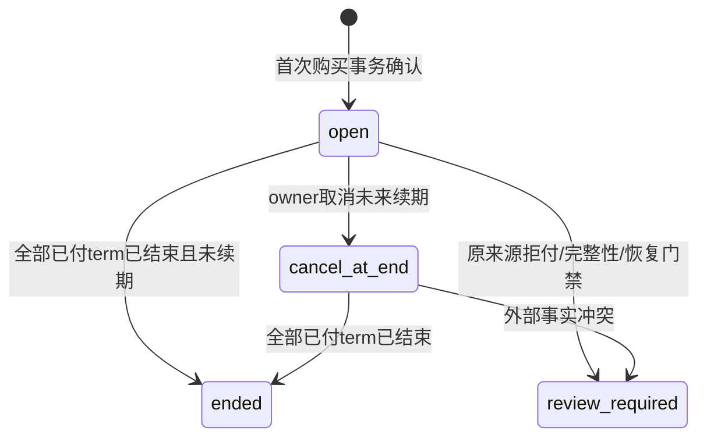

# 023-C 商品、周期权益与订阅：根审候选

2026-11-01。**仅代码调研和设计候选；未获根冻结，未分配迁移号，未实现商品售卖、权益或订阅。** 本文不授权注册购买、激活、退款或自动续费接口。023-A/B 的实现不代表本片完成；022-B 的本地模拟支付也不代表真实收款。

依据：[总规格](spec.md)、[总合同 C](contract.md#5-c期限商品与订阅方向尚不可冻结实现)、[原复核](review.md)、[计划](plan.md)、[验收](acceptance.md)、[模块设计](../../docs/design/periodic-products.md)、[HLD](../../docs/design/HLD.md)、[LLD](../../docs/design/LLD.md)、[022 来源 lot](../022-self-service-payments/c0-lot-contract.md)、[022 全钱包序列](../022-self-service-payments/c0-sequence-contract.md)、[022 共同资金](../022-self-service-payments/b2-funding-contract.md)、[B 接线](b-integration-contract.md)。上述概述部分仍保留历史状态；当前是否实现以真实代码与专项验收为准，不据旧页首推断。

## 1. 调研结论与完整目标

| 真实入口 | 当前行为 | 商品接线必须补齐的合同 |
| --- | --- | --- |
| [Reserve](../../internal/billing/reserve.go) | 固定租户售价；tenant/Key 两层周期控制；锁 AVAILABLE/HELD；request INSERT 后调用周期 helper | 权益选择、全部普通来源/权益等待必须先于 INSERT；保存客户零售上界及两类来源分配，不直接把套餐写到 AVAILABLE |
| [finish](../../internal/billing/settle.go) | 唯一 settlement；HELD→AVAILABLE/REVENUE；最终锁后重判24h | 权益释放回原期、过期桶；零售价扣额、钱包扣额和商品已付价值的收入归因分别冻结；24h规则不延长 |
| [消费退款](../../internal/billing/orders.go) | 不同财务人审批；原 settlement 限额；REVENUE→AVAILABLE | 普通来源仍回原 lot；权益只能恢复原权益及期限，不固定回现金钱包；不恢复 Key/周期 spent |
| [周期源时间](../../internal/periodicbudget/tx_sources.go) / [派发](../../internal/periodicbudget/tx_dispatch.go) | pb_admitted_at 在 request INSERT 固定；sending UPDATE 返回最终 pb_dispatch_checked_at | 不能只移动 AdmitCustomerTx；派发许可时刻还要检查原权益期限；prepared 不能在到期后偷偷换钱包重发 |
| [采购](../../internal/billing/procurement.go) | 每 attempt 独立供应商报价/硬预占/unknown；与客户收费分开 | 商品价格、权益额度、客户售价均不能取代实际供应商成本；套餐用量也产生采购成本 |
| [共同入账](../../internal/billing/funding.go) | 三种来源进入普通钱包；source/receipt/journal/outbox 唯一 | 当前没有商品支付用途。不得复用 capture 后再免费发一份权益；商品购买是独立 conversion，不再算充值 |
| 022-C0 两份候选 | 普通钱包 lot/FIFO/全钱包序列仍待 SQL 与实证冻结；没有到期桶/原路退款/拒付 | 本文依赖而不宣称它们已存在；增加商品后必须再次验证所有源路径和序列，不仅测新 API |

整个023-C目标是可销售的不可变商品、独立订阅、逐期权益、手动及授权自动续期、取消未来续期、到期、来源可追踪的退回与外部退款/拒付交叉。**第一笔售卖不以目录页、预算重置或1:1余额转换代替订阅。** 额度可以大于或小于购买价；第一片仍提供真实固定期限权益，后续再开放明确单位的 token 权益。

本文提出首片金额权益的精确业务模型与候选表/接缝。生产 SQL、静态授权证明和源核验器仍需独立原型后根冻结；本文不把逻辑设计称为 SQL 已证明。

## 2. 切片、真实前置和并行边界

| 切片 | 交付能力 | 不可跳过的前置 |
| --- | --- | --- |
| C-D | 产品根、不可变版本、发布/停售、受控只读目录 | 根冻结目录合同即可独立实现；只是辅助片，不算订阅交付 |
| C-F | 普通资金→商品已付价值、独立权益账、原来源购买条带、Reserve/派发/结算/释放/消费退款/退回全路径 | 022-C0 的来源+全钱包序列实际PG/维护/恢复验收；022-C1原路退款和022-C2/C3拒付/债务门禁的交叉合同与验收。沿[总合同§5.1](contract.md#51-必须先具备的来源)保留完整门禁，不用现有模拟支付降低依赖 |
| C1 | 金额权益、UTC锚点月、即时首期、最多一份预付后继期、显式购买/手动续期、取消未来续期、到期、原来源未用权益退回 | C-F完成；全路径受限角色、真实main/浏览器、离线全图核验通过后才可开启售卖 |
| C2-A | 显式授权的普通钱包自动续期、余额不足/past_due、取消与扣款竞态 | C1通过；独立续期授权/worker/重试/撤权合同和实际验收，不把人工点击意图当永久扣款授权 |
| C2-B | PSP直接购买商品/外部自动续费、延迟capture、拒付/部分原路退款 | 022真实对应支付能力、唯一capture用途、原路退款、拒付/债务与旧备份恢复验收；不是现有022-B钱包capture增加一个字符串 |
| C3 | 模型/输入输出 token 周期包、多权益维度 | 单位、硬界、确认usage、售价预算与权益双记账、退款数量和价值权重完整合同；不能把金额除以当前价冒充 token 包 |

C-D与C-F设计、只读核验器和客户端纯DTO可并行；C-F钱包/权益公共事务、source validator和迁移由一个账务负责人串行。C1订阅Commander/Reader、web可在冻结表与DTO后并行；Reserve/finish/refund/资金恢复共享文件不多人同时编辑。自动续期设计可并行审阅，不能先运行worker再补财务合同。

## 3. 金额、单位与产品版本

本稿公共值沿[B HTTP](b-http-contract.md#1-公共值与精确-dto)：UUID为小写非nil规范UUID；单笔金额、额度、端点和revision使用int64范围十进制字符串，累计使用Numeric100；时间为UTC6。所有金额乘法/区间价值用NUMERIC或big.Int，不用float。currency仅CNY。

首片权益单位固定`cny_credit`，一单位表示可抵扣一微CNY的**客户零售费用**，并非一微CNY现金。产品版本冻结`purchase_amount=P>0`、`allowance_amount=G>0`，两者各自≤int64，允许P≠G。客户端必须同时展示“购买价”和“每期调用额度”，不可将G列为可原路退款金额。商品不改023-A价格组；模型按原售价冻结R和实际C，权益仅承担其中抵扣额。

产品根可`enabled|disabled|retired`；disabled可再次enabled，retired不可恢复。根的current_version/revision可受CAS改变；已发布version全部不可变、不删除。停售/退休停止新购买和续期；已付term的权益和模型当前授权继续独立判定，不截断收尾。不自动采用更贵新版本，不把变更产品版本与tenant价格组绑定。

首片版本固定：`benefit_kind=cny_credit`、`term_kind=anchored_utc_month`、`source_policy=wallet_original_sources_v1`、`allocation_policy=earliest_expiry_then_wallet_fifo_v1`、`return_policy=unused_original_source_v1`，模型范围为非空、去重、UUID C序、最多32个逻辑model ID。版本发布时模型存在且有受支持计量profile；授权交集在每次调用重验，产品范围不授予tenant/member/Key权限。模型更名不改变ID，禁用/收权优先；不给客户看渠道/采购价。

## 4. 订阅、周期和购买状态机

首片每tenant只允许一份未最终结束的订阅，可有当前期和**最多一个**已付预排后继期。此限制防止未经设计的多套餐叠加；后续多订阅必须另冻结消耗排序/退款和锁图。每次购买一个term，不接受quantity。



`review_required`只暂停新购买/续期，不撤销已sending的有利收尾；解除须未来明确财务复核合同，不提供owner强制清除。`ended`、`cancel_at_end`不可重新开启；全部已付term结束后可新建subscription。取消不等于退本期权益，也不退已预付后继期；退回必须是另一个显式财务命令。

初次购买在全部资金/权益锁后取得DB时刻`t0`，首期`[t0,month(t0,1))`。保留最初`anchor_day`及UTC时分秒微秒，`month(t0,n)`从最初年月增加n、该月不足anchor_day时夹到当月末；1月31日→2月末→3月31日，不从2月末递推。非闰/闰年明确，month1不是30天；越出9999年拒绝新期。读、准入和派发都用DB时刻，不用浏览器、worker启动或provider时间推进。

手动续期只允许当前未取消的open订阅，使用同一product的显式`product_version_id`和CAS；可以升级到该product当前上架version，但owner必须提交它的完整购买意图，不能暗用新版本。尚未结束且没有预排term时，续期创建`[上一已付term.end,next_anchor)`；已有预排term则409。已经无有效/预排期时不得追溯补一个过期期，旧订阅ended，新购买从新t0开始。每期快照可采用不同版本；周期锚点仍属subscription。没有免费宽限期或按missed months补发。

首片购买是一个数据库原子命令，没有外部payment_pending：`无购买事实 → 原来源扣取+purchase+term+grant+回执`同COMMIT。业务失败整体回滚；提交未知是客户端unknown，不是可补发的purchase状态。未来PSP购买必须另建`purchase_intent: created→payment_pending→activated|closed|review_required`，支付事实、grant事实和订阅控制状态分离；浏览器返回不激活。

term不可变；其展示状态由同一as_of派生`scheduled|active|expired`，而不是由定时worker更新。grant余额状态和term资格分开：期末有held也仍是expired。`UNIQUE(subscription_id,term_index)`、`UNIQUE(purchase_id)`、`UNIQUE(term_id)`分别保护期、购买和grant；后台不能创造没有已付购买的新term。

订阅控制保存open/cancel_at_end/review_required；最后已付term结束时，Reader以同一as_of派生ended，不修改DB。下一次新购买在tenant control锁内将旧open/cancel_at_end控制投影物化为ended、记录`term_clock_end`不可变控制change，再允许新subscription；review_required不能被自然到期消除。该物化不发额、不扣款、不重置旧权益；客户端看到的revision仍是已持久控制revision，不能用浏览器倒计时自增。expiry runner也可沿同一锁序物化，二者唯一前驱CAS保证只发生一次。

## 5. 原来源价值条带：P≠G也不能套取现金

购买从**普通钱包**的022-C0 FIFO取P，禁止用任意商品权益再次购买商品。每条`purchase_funding_edge`记录原funding lot、FIFO次序、金额和购买本金坐标`[money_start,money_end)`，所有边恰好无缝覆盖`[0,P)`。原lot资格、receipt、fifo_at永远保留；不生成新的cash/sandbox_original来源。

商品grant的G个最小单位按整数坐标`[0,G)`表示。定义：

```text
F(k) = floor(P*k/G), 0<=k<=G
权益区间 [a,b) 的原已付价值 = F(b)-F(a)
对应原资金范围 = [F(a),F(b))
原lot价值 = 上述范围与 purchase_funding_edge 原本金坐标交集的整数长度
```

这将每个最小权益单位永久映射到不重叠的原本金条带，所有区间合计恰好P。不是每次退款分别乘比例再取整；保留精确区间后，拆分/合并、退款顺序、P<G产生的零价值单位均不会多造一微元。不能把所有G按当前售价/剩余百分比再次估值，不能把某个赠额区间改绑到可退现金来源。

例如P=100、G=150，先用权益`[0,60)`，对应已付价值40；可用尾部`[60,150)`对应60。退回全部未用权益仅把这60按原购买资金边归还。若原支付已用完、购买用了券，这60仍回券lot，原支付可原路退额度仍为0。P=3、G=10时分拆区间价值之和仍≤3，零价值权益不能换一微现金。

权利桶为`available|held|consumed|expired|returned`，五者区间不重叠且完整覆盖`[0,G)`，金额桶是区间长度。已消费区间退款精确逆原charged边恢复同一坐标；它恢复原期限和价值，不能重新分配坐标获得另一份可退价值。取消未来续期只改订阅控制，不移动任何桶。

## 6. 两套账和每类操作的精确效果

**CNY资金账与非现金权益账分开。** 权益账是产品单位的平衡台账，不能把G写入普通AVAILABLE或当作cash收入。原钱包lot拟增加`product_converted_amount=X`；保留其真实前置022-C1原路退款桶，完整守恒为`P_lot=A+H+S+payment_refund_held+payment_refunded+X`。022-C0自身尚无退款桶时只能在明确版本门禁下将二者解释为0，商品生产迁移不得覆盖/丢弃已实施的C1桶。X是仍用于产品的原本金，包括已用于服务/到期价值，只有原来源商品退回才减X。购买只能取A，payment_refund_held/payment_refunded、推理held和已转换本金不可再次用于商品；不能把purchase假写成推理settlement来复用S。

资金账拟新增平台科目`PRODUCT_PREPAID_CLEARING`与`PRODUCT_EXPIRY_CLEARING`。前者保存未被消费/到期/退回的原已付价值，后者记录到期权益的原价值，与服务REVENUE分别报告；均不是用户可花余额。科目和APP列权限仅追加迁移，不改既有SQL。下面所有动作同时包含原source、源/权益event、cache、审计、必要outbox和同一钱包操作序列；任一失败全回滚。

| 操作 | 普通lot/CNY journal | 权益事实/平衡台账 |
| --- | --- | --- |
| 购买P、发G | 原lot A−P、X+P；AVAILABLE−P / PRODUCT_PREPAID_CLEARING+P | 恰一个grant，available+G / grant-clearing−G；记录原本金条带，不写credited、不记第二笔收入 |
| Reserve，R=W+E | 普通来源按FIFO W：A−W、H+W；AVAILABLE−W / HELD+W | 选原有效grant区间E：available−E、held+E；保存原term、区间、抵扣额、R和W/E |
| 可信finish，零售C=Cw+Ce | 普通来源HELD−W、AVAILABLE+(W−Cw)、REVENUE+Cw；商品消耗区间价值v：PREPAID−v/REVENUE+v | 原held区间按allocation prefix收费Ce→consumed，剩余回available或expired；后者价值e另做PREPAID−e/EXPIRY+e |
| release/24h截止 | 普通held全回原lot available；不自动收取上游成本 | 原held全回原期；已过期部分进expired。unknown不释放，不换新期 |
| 自然到期 | 过期可用区间价值e：PREPAID−e/EXPIRY+e；不改AVAILABLE | available→expired；held原样保留，不重置grant |
| 消费退款，原期仍有效 | 普通收费部分按022原lot返回；商品区间价值v：REVENUE−v/PREPAID+v | consumed→available，恢复同一原区间；不增Key或B周期可用 |
| 消费退款，原期已过 | 商品区间价值v：REVENUE−v/EXPIRY+v；不能AVAILABLE+v | consumed→expired；不续期、不变现金 |
| 显式退回尚未用的本期/预排期权益 | 取当前available全部区间q，对应价值v；PREPAID−v/AVAILABLE+v；各原lot X−其价值/A+其价值 | available→returned；held/consumed/expired不动；原来源、原资格和FIFO不变 |

退回是退平台原来源余额，不是现金退款；之后如果符合022-C1，只能对恢复的同一原支付lot发起原路退。退回不恢复已到期权益、不以券/legacy补足某笔现金，也不自动拿走held。一次退回可因价值舍入得到v=0，仍有不可变q/范围事实及零额资金见证，不省略整条路径。

首片退回接口只支持“当前全部未用区间”，不接受客户端指定q、lot、金额或可退来源；CAS绑定最新权益revision，避免页面报价之后发生消费却按旧金额退。后续部分退回再独立冻接口，不能靠服务端任意挑最可退区间。

`settlements.charged_amount`继续表示按冻结售价计的客户零售收费C，Key lifetime和023-B客户spent仍计C；新增不可变拆分`wallet_charged_amount=Cw`、`entitlement_charged_amount=Ce`、`product_recognized_amount=v`，满足Cw+Ce=C。**REVENUE增量是Cw+v，不能再假设等于C。** 报表分别显示零售消耗、商品抵扣、购买价、消费归因价值、到期价值和真实供应商成本；margin使用资金价值与真实/未知采购成本，不用G虚增现金利润。

全request收费顺序固定为全部权益allocation（grant排序与坐标升序）在前、普通钱包allocation的FIFO在后，因此`Ce=min(C,E)`、`Cw=C−Ce`，不能由客户端或finish挑来源。原消费退款逆该全序：先逆普通钱包charged边，再逆权益charged区间；各类内部index分别连续，源kind优先级使合并次序唯一。金额退款F只指原零售收费的退款量，其中权益部分恢复等量原权益，不把它的已付价值v另外送到普通AVAILABLE。

过期worker迟到时，准入直接按DB时间排除过期grant；Reader分别提供eligible_available与expired_pending，不能把缓存available当可用余额。所有写在锁后先规范化本次接触的到期可用区间；worker只是将既有到期事实落账，不能发放/续期/发模型。CNY PREPAID始终与权益各未消耗/未退回区间的原价值对应，pending到期价值需单列，不以迟到worker做已知可用承诺。

## 7. Reserve、派发、结算和模型范围

1. 按当前tenant/member/user/Key/model、价格组、价格和profile原锁顺序；取得B客户controls，再取得本次完整账户集合和普通lot/权益余额锁。所有商品写也持tenant AVAILABLE锁，沿022-C0同一个钱包串行点，不加反序tenant advisory gate。
2. 按`ends_at ASC, starts_at ASC, grant_id COLLATE C ASC`选择该模型当前有效权益；同grant选可用单位坐标升序；E≤R，剩余W=R−E按普通钱包严格FIFO。**这是对022-C0普通钱包FIFO的显式扩展：域内FIFO不变，金额权益优先抵扣。** 不提供请求字段或Key字段选便宜来源。首片单订阅且不重叠有效期，但仍冻结排序以便核验。
3. 当前权益和普通来源都足以覆盖才准入；不能只靠周期预算。为防止权益等待跨到期后又回取更早的普通lot，先在AVAILABLE串行点内取得**普通钱包最多覆盖完整R的FIFO候选prefix**（不足R时取全部正可用候选，此时尚不拒绝），普通lot按ID锁；再锁当前/唯一预排term的两个候选grant按ID锁。若当前模型不在某grant范围仍不选它，历史过期grant不作为新准入候选。锁后取最终DB时刻，按该时刻有效grant重算E、W，只在已锁普通prefix中选择W；不足则整笔回滚，禁止从权益锁后回取新普通lot。购买/退回/发额也持AVAILABLE，所以候选全集在此期间不能被合法并发写改变。**request/reservation INSERT必须在最终来源选择与全部等待之后**，随后使用020持久pb_admitted_at；最终时刻复验Key、deadline和权益资格，任何不一致整笔回滚，不重记预算。这一保守候选锁有性能成本，必须实测，不能为了少锁而留下期末反序。
4. reservation写`funding_mode=product_v1`及W/E，即使E=0也精确保存版本；旧/纯wallet_v1行不猜历史。零额R继续原零journal+钱包序列见证，不创建正额权益分配。
   INSERT产生的真实pb_admitted_at还要再次复验所选term半开边界；若它与前一锁后观察跨过边界则整笔回滚，以安全过期错误结束，不在已插入request后重新选来源或更改周期源时刻。
5. PrepareDispatch先按原父锁/reservation/attempt与采购锁完成等待；sending UPDATE的最终许可时刻必须使本request所有权益分配的term仍有效。核验原held和原allocation，不重新选择权益、补扣钱包或重新报价。到期拒绝派发，走not_sent并按上节释放；安全第二attempt不再次创建客户分配。
6. 一旦sending COMMIT，后续到期/商品停售/取消/授权收紧均不阻断原有利收尾。finish在全部账户、普通lot、权益余额等待后重判24h；已到期未用区间回expired，可信收费使用原区间。客户请求unknown和采购attempt unknown继续分别占用，后台没有模型重发。

授权仍是当前模型/tenant/member/Key/地域交集，再与产品model_scope交集。某模型无有效权益时可以正常使用普通钱包；但已预占权益在派发前失效不自动改用钱包。收费与权限版本的历史快照不可被产品发布覆盖。

## 8. 候选追加DDL与双向证明

以下是候选准确表名、主列和约束，不是已审SQL；不给迁移号。跨tenant关系FK均同时含tenant_id，source历史TEXT ID不强改UUID。不可变表统一拒UPDATE/DELETE；cache仅按本事务新effect连续CAS更新。

| 表 | 核心列、唯一性及来源 |
| --- | --- |
| `products` | id PK、created_by/at；revision>0、current_version_id nullable、state、last_change_operation_id；current FK归本product；只有根CAS字段可更新 |
| `product_versions` | id PK、product_id、version>0、display_name(1..100 UTF8字节)、purchase_amount>0、allowance_amount>0、currency=CNY、benefit/term/source/allocation/return policy枚举、sorted model_scope、publish_operation_id、created_at；UNIQUE(product,version)、publish_operation |
| `product_changes` | operation_id PK、product、expected/before/after revision/state/current、published_version nullable、previous_change_id、created_xid/at；与根当前投影/不可变操作一对一；no-op有change但revision不增 |
| `product_tenant_controls` | tenant_id PK、revision、current_subscription_id nullable、last_change_id；在tenant父锁后首次建立，稳定同步购买/续期/取消；不能靠删除重置 |
| `product_subscriptions` | id、tenant_id、product_id、anchor_at/day/time、created_operation、created_at；控制投影state/revision/last_change_id；UNIQUE(tenant,id)，根control限制同tenant唯一未ended订阅；不使用now() partial unique |
| `product_subscription_changes` | id、tenant、subscription、kind、operation_id UNIQUE、before/after state/revision、previous_change_id、created_xid/at；取消和状态控制连续链；支付/权益状态不塞入state |
| `product_purchases` | id=operation_id、tenant、subscription、term_index、product_version、P/G快照、source_policy、source_journal_id UNIQUE、created_at；UNIQUE(subscription,term_index)，金额从version推导，不能自报 |
| `product_terms` | id、tenant、subscription、purchase_id UNIQUE、term_index、product_version、starts_at、ends_at、anchor_index；UNIQUE(subscription,term_index)、UNIQUE(tenant,id)；与purchase完整同tx，边界由锚点和index重建 |
| `product_purchase_funding_edges` | id、tenant、purchase、funding_lot、allocation_index、money_start/end、amount=end−start>0；UNIQUE(purchase,index)、连续覆盖[0,P)；来源FIFO和X变化由022钱包全序证明 |
| `product_entitlement_grants` | id、tenant、term_id UNIQUE、purchase_id UNIQUE、G、unit=cny_credit、starts/ends、model_scope、created_at；全部与term/version一致，不接受worker直接发额 |
| `product_entitlement_balances` | grant_id PK、tenant、revision、last_event_id；available/held/consumed/expired/returned五个BIGINT桶及相应canonical int8multirange；范围两两不交、并集=[0,G)，桶数=范围长度；只按精确新event更新 |
| `product_entitlement_events` | id、tenant、grant、wallet_operation_id、kind、source_kind/id、journal_id、previous_event_id、before/after revision、精确前后范围/桶与delta、created_xid/at；UNIQUE(grant,after_revision)、唯一effect边；不得仅校验delta总和为0 |
| `product_reservation_entitlements` | id、tenant、reservation、grant、allocation_index、非空canonical unit_ranges、amount；UNIQUE(reservation,index)、UNIQUE(reservation,grant)；范围当时available、金额总和E；原term永久绑定 |
| `product_settlement_entitlements` | id、tenant、settlement、reservation_entitlement_id UNIQUE、charged_ranges、released_ranges；两者不交且恰覆盖原分配；charged按全request冻结顺序prefix，不重新挑来源 |
| `product_consumption_refund_entitlements` | id、tenant、approved_refund_order、settlement_entitlement、unit_ranges、amount；累计不超过原charged区间，按全request原收费边逆序；原refund Money只分解零售抵扣，不换算可退现金 |
| `product_return_intents` / `product_return_edges` | intent id=operation、tenant、term、expected_entitlement_revision、frozen returned ranges/q/v、journal UNIQUE；edges精确关联purchase funding edge及原lot，amount为F区间与原money条带交集；不引用其他付款补足 |
| `product_operations` | operation_id PK、actor、scope、kind、target、safe_input、canonical fingerprint、result_snapshot、resource_id、created_at；只保存成功不可变回执，与实际change/purchase/return/audit双向一对一 |

权益账每个event的五桶delta精确求和为0，grant首事件另从grant-clearing发行G；其余额/范围投影与所有不可变event核对。台账不以原CNY账户的balance保存G；DB类型int8multirange只用于内部精确区间，不进入HTTP。需验证片段增长/TOAST/遍历时限；在剩余context内完整处理，超时回滚，不能截断区间后放行。每页128边、金额/区间NUMERIC求和；不得因只取前N边改变来源语义。

`reservations`追加不可变funding_mode、wallet_reserved_amount、entitlement_reserved_amount；新mode满足W+E=amount。`settlements`追加不可变同mode及Cw/Ce/v和release拆分。新源核验器按mode分支；022旧validator不能继续把所有reservation_lot之和强制为R、所有REVENUE强制为C。旧行只按wallet_v1解释，不重写已结算金额。退款按原mode和原charged次序拆分；lot/events、权益events与单一钱包operation共源。

022钱包operations保留一个唯一连续序列，新增purchase/return/expiry等精确kind和源绑定；原reserve/finish/refund的product_v1分支保存普通delta与权益effect见证。候选新增`product_wallet_effects(wallet_operation_id PK, tenant_id, effect_kind/source_id, entitlement_event_count, entitlement_delta_snapshot, recognized_value, expiry_value)`，反向要求每个有权益变化的operation恰有该事实，全部源/权益event恰归它。不能开一个独立商品序列让普通余额和权益操作顺序无法比较。零CNY变化的权益reserve/expiry/退款也保留原单source零额CNY journal和这份见证，不按无正额line忽略。

生产SQL片须展开每个来源/check guard、约束trigger、current-xid stamp、确切FK/函数依赖/权限和静态摘要。至少有反向证明：无购买的grant、无扣款的purchase、无term的消费、无批准refund的恢复、遗漏原lot的退回、无源event的cache更新、另一事务旧effect更新、缺尾区间都不能COMMIT。单lot守恒不能代替钱包prefix和权益区间前缀重放。

## 9. 锁图、Go接缝与账户等待

```text
用户命令operation独立advisory门
  → tenant SHARE → actor membership SHARE → actor user SHARE
  → product SHARE（购买/续期需要；目录管理没有tenant后向边）
  → product_tenant_control NO KEY UPDATE → subscription NO KEY UPDATE
  → 本次全部CNY账户按account_id升序（始终含tenant AVAILABLE）
  → 读取022钱包head/候选seq
  → 普通funding lot balances按lot_id升序
  → entitlement balances按grant_id升序
  → 锁后DB时刻/原source判断 → 原子facts/events/cache/head CAS → COMMIT
```

catalog管理按admin当前user SHARE→product NO KEY UPDATE，不锁tenant/subscription/account。仅取消未来续期不取财务账户；不从product/root回锁用户。Reserve/finish/原消费refund保留既有父锁/周期control位置，直接进入账户尾层；**不补锁subscription、产品根或另一个人类user**。不可变term、grant、purchase的FK KEY SHARE须与根投影NO KEY UPDATE兼容，不能用UPDATE key的guard制造隐式反序。

PrepareDispatch不锁权益余额后再取采购锁；原request/reservation保证本次held不会由另一路finish释放，取消/到期/退回均不得动held。最终sending时只核原完整分配及不可变term边界，不创建新客户lot分配。全部到期写/退回同样先取得tenant AVAILABLE，然后普通lot→权益；无entitlement→AVAILABLE反向路径。

候选模块`internal/products`包含纯DTO/区间价值算法、Reader/Commander、事务内权益helper和只读Verifier；`billing`调用同tx helper，不导入HTTP/PSP，产品Commander不能自行创建新funding receipt。建议两阶段opaque proof，绑定tx对象/xid、tenant、原source和精确候选集合：

```go
// 签名是候选seam，不是已存在API；所有helper不Begin/Commit/重试/联网。
LockReservationSourcesTx(ctx, tx, sourceInput) (LockedSources, error)
CommitReservationSourcesTx(ctx, tx, LockedSources, requestID, reservationID, journalID) error
LockFinishSourcesTx(ctx, tx, tenantID, reservationID) (LockedFinish, error)
CommitFinishSourcesTx(ctx, tx, LockedFinish, finalDBTime, settlementID, journalID) error
CheckDispatchSourcesTx(ctx, tx, tenantID, requestID, attemptID, persistedDispatchAt) error
ApplyConsumptionRefundTx(ctx, tx, alreadyLockedRefund) error
PurchaseTx(ctx, tx, alreadyLockedSubscriptionAndAccounts, versionID) (PurchaseResult, error)
ReturnUnusedTx(ctx, tx, alreadyLockedReturnAndSources) (ReturnResult, error)
ExpireGrantTx(ctx, tx, alreadyLockedAccountsAndGrant) error
```

冻结真实Go片时须把`alreadyLocked...`展开为不可伪造proof和精确字段，不能留下Trusted布尔值/任意金额/外部source kind。proof不跨事务或另一个pool；不在helper隐藏回取前层锁。024/019采购合同、价格组观察时刻和B源时刻保持原义。

## 10. 精确首片HTTP、DTO和当前权限

新写body≤8KiB、严格UTF8单对象、拒重复/未知/尾JSON；金额/revision只收string。scope、actor、tenant来自Cookie和DB，不收body/header可信标记；API Key无管理接口。平台读admin/finance_operator/finance_approver，写admin；tenant购买/续期/取消/退回仅当前active owner，读取owner/billing_viewer；member不枚举账务。当前tenant/user/membership失权403，当前合法身份但不可见资源404。财务消费退款继续原双人审批；商品未用退回是owner资产操作，不冒充财务消费refund。

所有写沿CSRF、账号已开启才MFA、10分钟再认证、ready/Guard/recovery和`products.enabled`门禁。开关只挡新购买/续期，取消、原回执和有利财务收尾不被开关挡住；recovery仍按统一资金门禁，不用开关绕过。首片开关默认off；关闭不撤销已付权益。C-F未验收时无可用购买/激活路由，不能只靠按钮灰掉。

| API | 精确输入或结果；首片可注册范围 |
| --- | --- |
| GET `/api/products` | 已登录本tenant owner/billing_viewer；仅enabled/current version安全目录，固定分页；匿名公开销售页另审，避免意外把产品范围当公开模型权限 |
| POST `/api/platform/products/{product_id}/versions` | `{operation_id,expected_revision,display_name,purchase_amount,allowance_amount,model_scope}`；固定首片policy，发布新version不自动上架；首次product_id不存在要求expected="0" |
| PUT `/api/platform/products/{id}` | `{operation_id,expected_revision,state,current_version_id}`；current_version_id可显式null；退休不可恢复，enabled须有本product已发布version |
| GET `/api/platform/products[/{id}]`，GET `.../{id}/versions` | 根/安全version；历史不删除，不输出source及采购资料 |
| GET `/api/subscriptions`，GET `/api/subscriptions/{id}` | 当前tenant订阅和term摘要；同快照as_of，不据浏览器倒计时写state |
| POST `/api/subscriptions` | `{operation_id,product_version_id}`；只允许当前enabled version；一次购买即时首期，无existing open/cancel_at_end/review订阅 |
| POST `/api/subscriptions/{id}/renewals` | `{operation_id,expected_revision,product_version_id}`；同product显式版本、无预排期、未取消、当前仍有有效期 |
| POST `/api/subscriptions/{id}/cancel` | `{operation_id,expected_revision}`；只停止未来创建term；重复新意图同状态为no-op成功，仍保留回执 |
| GET `/api/subscriptions/{id}/terms`，GET `/api/subscriptions/{id}/terms/{term_id}` | 历史期和当前安全额度；过期held、过期pending和returned分别显示 |
| POST `/api/subscriptions/{id}/terms/{term_id}/return-unused` | `{operation_id,expected_entitlement_revision}`；冻结当前全部available区间和原来源金额，禁止自报金额/源；term可scheduled或active，expired无可退权益业务冲突 |
| GET `/api/product-operations/{operation_id}` | 本tenant当前owner/billing_viewer；原完整安全回执，仅当前scope可见 |
| GET `/api/platform/product-operations/{operation_id}` | 平台当前三角色，仅platform scope；不以此读任意tenant购买回执。平台审计查询另行显式受控接口 |

```text
ProductVersionView={id,product_id,version,display_name,currency,purchase_amount,allowance_amount,
 benefit_kind,term_kind,model_scope,source_policy,allocation_policy,return_policy,created_at}
ProductView={id,revision,state,current_version_id,created_at}
SubscriptionView={id,product_id,revision,state,renewal_mode:"manual",anchor_at,
 current_term_id:UUID|null,queued_term_id:UUID|null,last_paid_term_id,created_at,as_of}
TermView={id,subscription_id,term_index,product_version_id,purchase_id,starts_at,ends_at,
 state:"scheduled"|"active"|"expired",unit:"cny_credit",issued_amount,eligible_available_amount,
 scheduled_available_amount,held_amount,consumed_amount,expired_amount,expired_pending_amount,returned_amount,
 entitlement_revision,purchase_amount,original_value_remaining,as_of}
ReturnView={id,subscription_id,term_id,returned_allowance_amount,restored_wallet_amount,
 result_kind:"original_wallet_sources",created_at}
ProductOperationView={operation_id,kind,scope,actor,target,input_fingerprint,resource_id,created_at}
ProductRootReceipt={operation:ProductOperationView,result:ProductView}
ProductVersionReceipt={operation:ProductOperationView,result:ProductVersionView}
PurchaseSnapshot={id,term_id,version_id,purchase_amount,allowance_amount}
PurchaseResult={subscription:SubscriptionView,purchase:PurchaseSnapshot,term:TermView}
ProductPurchaseReceipt={operation:ProductOperationView,result:PurchaseResult}
ProductCancelReceipt={operation:ProductOperationView,result:SubscriptionView}
ProductReturnReceipt={operation:ProductOperationView,result:ReturnView}
```

上述DTO字段全部必有，nullable显式null，空集合[]；金额/term_index/version/revision为十进制string，时间UTC6。operation.kind精确为`product.version.publish|product.configure|product.subscription.purchase|product.subscription.renew|product.subscription.cancel|product.term.return_unused`，分别对应Version/Root/Purchase/Purchase/Cancel/Return六种回执；GET原operation先验证kind再严格解码其唯一result字段集合，不能用宽松union碰运气。purchase快照id等于operation_id，term/purchase/version和subscription属于同tenant且关联一致，购买/续期result全部as_of等于operation.created_at；cancel返回相同语义的当时安全快照。scope仅`platform|tenant:<UUID>`，target为固定规范路径。

TermView守恒：issued=eligible_available+scheduled_available+expired_pending+held+consumed+expired+returned。scheduled期的available进入scheduled_available，active期进入eligible_available，expired期尚未落账部分进入expired_pending，其余两个available观察字段为"0"。original_value_remaining精确为底层available与held区间的原价值和，包含尚未物化的到期available价值；它不是“可现金退款”，页面明确显示held/expired_pending尚不能退回。display只用精确格式/BigInt，不走Number。

列表固定50，查51；envelope `{data,request_id,next_cursor}`，末页`next_cursor:""`，不沿022支付的null。cursor从Pepper独立HMAC域派生，绑定route/current actor/current scope/筛选/排序；版本/term/operation按`created_at DESC,id COLLATE C DESC`，版本也以不可变version校验。token≤2048字节且canonical；不收limit/offset/客户端tenant筛选。

候选有界准入：读全局32、actor4；原operation核查另限全局8/actor1，2/s burst4；写全局8/actor1，1/s burst2；全部先于DB Guard取得且最终释放，不共享推理许可。读5s、写10s与parent取短，DB lock3s/statement5s；超时安全错误，不返回半份快照。正式HTTP片须用真实并发验证该预算，不把产品unit算法测试等同准入验收。

## 11. 幂等、未知提交、角色和恢复

商品命令采用023-A/B式**成功回执不可变、业务拒绝整体回滚**，不用022 commerce_commands的HTTP200 rejected语义；独立`product_operations`和operation advisory域，不能只扩commerce kind CHECK。候选operation门为两int域`(23023031, hashtext(current_schema()||':'||canonical_operation_uuid))`；首次product根另用`23023032`加同schema/product UUID，均只作串行门，冲突仍完整比较UUID/身份，不复用A/B/022域。指纹为SHA256，先长度分帧固定域`moni-aigate:product-operation:v1`，再kind/actor/scope/target及规范safe_input；金额字符串、model_scope去重C序，不散列原JSON字节，不允许敏感凭据字段。新成功201（创建/购买/续期），控制更新/取消/退回及原回执重读200；失败不建立成功operation。新operation同target的CAS旧值409；同operation完整actor/scope/kind/target/safe_input一致才返回原安全快照，异体409`product_operation_conflict`，不暴露他人操作内容。当前读写身份每次重新验证，旧owner不能凭operation ID读回资金信息。

400 invalid_request/invalid_cursor，403 forbidden，404 not_found，409 product_revision_conflict/product_operation_conflict/product_not_on_sale/subscription_state_conflict/product_term_expired/product_source_unavailable，402 insufficient_balance，429 rate_limited，503 product_unavailable/product_outcome_unknown/product_invariant/product_clock_regression；错误不输出SQL/DSN/原body。根冻结时须核对既有HTTP映射并固定文字，不凭任意PG CHECK/23505猜成业务冲突。

RC事务显式持连接至清理完成；只对确定40P01/40001、确认全回滚且连接idle的同ID数据库closure有限重试，最多初次+2、总10s。COMMIT未知销毁该连接，返回零结果和outcome_unknown；只GET原operation，无自动POST重试、换ID、重发grant或模型。GET404不证明失败，最新subscription/余额相同也不证明原意图成功。

web独立安全IndexedDB journal，单readwrite事务complete后才发写；只存operation metadata，不存资金明细/凭据/任意body。actor/scope/目标互斥、上限128、跨tab和损坏key fail closed，身份/租户/角色/route epoch同步取消晚回及journal删除。原回执kind/actor/scope/target/安全意图精确匹配才解除unknown；缺读权/离线/404保留记录。原意图明细只存当前内存，reload后以安全回执和显式核对流程恢复，不能猜原body重发。

权限候选：APP仅产品根指定投影列UPDATE及不可变fact INSERT；不能改旧版本、原来源资格或直接设权益金额。projector只读新增安全outbox与自己的projection，不读funding source/权益底表、不写金额；migration/离线核验为独立owner实际LOGIN。现有payment worker保持仅钱包sandbox_capture权限，**不获得购买/续期/商品grant EXECUTE或表权**。首片expiry runner用APP受限pool、既有Instance/Guard，没有owner凭据；有界发现候选后释放发现事务，再按上述固定锁图逐grant处理，每轮最多32、2并发，不持SKIP LOCKED任务行回锁前层。仅确认的原到期事实可重复处理，唯一effect阻止重复记账。自动续期worker将来单独最小角色和启动证明。

完整恢复沿既有recovery latch，旧备份不重播购买/续期/已知外部支付。C0 epoch保留，产品前历史不伪造term；新迁移仅追加，不从钱包总额猜商品。恢复后核对离库财务凭证、所有purchase原source、term/grant、钱包连续prefix和权益区间prefix，双人确认后才开资金门禁。known payment unknown仍由022原命令查询；产品worker不得拿缺失term解释成“应补发”。

## 12. 自动订阅、token权益与外部资金后续合同

这三项是整个目标的保留工作，不隐藏在C1完成说明里。

**C2-A授权钱包续费。** 新增独立owner consent，冻结product_version、单期P/G、最高扣额、周期、起止、原operation及撤销事实；普通登录/购买不是授权。续期worker在product_tenant_control/subscription串行点，用`UNIQUE(subscription_id,next_term_index)`唯一renewal intent；资金提交前重新验tenant active、授权人仍active owner、产品/版本仍允许、consent未撤销。失权/商品停售停止新扣款；不足为past_due，无新grant/宽限额度，既有旧held按原期收尾。取消在扣款COMMIT前赢则不新建term，扣款已确认则该term是已付承诺，取消只阻后续；未知提交只查同intent不另扣。重试时刻/期限、是否保持原月锚点或重新锚定、past_due后价格同意必须在C2-A合同选择后才能实现，不能擅自“补过去三个月”或无限扣款。建议首片不追补：错过边界且未付则暂停，owner显式恢复从新t0开始。

**C2-B直接PSP商品。** 原订单必须冻结`effect_kind=wallet_funding|product_purchase`且全局capture身份只允许其中一条路径；原022-B固定wallet额度和source CHECK不能复用。capture/term唯一effect、取消与capture、延迟权威query、过期首期的起算政策、回款已发生但grant失败的review、退回/原路refund/拒付/债务分录须逐项另审。对原funding lot发生外部扣回时，必须沿purchase本金条带定位剩余商品价值、同源追回与已消费/held的短缺；不能扣另一个支付/券/tenant，不强行杀已sending，不把未知外部消费设零。现有C0无债务/自动偿债，本文没有假定它可调用。分期退款与拒付交叉的逐区间优先级和债务量精确合同是C-F售卖依赖，不靠“以后人工处理”跳过。

**C3 token/多维权益。** 产品行必须明确`model_id + unit(input_token|output_token|检索协议明确定义单位) + quota + basis_amount`；各行basis之和=P，零basis行可赠送但不产生可退现金。一百万token不能混为一百万输入+输出，更不能用当前模型价换算。每行单独硬预占和原确认usage消耗，归因仍用F区间；第一token片建议同request所有计费维度均由本期token权益覆盖，否则整request用普通钱包，禁止未设计的半维度透支。金额R/Key/B仍按冻结售价约束，token计量与金额计量并行。现有Money消费refund不足以表达“恢复多少输入/输出token”，必须新冻结指向原usage/charged边的typed quantity退款及舍入，不凭退1元重置一百万token。媒体/异步/供应商缓存维度沿024独立范围，不能宣称C3天然已覆盖。

## 13. 验收矩阵和冻结门槛

| 编号 | 必须提供的证据 |
| --- | --- |
| CC01 | 022-C0全路径/严格FIFO/全钱包序列/空库与非空维护/旧备份真实PG验收；022原路退款、拒付/债务交叉未通过时商品售卖仍关闭 |
| CC02 | P=100/G=150、P=3/G=10、P>G、零价值区间、分拆/合并/重复refund，所有区间价值合计精确P，不按每次比例多取整 |
| CC03 | 原支付用完→券/legacy购买→商品退回；原支付可退额不增加；混源购买的每条退回只恢复对应lot及资格；同lot部分原路refund在途/已退时仅A可购买，不能把refund_held/refunded本金再转商品 |
| CC04 | 同operation并发、同subscription相邻续期、同term grant/notification/query重复；仅一次购买/扣款/grant，失败无半图 |
| CC05 | 金额权益+普通钱包混合R、C prefix、逆收费边消费退款、0价/零额R、到期后消费refund，不增Key/B spent可用，不改旧价 |
| CC06 | 普通账户/lot/权益锁等待跨UTC月、Key expiry、request deadline和term end；request INSERT/pb源时刻覆盖全部等待；最终sending期限再验 |
| CC07 | prepared跨期不派发；sending跨期仍可信结算/24h释放；unknown跨期保留；新term不承担旧held；客户释放不释放采购unknown |
| CC08 | 1月31日/闰年2月/3月31日、精确end半开、提前一份续期、再次提前拒绝、取消与并发续期、停售原term继续、模型收权优先 |
| CC09 | 注入缺purchase/缺grant/缺源edge/区间重叠或缺尾/旧event更新/错钱包序列/跨tenant FK/直接UPDATE桶；受限APP与worker均拒非法提交 |
| CC10 | 真实COMMIT回复丢失、rollback失败、进程SIGTERM/崩溃、expiry延迟与重复、Guard丢失/recovery/off、旧备份；只有原operation查询，没有重发模型/重复grant |
| CC11 | 新版VerifyLedger/Funding/Lots/Products与Rebuild同一RR快照，源→event→projection和反向完整；按钱包seq重放原资金FIFO及权益unit prefix，不用净SUM冒充全历史证明 |
| CC12 | 平台/tenant/owner/billing_viewer/member越权、撤权后原operation、跨tab journal/损坏namespace、身份epoch晚回；真实main和桌面/窄屏浏览器分开记录 |
| CC13 | 报表购买100/额度150/服务抵扣60→已付归因40，实际采购成本独立；期限未用到期单列，模拟余额不写真实收款，未知供应商成本不当0 |
| CC14 | 大量来源lot、碎片权益范围、并发旧held收尾的EXPLAIN/时限；完整处理超时回滚，不为p95截断来源或丢失反套利证明 |

只读Products核验器拟同022/B采用balanced/mismatch/indeterminate和0/2/3/1出口：损坏为mismatch，历史缺可证明见证为indeterminate，错误/权限/迁移/超时为执行失败，不返回部分“通过”。核验器不修账、不grant、不重发模型。普通ledger平衡不足以替代产品范围/来源/价值分配证明，产品fixture通过也不替代外部PSP/供应商生产认证。

根冻结前需裁决：独立非现金权益账和P≠G条带归因；单未结束订阅/最多一预排期；锚点月夹末日；权益优先、普通来源域内FIFO；未用权益退原lot而非现金；APP仅到期runner、自动续期另角色；原消费金额与已付价值报表分离；以及C-F必须保留022退款/拒付的原依赖。任何裁决变化先改本文状态机/分录/范围/锁/验收，再出SQL和生产代码。

实施后由集成人更新统一架构的产品模块、调用与两套账链路、subscription/term/grant/source关系、权限、恢复、能力状态与源码链接，连同HLD/LLD和分层证据；所有并行结果汇总再执行reviewed refresh。本文未动共享架构、未refresh、未运行DB或主进程验证，不能被记为已实现能力。
