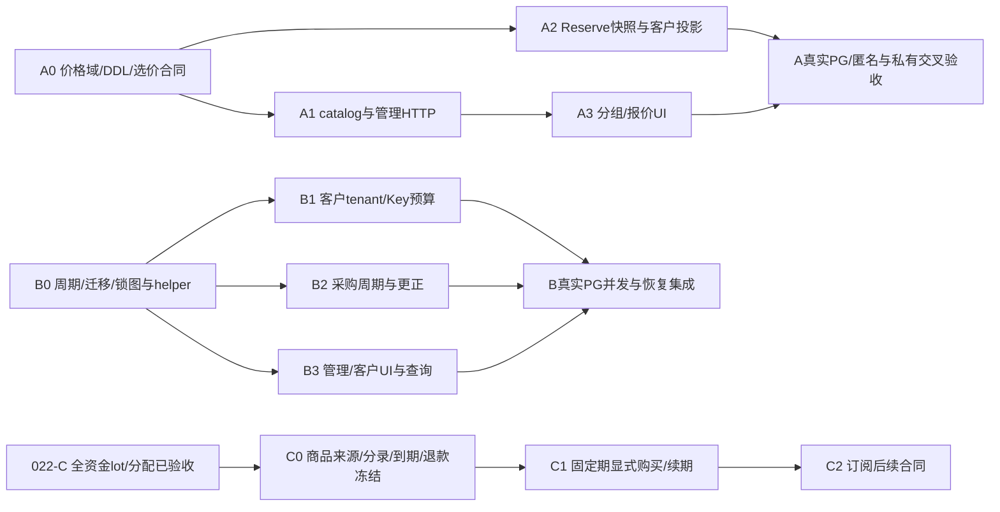

# 023 分片与并行计划草案

2026-11-02，**A0已冻结，A1/A2/A3已实现并通过限定本地验收；B核心与HTTP/UI按020接线，专项/浏览器、最终相关回归及020预览升级通过，独立三态Verifier/CLI专项已通过；C-V纯价值条带与锚点月已按独立合同冻结实现，C商业售卖仍独立门禁**。A以[精确合同](a-contract.md)与[根裁决](review.md)为准；SDD原型不代表运行能力，B/C不得据A授权接通。

## 1. 依赖

021身份、022-A兑换券和023-A/B可独立设计；022-A或B通过不等于C依赖已满足。B1/B2的代码可在固定接口后分工，但与A2同时修改Reserve/evidence/settle时必须由同一账务负责人串行集成，不能并行覆盖共享文件。

## 2. A任务与所有权

- [x] 集成人接受或修订：单tenant单组、缺组价fail-closed、组退休不变已授客户、匿名只默认价、绝对单价和钱包前定价时刻。
- [x] A0冻结price_versions新增nullable组域、唯一性迁移、旧FK与旧数据兼容、tenant独立revision、不可变事件、操作回执与角色权限；列实际约束与触发器而非只写逻辑图。
- [x] A0固定Group/Assignment/Price/RetailPrice及management operation精确schemas、分页、有界准入、缺价预览和错误码；新管理API不得改变旧默认价body/语义。
- [x] A1独占catalog和管理存储：新group/assignment/price API；发布/退休/分配CAS、当前admin原子校验、无成本泄漏。
- [x] A2独占billing：同DB时刻确定选价与不可变request快照，旧请求legacy标记；RecordAttempt/dispatch/finish不重新定价。
- [x] A1/A2合并全部选价读取点：默认发布、匿名public SQL、tenant模型列表、Key调用目录和Reserve；不能只修改Reserve使页面继续显示另一价格。
- [x] A3独占web：分组和分配管理、客户有效报价、匿名默认说明；严格DTO、无损金额、未知回执与身份epoch。
- [x] A专项真实PG：跨组缺价/0价、同有效时刻唯一、调组/发布/锁等待、历史收尾、匿名隔离；再真实main浏览器及完整架构收口。

## 3. B任务与所有权

- [x] 接受或修订UTC日/月、原期归属+carry、首次下一完整期启用、无手动reset、周期一旦配置不可改、客户退款不恢复预算以及tenant/admin权限。
- [x] B0审计实际Reserve、lockRequest、model升级、PrepareDispatch、采购evidence/更正和恢复；画出新增control/window/FK完整锁图，明确账户与control先后不同层，公布同tx helper签名。
- [x] B0冻结稳定controller、配置版本、window/allocation/event DDL、受限角色、首次配置的完整legacy held同步扫描、tracking_started_at和时钟异常fail-closed；未配置不宣称已跟踪，首配后禁用期间持续记账。
- [x] B0补齐当前视图/历史窗口/allocations状态枚举、平台/tenant操作查询路由、错误映射、游标编码、请求并发/时限上界；精确合同/纯层、Tx helper、Reader、Commander已实施，核心接线按[b-integration-contract](b-integration-contract.md)推进；HTTP/前端专项、真实多tab及隔离main浏览器已通过，最终回归/预览仍另验。
- [x] B1客户资金负责人接入tenant/Key两重预占、同request一次allocation、原期settle/release/24h和不减spent的消费退款；每一处与ledger同tx。
- [x] B2采购负责人接入每attempt原期、累计cap与周期cap交集、保守unknown/disputed、双审绝对成本更正；不得进入客户Settle事务或因客户释放减采购carry。
- [x] B3独占web/HTTP查询：当期和carry分栏、UTC起止与观察时间、scheduled/disabled、独立CAS、只读原操作；不把周期额度显示成钱包到账。
- [ ] B交叉PG验证月末锁等待、第二attempt跨期、限额收紧/关开、旧held恢复、更正、禁用/过期账号的有利收尾、process crash/旧备份门禁；实际main跑单再刷新架构。

## 4. C串行关口

- [x] C-V独立纯层按[精确合同](c-value-contract.md)冻结实现：规范int64十进制P/G、绝对端点floor条带、完整本金分区按原edge索引归因、UTC6原锚点月与半开term；有界4096 ranges/4096 edges、固定安全错误和失败零结果，定向race/vet、独立单位枚举oracle和三组短fuzz通过。新`internal/productvalue`没有DB/HTTP/worker或生产import，不授来源资格、去重、余额、购买/续期/退款能力；不满足下列任何资金关口。
- [ ] 确认022-C已实际验收，而非只有lot表或草案；现有全部客户资金路径与原路退款/拒付的来源分配覆盖齐全。
- [ ] C0逐项冻结purchase输入来源、原支付/钱包购买分配、grant/journal分录和唯一effect；退款累计取整、费用、拒付/债务归因与恢复规则。
- [ ] 冻结过期available/held/release/settle/refund的桶变动、服务授权交集、term边界及重叠消耗顺序；先证明赠额无法转换现金。
- [ ] 给出真正的商品/购买/term/取消/续期DTO和API、所有权/权限、操作回执、完整锁图；未完成不注册售卖接口。
- [ ] C1先固定期与显式续期；可靠权威支付effect/到期任务只能执行既有财务事实，不能发模型生成或重复grant。
- [ ] C2自动续费和更复杂订阅另行冻结支付授权、余额不足、取消竞态、退款/拒付和时钟合同；不因有订阅按钮直接启用。

## 5. 汇合与架构

每片专项PG测试、严格前端构建和隔离浏览器完成后，由集成人汇总全部并行结果，同步HLD/LLD、路线图、统一架构的价格链路/预算数据/权限/能力状态/源码链接及验证范围，再执行仓库规定的显式reviewed refresh和只读检查。

A的实施/验收见[验证记录](../../docs/verification/tenant-pricing.md)，B核心/HTTP/UI已接线且专项、隔离main浏览器、最终相关PG race与020预览升级通过，独立只读核验器及C仍继续；A完成不能写成周期和订阅完成，B也不能写成供应商真实月账单硬封顶。当前代码、旧验证和fixture不得被当作新行为验收证据。

## 6. B-P2 固定历史与隔离安装

按[安装合同](b-prefix-install-contract.md)拆分固定 original22 同事务核验、纯候选材料与局部权限复核，根串行接入明确历史 fixture 与 savepoint 安装，再验实际失败阶段及旧 provision 扩权负例。新接缝仅在 testsupport 专库运行，不给生产入口增 DDL 权限；旧 current API、roots 与运行证明保持。

本片实现与结果分别见[安装架构](../../docs/architecture/periodic-budget-prefix-install.md)和[执行记录](../../docs/verification/periodic-budget-prefix-install.md)。B-P3按下节承接完整source/wallet profile、共享物理预算与新basis/catalog/report，连同protected pre/post、observer、APP runtime验证；最后正式迁移/provision/startup与全经营验收。不能以本片安装成功关闭R1-B/R2或其他后续阶段。

## 7. B-P3 固定profile与完整组合

以[冻结合同](b-prefix-profile-contract.md)为唯一行为边界，scanner、basis、catalog静态材料分工并行，根负责状态机、跨mode/variant兼容、runtime与最终集成；共享生产文件由单一owner修改，真实PG串行执行。

- [x] 新source71表/635列、wallet87表/804列与独立Facts/八或九算法；同session共享物理预算、generated逐值核验和三个无查询深拷贝投影，旧68/84表、原Base和legacy缺证保留。
- [x] 新basis112表/1004列/131个PK字段及固定descriptor；与旧109表共用唯一读取核心，旧材料/framing/golden保持。
- [x] 新完整catalog128张普通表及显式V3发行API、静态base+delta固定根；旧generic API、roots和有效权限边界保持。
- [x] 原Gate/Snapshot中显式V3 Begin/Installation与kind6/7共用once；受保护pre71→basis112→writer→post87→fresh证据→唯一提交，Init首读前固定锁128表。
- [x] 新停服observer、ordinary/sandbox actual APP组合与共用12项历史/current映射；保留原事务/实际身份/总预算和sandbox本地原件。
- [ ] 完成catalog双轮多variant/权限/正文负例、genuine sandbox与全场景交叉验收，汇总旧接口回归、专项race及最终仓库检查；实际PASS/SKIP与清理按[组合验证](../../docs/verification/periodic-budget-prefix-profile.md)记录，叶子通过不关闭整个B-P3。
- [x] 由集成人复核HLD/LLD、统一架构正文/源码链接和能力状态，刷新与只读检查后提交、推送并核精确远端源码/CI。交付提交 `0b150c5` 的10/10任务已成功，默认C0 opt-in跳过仍不计PG验收，见[精确CI记录](../../docs/verification/periodic-budget-prefix-profile-ci.json)。

实现已落地，scanner、basis和ordinary全阶段已有专项PG证据，其他门禁按记录继续。正式迁移/provision/维护CLI/startup与在线资金接线不在本候选交付中；本片不能关闭R2或把本地fixture当正式供应商、生产支付、1Panel/HA和性能验收。完整细图见[组合架构](../../docs/architecture/periodic-budget-prefix-profile.md)。

## 8. B-P4 采购完整历史设计与实施关口

承接[采购缺口](b-prefix-procurement-barrier-gap.md)与[设计稿v0.1](b-procurement-prefix-design.md)。不能以窄总upper定理或当前proposal/reservation相等替代历史消费证据；B-P3整体验收保持未完成。

- [x] D0：汇合账户/成本两路源码审查，明确十一项Unproven对应原始来源、正常/冲突/审批时序、无变化decision及历史不可回填原则；交付设计稿，完整writer尚未实施。
- [x] D1-A：冻结[权限/事务方向](b-procurement-writer-authority-contract.md)：闭合DB mutation与最小NOLOGIN writer；真实namespace实验确认与原PB锁域同步所需search_path。它不是全DDL或权限攻击验收。
- [x] D1-I：先冻结[身份字节合同](b-procurement-identity-contract.md)，实现独立六函数SQL材料与原Go ABI差分；真实PG/race 2顶层/8含子项PASS，无SKIP。无默认业务import、安装器或授予财务权限，见[验证](../../docs/verification/procurement-identity-leaf.md)。
- [x] D1-S：汇合[共同来源](b-procurement-source-contract.md)、[账户](b-procurement-account-contract.md)、[成本/request](b-procurement-cost-request-contract.md)逻辑字段与联合、单attempt链/双向原件和[PB最小闭包](b-procurement-pb-acl-contract.md)候选合同；锁权primitive actual LOGIN实证通过。它不是完整可执行DDL、全部角色ACL/锁图或writer实施。
- [x] D1-L：汇合[32表布局](b-procurement-schema-contract.md)、[执行锁图/错误](b-procurement-execution-contract.md)、[完整ACL](b-procurement-full-acl-contract.md)及[重放读取](b-procurement-replay-read-contract.md)合同；当前只读列布局工具展开32新表715列/68 generated并比对静态候选物料，PP错误为81个（含PP906未受证域）。此项只交付列设计与开发检查；原711/64历史验证不改签。
- [x] D1-K：交付[固定关系材料](../../internal/procurementprefixschema/materials.go)、32新表715列/18原表110扩列及685项候选关系约束；隔离结构和声明边验证按[历史记录](../../docs/verification/procurement-relation-materials.md)保留，不证明宽TEXT兼容或完整writer。
- [x] D1-R0：先冻结[DTO与旧Base投影合同](b-procurement-core-dto-contract.md)，实现[40原件482列/32前缀715列DTO](../../internal/procurementprefix/types.go)、全部72数组共享预算和[旧23数组173字段无损投影](../../internal/procurementprefix/base_projection.go)；独立旧scanner/readset/110扩列测试与定向race通过。未导出Check，完整四域与aggregate未完成。
- [x] D1-R1叶子：先冻结[私有实施合同](b-procurement-replay-implementation-contract.md)，加入来源/请求/账户私有重放及十一类Required自然对象集合；手算对象与原checker差分、域专项和最终结果见[本轮记录](../../docs/verification/procurement-replay-leaves.md)。局部Candidates不发行Proven，来源未完整时Qualified为空。
- [x] D1-R1成本/finish叶子：独立成本历史子域与Reconcile/finish局部核验、严格路由/原件追踪联合及冻结出生快照已实现；[续片记录](../../docs/verification/procurement-cost-finish-replay.md)保留三项finish历史cut与来源闭包余项，不将两个子域视作完整AttemptCost。
- [x] D1-R1当前原件续片：原request/attempt末项、永久dispatch及managed journal、p出生/自身最后journal与三处Usage JSON已核；纠正finish误假定墙钟单调，详见[验证](../../docs/verification/procurement-current-source-clocks.md)。来源资格和完整AttemptCost仍未完成。
- [x] D1-R1收口审查：形成[依赖与观察计划](b-procurement-replay-closure-plan.md)；后续已实现人工P→A→R、原case最后人工来源与派生decision前驱桥，见[人工顺序验证](../../docs/verification/procurement-reconciliation-order.md)。未派生/sent与PB absence的跨序观察仍缺，715列物料不变。
- [x] D1-R1来源值/连续性续片：40类原件本地值、采购命令/audit/outbox严格JSON、补充业务联合与attempt/account/member连续性已实施，见[验证](../../docs/verification/procurement-source-values-continuity.md)；PB两列操作JSON、完整跨行效果与逐对象Qualified仍未齐，无公共Check。
- [ ] D1-R1完整：补齐来源全部闭包、AttemptCost、同次原Base真实调用、十一对象依赖交集与最终aggregate，再开放唯一完整Check；现有叶子不替代完整核心交付。
- [x] D1-W0材料：冻结[账户writer合同](b-procurement-account-writer-contract.md)，落盘[20函数/29触发器与精确账户ACL隔离候选](../../internal/procurementaccountwriter/materials.go)；仅create/configure，不接线上或完整profile。
- [x] D1-W0基础专项：actual APP LOGIN专库create/configure/noop/拒绝/重放、并发operation与CAS、失权/权限攻击、撤validator后COMMIT全回滚、timeout协议、SQL NULL及精确清理通过；准确范围见[记录](../../docs/verification/procurement-account-prefix.md)。
- [ ] D1-W0完整故障矩阵：继续覆盖全部坏来源/额外来源、必要grant逐项撤销、超时取消、极限计数、未知COMMIT与完整原APP/PB经营路径，不以基础专项替代I1/A0。
- [x] D1-X原语：冻结[宽TEXT精确链接候选](b-procurement-exact-link-contract.md)与[268 PK/UK、291 FK清单](b-procurement-exact-link-inventory-v1.json)，独立RC实验6组PG race场景通过；685项关系未改，全域替换/guard/权限及接受集门禁仍未完成。
- [ ] D1：冻结完整可执行DDL与根/helper/validator/guard正文、精确约束与全部权限装配、原表新增列及固定全量reader/basis/catalog/profile材料；32新表列布局不替代这些义务。
- [ ] I1：在D1之后并行实施受控写证与独立纯重放/手算oracle；业务共享文件单一owner，PG串行。
- [ ] I2：在完整固定材料后接入scanner/basis/catalog、protected pre/post、observer和actual APP runtime；旧Base、V3固定材料与缺证边界保留。
- [ ] A0：实际APP完整成功/失败矩阵、旧接口回归、最终仓库与精确CI、统一架构和推送收口；不得把SKIP或纯模块通过当完整验收。

正式migration/provision/维护CLI/startup/在线资金接线仍为R2独立合同，不随设计稿或候选完成自动启用。

原两份D1工作提案保留当期记录；当前共同/账户/成本逻辑合同和PB最小闭包已汇合。D1整体仍缺剩余根/全域validator/guard与完整ACL装配、四域独立重放/十一对象义务、宽TEXT全域方案及固定全量新profile材料；已有关系、DTO/预算/Base投影与账户局部候选不替代这些义务。纯identity与锁/精确链接原语实验不解决原十一项历史缺证，不改旧checker、V3材料或B-P3门禁。精确2223e40的[远端CI](../../docs/verification/procurement-identity-ci.md)10/10成功；旧本机整仓失败与专项SKIP保持分别计账，本轮最终范围另见[验证](../../docs/verification/procurement-account-prefix.md)。

## B-P4 D1关系材料切片（2026-11-03）

先冻结[source](b-procurement-source-ddl-contract.md)、[account](b-procurement-account-ddl-contract.md)、[cost](b-procurement-cost-ddl-contract.md)、[原件](b-procurement-original-ddl-contract.md)逐边合同，再交付固定摘要的纯SQL装配包。候选新表从711改715列，647普通/68 generated，原18表110列无默认扩展。专用PG按原001–022+B-P1串行安装并独立核结构和命名声明边，具体范围与结果见[验证](../../docs/verification/procurement-relation-materials.md)。随后DTO/预算/Base投影及账户局部writer候选按上节独立交付；D1整体不勾选完成，剩余根/全域validator/guard、完整ACL/触发顺序、宽TEXT全域兼容、四域重放/readset/profile与actual APP完整矩阵仍缺。正式迁移/启动/在线资金及其他既有门禁保持。
