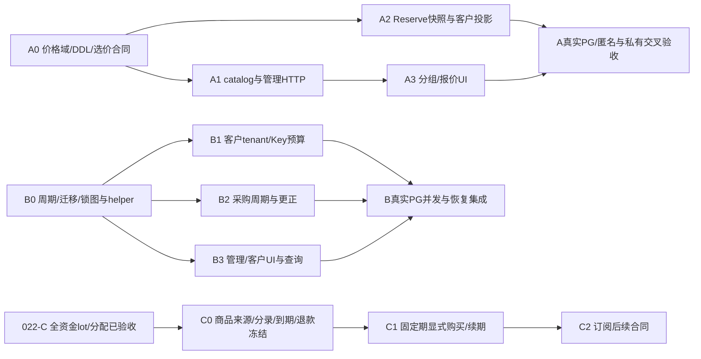

# 023 分片与并行计划草案

2026-11-01，**A0已冻结，A1/A2/A3已实现并通过限定本地验收；B核心与HTTP/UI按020接线，专项/浏览器、最终相关回归及020预览升级通过；只读核验器继续实施，C仍独立门禁**。A以[精确合同](a-contract.md)与[根裁决](review.md)为准；SDD原型不代表运行能力，B/C不得据A授权接通。

## 1. 依赖

021身份、022-A兑换券和023-A/B可独立设计；022-A或B通过不等于C依赖已满足。B1/B2的代码可在固定接口后分工，但与A2同时修改Reserve/evidence/settle时必须由同一账务负责人串行集成，不能并行覆盖共享文件。

## 2. A任务与所有权

- [x] 集成人接受或修订：单tenant单组、缺组价fail-closed、组退休不变已授客户、匿名只默认价、绝对单价和钱包前定价时刻。
- [x] A0冻结price_versions新增nullable组域、唯一性迁移、旧FK与旧数据兼容、tenant独立revision、不可变事件、操作回执与角色权限；列实际约束与触发器而非只写逻辑图。
- [x] A0固定Group/Assignment/Price/RetailPrice及management operation精确schemas、分页、有界准入、缺价预览和错误码；新管理API不得改变旧默认价body/语义。
- [x] A1独占catalog和管理存储：新group/assignment/price API；发布/退休/分配CAS、当前admin原子校验、无成本泄漏。
- [x] A2独占billing：同DB时刻确定选价与不可变request快照，旧请求legacy标记；RecordAttempt/dispatch/finish不重新定价。
- [x] A1/A2合并全部选价读取点：默认发布、匿名public SQL、tenant模型列表、Key调用目录和Reserve；不能只修改Reserve使页面继续显示另一价格。
- [x] A3独占web：分组和分配管理、客户有效报价、匿名默认说明；严格DTO、无损金额、未知回执与身份epoch。
- [x] A专项真实PG：跨组缺价/0价、同有效时刻唯一、调组/发布/锁等待、历史收尾、匿名隔离；再真实main浏览器及完整架构收口。

## 3. B任务与所有权

- [x] 接受或修订UTC日/月、原期归属+carry、首次下一完整期启用、无手动reset、周期一旦配置不可改、客户退款不恢复预算以及tenant/admin权限。
- [x] B0审计实际Reserve、lockRequest、model升级、PrepareDispatch、采购evidence/更正和恢复；画出新增control/window/FK完整锁图，明确账户与control先后不同层，公布同tx helper签名。
- [x] B0冻结稳定controller、配置版本、window/allocation/event DDL、受限角色、首次配置的完整legacy held同步扫描、tracking_started_at和时钟异常fail-closed；未配置不宣称已跟踪，首配后禁用期间持续记账。
- [x] B0补齐当前视图/历史窗口/allocations状态枚举、平台/tenant操作查询路由、错误映射、游标编码、请求并发/时限上界；精确合同/纯层、Tx helper、Reader、Commander已实施，核心接线按[b-integration-contract](b-integration-contract.md)推进；HTTP/前端专项、真实多tab及隔离main浏览器已通过，最终回归/预览仍另验。
- [x] B1客户资金负责人接入tenant/Key两重预占、同request一次allocation、原期settle/release/24h和不减spent的消费退款；每一处与ledger同tx。
- [x] B2采购负责人接入每attempt原期、累计cap与周期cap交集、保守unknown/disputed、双审绝对成本更正；不得进入客户Settle事务或因客户释放减采购carry。
- [x] B3独占web/HTTP查询：当期和carry分栏、UTC起止与观察时间、scheduled/disabled、独立CAS、只读原操作；不把周期额度显示成钱包到账。
- [ ] B交叉PG验证月末锁等待、第二attempt跨期、限额收紧/关开、旧held恢复、更正、禁用/过期账号的有利收尾、process crash/旧备份门禁；实际main跑单再刷新架构。

## 4. C串行关口

- [ ] 确认022-C已实际验收，而非只有lot表或草案；现有全部客户资金路径与原路退款/拒付的来源分配覆盖齐全。
- [ ] C0逐项冻结purchase输入来源、原支付/钱包购买分配、grant/journal分录和唯一effect；退款累计取整、费用、拒付/债务归因与恢复规则。
- [ ] 冻结过期available/held/release/settle/refund的桶变动、服务授权交集、term边界及重叠消耗顺序；先证明赠额无法转换现金。
- [ ] 给出真正的商品/购买/term/取消/续期DTO和API、所有权/权限、操作回执、完整锁图；未完成不注册售卖接口。
- [ ] C1先固定期与显式续期；可靠权威支付effect/到期任务只能执行既有财务事实，不能发模型生成或重复grant。
- [ ] C2自动续费和更复杂订阅另行冻结支付授权、余额不足、取消竞态、退款/拒付和时钟合同；不因有订阅按钮直接启用。

## 5. 汇合与架构

每片专项PG测试、严格前端构建和隔离浏览器完成后，由集成人汇总全部并行结果，同步HLD/LLD、路线图、统一架构的价格链路/预算数据/权限/能力状态/源码链接及验证范围，再执行仓库规定的显式reviewed refresh和只读检查。

A的实施/验收见[验证记录](../../docs/verification/tenant-pricing.md)，B核心/HTTP/UI已接线且专项、隔离main浏览器、最终相关PG race与020预览升级通过，独立只读核验器及C仍继续；A完成不能写成周期和订阅完成，B也不能写成供应商真实月账单硬封顶。当前代码、旧验证和fixture不得被当作新行为验收证据。
