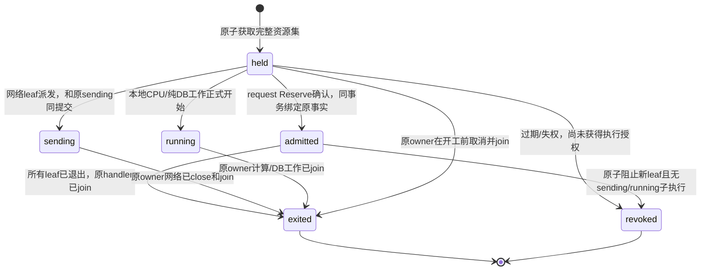

# 025-B0：共享准入、执行容量与失权合同（审查候选）

2026-11-01。**仅设计候选，未冻结、未实现、无HA验收。** 本文补[025规格](spec.md)、[合同](contract.md#b0实施前必须公布的共享状态合同)、[计划](plan.md)、[验收](acceptance.md)中缺少的共享状态、算法、执行状态和锁关系。没有修改生产代码、分配迁移号或删除单活锁；当前系统仍以[`operations.Instance`](../../internal/operations/instance.go)的session advisory lock及Guard运行。

必须先接受本文的保守活性边界，再冻结生产SQL、权限、精确helper与双进程故障运行器。本文提供候选数据合同和事务规则，不以一段DDL骨架冒充已完成生产DDL/触发器审查。022资金来源、023商品和024媒体尚未实施的分支，按当时最终合同纳入，不能从本稿推导为已支持。

## 1. 先确定共享限制究竟保证什么

首选方案仍以PostgreSQL为唯一持久事实源，不新增Redis依赖。安全目标是：多个网关进程共同持有的**已获准且尚未确认退出的执行**不能超过相应容量；同一模型attempt没有接班重发路径；资金事实仍按原唯一结算和不可变证据收尾。

这里有一个不能靠租约解决的边界：旧进程在“DB已提交sending、真正调用网络前”被任意暂停，之后可能恢复；DB连接断开、租约过期、epoch变化或本地deadline过去都不能证明它已经退出。供应商收到HTTP取消也不必然停止后台计算。因此：

1. `sending/running`执行的容量**不按时间自动回收**。租约失效只停止新授权，不能把仍可能发生的旧网络效果变成空闲容量。
2. 接班人不把原模型attempt发送一次来“继续”，不接管旧execution token，不创建同源替代attempt。仍沿原资金合同接受迟到证据、对账及24h客户释放；这些动作独立于执行容量。
3. 回收依据只能是原owner的实际资源join，或另经认证的外部停止/完成证据加确认旧发送路径被封闭。单独“供应商暂未查到请求”不是无消费或永久不能迟发的证明。
4. 任意暂停/网络分区模型下，本方案选择保守占用；未知执行可长期占满容量，降低可用性。**它不能同时承诺自动故障接管和无条件严格物理供应商并发。** 如果业务要求未知执行自动释放，必须另设计唯一受控egress服务/供应商幂等与任务查询协议或可验证进程终止边界，不能只改一个TTL。

根已接受以上保守安全/活性方向作为后续设计约束，尚未接受生产SQL/权限/接线或多活发行。没有完成反例验证前，不开放多活。当前单活的`deadline+5秒`接班等待是现有合同，不能被当作“任意暂停都已退出”的分布式证明；B1必须明确升级语义并按最终实现重验。

容量保证的对象是网关持有的授权及本地网络/计算资源；原owner的Close与join只能证明该本地路径退出，不能证明供应商后台计算已经停止。若商品或供应商要求限制其远端同时计算数，须额外认证终止/完成语义，不能从本地join推出该更强保证。未知消费的采购预占与客户资金收尾仍各按原事实处理。

## 2. 当前源码盘点与迁移分类

| 当前入口/状态 | 当前行为 | 025拟处理方式 |
| --- | --- | --- |
| [`Server.global/tenantPermits/keyPermits`](../../internal/server/server.go)、[`keyRuntime`](../../internal/server/key_runtime_limiter.go) | global=100、tenant=32，Key动态并发1..16、RPM1..6000、burst1..200；4096 Key进程内表，重启重置 | request共享容量和有理整数token桶；Key当前配置仍由原身份事务重检；成功获准后即消耗速率，不因后续钱包拒绝返还 |
| [`admissionQueue`](../../internal/server/admission_queue.go)及完成短阶段队列 | 每Key本进程最多16张ticket，序列化短DB阶段；不代表执行容量 | 保留为每节点连接/工作队列保护；不宣传跨节点全局FIFO。资金/命令正确性由共同DB锁和唯一事实保证；若产品要求全局FIFO，另冻持久排队合同 |
| [`routing.Engine`](../../internal/routing/routing.go) | 渠道/凭据容量、本地健康、half-open探测、代际；网络实际退出后Finish | 渠道和稳定凭据容量共享；健康默认允许本地提示，但持久quarantine/紧急撤销仍最终DB重检。half-open“每集群只一个”如要保留必须独立共享probe gate，不能把本地state当全局事实 |
| [`probe`](../../internal/server/probe.go)、[`discovery`](../../internal/server/discovery.go) | 平台4槽且共用100全局；探测占渠道/凭据，不扣客户钱包；发现受格式/版本/来源限制 | 共享global+platform_probe=4；探测再共享channel/credential，发现保持原无客户钱语义；一分钟渠道速率共享。它们也有真实出口，必须走持久授权，而不是只迁移付费请求 |
| [`rateDecision`](../../internal/server/server.go)、[`self_service`](../../internal/server/self_service_handlers.go) | 登录/密码、证明、探测等限流，有限来源表 | 涉及账号滥用/外发的限流必须共享；密码hash等物理CPU另保留每节点上限。已开工本地CPU任务若宣称集群硬上限，也须running到join，不靠TTL回收 |
| [`public_catalog`](../../internal/server/public_catalog_admission.go) | 独立global20/s burst40、source2/s burst8、4在途、4096来源，10分钟闲置回收 | 参数按020保持，改共享速率与共享读槽；额外每节点HTTP/DB池界。匿名身份不可绑定租户，不消耗付费Key桶 |
| [`pricing`](../../internal/server/pricing_admission.go) | read/write/preview/own分别全局/actor/tenant桶和并发；preview还占read | 构造同一原子多资源集合，全部成功才准入；保持每类既有值，不用统一默认值覆盖各slice；读槽先纯DB事务设计，不能笼统套模型sending |
| [`periodic_budget`](../../internal/server/periodic_budget_admission.go)、[`commerce`](../../internal/server/commerce_admission.go)、[`payment_admission`](../../internal/server/payment_admission.go)、[`alert_admission`](../../internal/server/alert_admission.go) | 独立actor/global速率、并发、截止，操作查询与写分离 | 每类独立资源域和桶，受其冻结HTTP合同约束；操作GET不变成命令重放。具体值由B1对照最终代码逐项固定并用双节点反例验证 |
| [`mailworker`](../../internal/mailworker/worker.go)、[`mail outbox`](../../internal/identity/mail_outbox.go) | 2 SMTP槽/60秒claim/generation，接受后ACK可能不原子；同proof可能重复邮件 | 业务claim/generation继续原义；若要求跨集群2条物理SMTP IO，另加保守发送容量，不以mail lease到期证明旧SMTP退出。允许重复同proof的既有语义继续明确 |
| [`payments.Runner`](../../internal/payments/runner.go)与processor | 2网络、4证据槽，持久原命令/租约/查询，独立LOGIN/attestation | 网络容量与DB证据处理分别共享；外部变更仍只能原命令，不让新epoch重新收款。022-B3当前只本地PSP，正式支付未认证。两个网络未知可能耗尽槽，不能默默增加query旁路 |
| [`alertworker`](../../internal/alertworker/worker.go) | 2个观察槽/专用2连接/Guard，无外部IO；来源只读且带规则revision | 集群2观察槽或按规则DB行锁共同调度；旧观察结果必须仍以原配置CAS丢弃。无外部效果可在事务内由DB fencing裁决，不能因此对模型也开放回收 |
| [`billing recovery`](../../internal/billing/recovery.go)、[`operations recovery`](../../internal/operations/recovery.go)及投影 | 原证据/原effect恢复、恢复闸门、独立角色投影 | 每类明确DB claim/扫描/排序和幂等；资金恢复不导入模型客户端。共享worker调度不替代资金唯一约束，projection不拿发送权限 |
| 024-B0纯[`metering`](../../internal/metering) | 只有纯计量/摘要/旧token adapter，未接线 | 没有网络/可共享许可；未来媒体buffer4/每Key1仍是B1候选，须精确profile后才进入共享资源清单 |

session/CSRF/MFA/当前角色、不可变目录/报价、资金/采购/预算是已有DB事实，不新增可绕过它们的缓存授权。只读缓存可以加速候选展示，实际Reserve/派发仍按最新DB状态裁决。日志/Prometheus的本地计数不当作共享限额。

## 3. 身份、时间和不可复用token

每个进程启动生成新的规范非nil `member_id` UUID，永不重用；`deployment_id`是该数据库安装的稳定身份。DB分配正`epoch bigint`，用不回退sequence保证集群内单调，允许事务回滚造成空号；到MaxInt64拒绝新注册，不循环。member状态`active -> fenced -> retired`，不可回到active。

heartbeat候选为每5秒一次、有效15秒，只使用同一主库DB时间。renew必须`state=active AND lease_until>clock_timestamp()`并匹配member+epoch；过期永久fence，只能新进程身份重启。所有许可行保留owner二元组和原执行ID，epoch不能只放日志或HTTP头。成员注册/心跳不是客户认证，也不是资金授权。

在相关短事务中锁定member行，完成所有可能等待后用新的`clock_timestamp()`重检；不能使用事务起始`now()`掩盖过期。statement/lock超时和连接总量由最终部署合同固定；新准入或sending提交未知时不调用外部。Go monotonic clock仅用于本地取消/排空，不是共享事实源；wall clock回拨时桶refill的有效时间取`max(last_refill_at, DBclock)`。

同一execution token绑定`deployment/member/epoch/group_id/purpose/parent_id/logical request_id/attempt_id/resource set digest/deadline`；通过私有字段与受控构造器暴露，不允许HTTP、另一个节点或恢复worker重建“可发送token”。它是进程内调用纪律，不能对恶意持DB app凭据的进程声称密码学不可伪造；DB仍需相应最小权限、来源/状态约束和可审计证据。

## 4. 共享数据关系（候选，不是迁移）

下列名字只占设计命名空间，不分配序号、不创建表。正式冻结前必须提交SQL全文、触发器/函数body、角色权限与禁止直接绕过的测试，不能拿本表作为DDL已经完成的声明。

| 关系 | 主键/不可变绑定 | 约束与索引 |
| --- | --- | --- |
| `execution_deployments` | 唯一deployment UUID | mode=`single_active/shared_preparing/shared_active/recovery`、configuration revision；切shared_active必须离线核验完整能力清单，无HTTP开关跳过 |
| `execution_members` | `member_id`，唯一`epoch`，FK deployment | state、registered/heartbeat/lease_until/fenced_at；owner二元组唯一；同UUID epoch和deployment不可改，已fenced不续租 |
| `execution_resource_policies` | `(kind,scope_id)`，不可变资源身份 | limit非负且有硬最大值、revision、enabled、fixed algorithm/version；关停=不发新许可，降配保留既有已准入数，可暂高于新值，禁止将负余额当容量 |
| `execution_rate_buckets` | `(kind,scope_id)`，FK policy | 非负NUMERIC整数credit、last_refill_at、policy_revision；同一算法固定scale，不能用float；Key桶不可清空补burst；匿名来源行数需有受锁保护的域总上限 |
| `execution_groups` | `id`，owner二元组，purpose及原逻辑来源唯一 | parent可空且深度≤1；state=`held/admitted/sending/running/exited/revoked`，创建/截止/最后状态/终态证据；root与leaf合法矩阵见§5。逻辑request ID先于业务Reserve存在，因此此字段是逻辑来源，不伪造业务FK存在性 |
| `execution_resource_edges` | `(group_id,kind,scope_id)`，FK group/policy | 正整数weight，资源集不可变；group终态前都计入used；group和edge同事务提交，不出现缺尾资源的半许可 |
| `execution_transition_receipts` | `(group_id,operation_id)`及状态revision唯一 | operation type、旧新state、actor owner、原资源集摘要、退出证据kind和DB时刻；同ID异指纹冲突，终态不可变；不是发起第二次外部调用的授权 |

group读取索引覆盖`(owner_member_id,epoch,state,id)`、`(parent_id,state,id)`及`(deadline,id) WHERE state IN('held','admitted')`；edge反查覆盖`(kind,scope_id,group_id)`。used只从非终态group的不可变edge合计得到，NUMERIC无损，不将过期group自动排除。不以未经同事务保护的materialized counter作为唯一准入依据；如性能需要缓存counter，必须另补双向守恒核验和触发器合同。

scope不接受任意URL/字符串DSL。global为固定scope，tenant/Key/channel/credential为稳定规范UUID；旧渠道无独立credential时用明确`legacy_channel`资源kind隔离，不能把同字符串当credential。当前credentials跨channel version和模型共享，资源键不能带版本使发布后凭空扩容。actor/source域用既有认证actor ID或固定purpose下的canonical IP HMAC，禁止原始邮箱/Token/API Key/URL或正文作为资源名；新HMAC轮换不得重置未耗尽桶。

request/probe/discovery各原业务表关联需在正式SQL补有向不可变关系，验收检查孤儿及资源集与原冻结身份是否一致。以无FK的逻辑ID度过“尚未Reserve”阶段不等于允许admitted/sending永远缺少原业务事实；状态触发器/同事务helper必须验证相应来源。

## 5. root/leaf状态机与计数



`request`是root，只允许held/admitted/exited/revoked，不直接执行模型网络；同request最多一个未退出的attempt leaf，尝试次数仍原协议最多2且仅安全not_sent可重试。`model_attempt`是leaf，在held->sending事务中与现有billing dispatch、采购预占及预算最终重检保持原子。probe/discovery/SMTP/payment等有外部IO的purpose是network leaf；纯计算或只DB工作是running leaf。root/leaf不允许任意嵌套或用户自选purpose。

root资源包括global/tenant/Key等原执行容量；attempt leaf包括渠道/凭据。probe另占global+platform_probe以及channel/credential；discovery占global+platform_probe。媒体验证buffer在未来profile中若加入，只在实际资源退出之后释放。获取、候选变更及attempt失败都不得先释放原leaf再等待旧网络退出。

所有held/admitted/sending/running都计入容量；只有exited/revoked排除。Reap只能处理过期held或满足“无获准子执行且能同事务阻止新leaf”的admitted root。它不等待/终止模型HTTP，不将sending改回held，不根据客户settled/released或采购unknown金额来回收执行容量。

根父行锁保护新增leaf/held->sending与root回收之间的互斥。若root被Reap改为revoked，旧进程恢复后派发CAS失败，无外部调用；若leaf已sending，Reap不得回收root/leaf，直到原join。即使member过期也允许原owner仅提交其已持有token对应的exit或迟到证据，不能借此续租、加资源或发送。若join提交未知，保留占用，先查原operation receipt；重复exit只返回同回执，不重复释放。

最终usage/唯一结算并不自动证明所有网络/handler已退出；先退出后待核对也可能成立。财务和执行状态是两个状态机，禁止把其中一个终态当成另一个的证据。允许受原财务权限处理迟到usage，而execution记录仍保守占用。

## 6. 精确token桶及配置变化

Key桶以RPM计，公共读等每秒参数统一精确换算为每分钟整数；当前已有值均可表达。固定`S=60_000_000`单位credit/token，DB时间差`elapsed_us=max(0,floor((effective_at-last_refill_at)*1e6))`，以NUMERIC整数算：

```text
effective_at = max(last_refill_at, clock_timestamp())
refilled = min(old_burst*S, old_credit + elapsed_us*old_rpm)
new_credit = min(new_burst*S, refilled)       # 新revision时先按旧配置前进
allow iff new_credit >= S
granted_credit = new_credit - S
```

新桶按该purpose首次激活语义初始化为完整burst；既有Key在多活升级时不能从空缓存推导“应该满”。升级需明确停准入并把旧进程已有债务保守迁移或等待其按旧速率完全充满，随后再固定共享基线。没有可验证Debt时默认零credit再自然补充，可减少可用性，不能赠送burst。该升级步骤须单独接受。

多个rate/capacity资源在同一个Acquire事务原子裁决：先确认容量都可发、所有桶都足够，再一次消耗每桶一个token并创建全部edge；任一失败不消耗任何桶，不生成半group。成功Acquire后后续Reserve因钱包/政策拒绝，容量以原token退出，已消费rate不返还，匹配现有成功runtime准入已消费速率的边界。无IO的准入重试只能读取同operation，不能再发token；客户端重复发新逻辑ID属于新请求，仍受原API幂等合同约束。

降RPM/burst先推进旧参数再截新容量；增RPM/burst不送额外credit；旧revision重放或同revision异参数拒绝。旧member的本地时间或缓存不能回写新revision。Key当前配置仍由原身份锁同步，运行域policy revision不得代替`limit_revision`或混入access/configuration revision。

bucket回收必须证明已按旧参数完全充满、没有活动group或保留债务/配置事实，且purpose合同允许；不能统一10分钟清空低速Key桶。匿名source域可按已固定最大补满时间和来源数回收，未知来源仍一个固定桶；超过4096来源/Key状态等已冻结界时返回503，不增长无界表或创建可绕过共享限流的新随机scope。历史终态group另设归档策略，不把清理它们当刷新桶的理由。

## 7. 候选Go接口与信任分层

只在正式冻结生产SQL后新增package；下列为待审签名，不是当前可调用API。外部入参不得传任意resource set或SQL；policy resolver根据purpose和当前身份/发布事实生成完整集合。

```go
type Member struct { /* private deployment, id, epoch, lifecycle */ }
type Admission struct { /* private member, group and purpose binding */ }
type Execution struct { /* private leaf, original operation and network state */ }
type ExitProof struct { /* only lifecycle join path can construct */ }

func Register(ctx context.Context, pool *pgxpool.Pool) (*Member, error)
func (m *Member) Renew(ctx context.Context) error
func (m *Member) Fence(ctx context.Context) error

// Own short transaction, no funds or provider IO. operation ID is caller-owned
// and persisted, and a COMMIT-unknown returns no Admission authority.
func (m *Member) AcquireRequest(ctx context.Context, principal Principal,
    requestID, operationID string) (Admission, error)

// Helpers participate in the one existing caller-owned transaction; no nested
// Begin, Commit, hidden connection or network call. Final helpers must import
// the exact production Principal and attempt/source types after B0-I freezes.
func AdmitRequestTx(ctx context.Context, tx pgx.Tx, a Admission,
    requestID string) error
func PrepareAttemptTx(ctx context.Context, tx pgx.Tx, a Admission,
    candidate FrozenCandidate, attemptID, operationID string) (Execution, error)
func MarkSendingTx(ctx context.Context, tx pgx.Tx, e Execution) error

func (m *Member) RecordExit(ctx context.Context, e Execution,
    operationID string, proof ExitProof) (ExitReceipt, error)
func (m *Member) ReadOperation(ctx context.Context,
    groupID, operationID string) (OperationView, error)
func (m *Member) ReapUnstarted(ctx context.Context, limit int) (ReapResult, error)
```

`MarkSendingTx`返回nil也不是已COMMIT的发送许可；caller必须明确获得同一业务事务成功COMMIT，并检查原本地lifecycle没有发起过调用后才消费一次本地send对象。未知COMMIT不能由恢复worker重新铸造可发送对象。原caller如果明确从未调用provider且完成全部资源join，可用专门not_invoked证据关闭原group；不能把“没有拿到HTTP响应”当not_invoked。

RecordExit接受失权后的原owner只是安全收尾，不将其重新active。新owner只能读原operation、Reap未开工组或按既有领域合同处理证据；它不能构造旧ExitProof、重新领原模型send对象或把unknown改成not_sent。操作视图仅给状态/安全ID/资源域、revision、时间和原因码，不返回API Key、邮箱、正文、密文、媒体或endpoint；跨租户和采购视图继续各自权限。

错误候选为固定code：`shared_unavailable/shared_capacity_limited/shared_rate_limited/shared_state_full/shared_fenced/shared_binding_mismatch/shared_operation_conflict/shared_outcome_unknown/shared_integrity`。429用于明确速率/容量拒绝，503用于DB/失权/状态表满/未知；先读原操作，不自动重发。精确HTTP映射仍须各slice最后冻结，不能因为统一SDK就覆盖原商务200业务回执语义。

## 8. 事务、锁图及恢复

**候选统一原则：共享资源修改与既有财务短事务尽量分开，开工许可与原sending事实必须同事务。** 财务网络过程仍在事务外。

1. Acquire事务只锁当前member、资源policy及相应bucket（按`kind COLLATE C,scope_id COLLATE C`），再锁/写原operation/group；检查完整used和rate，提交全部资源集。成员/资源配置写遵守同序，不获取资金账户锁。
2. Reserve接线事务先按固定顺序锁member、root group，再执行原身份父锁/钱包/来源/周期预算路径；admitted绑定与原request/reservation同提交。共享policy不在该财务事务中重取，不因已held group改变资源集合；身份/模型紧急撤销仍原最新重检。若经过等待member或root已失效，回滚，无新钱/网络。
3. attempt准备/派发按member、root、leaf顺序持锁，再走既有身份/渠道凭据/采购/预算/原attempt锁图；完整leaf容量Acquire在独立资源事务提前完成，但最终MarkSending和原billing sending同提交。root/state重检防止已reaped组迟发。新的leaf必须先固定ID/候选和完整资源集；换候选用原安全not_sent规则及新leaf，不改旧edge身份。
4. Reap按member -> root -> leaf固定顺序，处理最多100条，使用有界`SKIP LOCKED`；不同时持资金/采购/身份业务锁。需要释放的财务由既有恢复按原证据另起事务；不得先释放发送unknown。
5. 退出资源计数需要锁resource policy与group，不能在已经持财务账户/leaf锁的事务里反向调用。先按原合同提交usage/结算或记录pending并join本地资源，再在独立共享事务按member -> resources -> root -> leaf提交exit；失权member只走受限收尾谓词。事务失败保守不释放，下一步只读原operation或重复同一exit，不重做模型。
6. 配置降配不强制回收当前许可。共享资源revision和原Key limit revision的更新桥接必须同一显式命令事务，否则旧配置可能在另一节点重新发更宽许可；该精确bridge/锁顺序是B1冻结前阻断项，不能先做TTL同步。

以上顺序必须与最终022-C0/023-C/024-B0-I叠加做完整有向锁图和实际锁等待测试。尤其第3步“提前Acquire leaf与当前routing.Plan持本地锁”的对应关系、父group和业务外键隐式锁、退役/命令并发尚需生产helper SQL全文审查。任何最终路径发现资源->group与group->资源环，须改为独立阶段，不以“通常很快”接受死锁。

恢复模式不新准入模型/支付变更/身份外发；只处理原持久证据、账本检查与被允许的原命令查询。worker失权停止claim并取消join，其已授权外部效果保留原source/epoch。DB failover必须保证此deployment单写主库和不回滚已承诺资金事实；备份恢复另进recovery latch并核对离库外部事实，不能在恢复数据库中把旧members/permits删掉就正常开写。

## 9. 发布、角色与离线核验

正式迁移只追加，owner安装；app/worker/projection角色分离。app不能CREATE/DROP/改表/重置epoch或清空bucket，projection不能注册member/续租/claim/发送/exit。若用SECURITY DEFINER函数，固定search_path和完整schema引用，核function owner、ACL、静态body摘要、参数/返回及行触发器，不能让服务通过传role/schema/table字符串扩权。

上线过程先保持单活，新增共享数据并完整填充策略/身份桥接，以shadow只读比较本地/共享候选；shadow不得重复消费rate/资金或发双请求。冻结最终manifest及全部生产路径覆盖后，停新准入并排空/核对未知，再安装共享基线。多节点开写是单独离线受控动作，没有`SKIP_INSTANCE_LOCK`或普通HTTP开关。旧二进制缺迁移即拒启，不自动降级运行。

离线Verifier在一个RR READ ONLY快照核：成员epoch唯一/状态一致；group完整来源和合法状态；资源edge无缺尾/伪scope/孤儿；活跃容量NUMERIC合计与配置；发送group与原attempt身份一一对应；原资金及采购状态独立；bucket范围/原revision桥接/来源数上限；命令回执/exit证据和所有外部effect关系。降配导致used>limit应报告“既有占用超新限”并阻止新准入，不能一概修成数据错误或截断；长期未知单列，不以0处理。Verifier不修复、发网络、铸造发送token或清空表。

## 10. 必须独立验证的反例与冻结清单

| 场景 | 必须成立 |
| --- | --- |
| 两个真实main同时冲击同Key/tenant/channel/credential | 集群总容量、RPM/burst都成立，不能每节点各发一份；多版本/多模型共用稳定credential容量 |
| 旧owner在sending提交后、首次网络前SIGSTOP；epoch失效后新owner工作；恢复旧owner | 原execution仍计数，新owner不接管/重发；旧进程的单次迟发至多属于原许可，不能叠加出超容量的替代许可 |
| held或admitted root过期与派发争锁 | 要么sending先提交并保守占用，要么root被撤销且旧派发拒绝；无中间可绕过状态 |
| 旧owner已发、body/EOF/Close/join任一点停顿 | 只有实际退出路径发ExitProof，资金终态/取消/TTL都不能提前释放；SIGKILL不能只用断开DB连接替代 |
| Acquire/Reserve/MarkSending/exit的COMMIT丢包 | 原operation查询和保守占用，无半资源/重复token消费/重复模型POST/重复释放；资金仍唯一 |
| DB失联/主切换/statement timeout/角色失权 | 新准入fail closed；旧sending收尾可延后但不重发，恢复不删未知许可；不能两个可写主库各发许可 |
| Key降/升RPM、burst、并发，旧配置迟到、wall clock回拨 | 旧参数先refill、不送credit、不重置债务；下调保留既有占用，不再新发；三条Key revision互不伪造 |
| 独立公共目录/登录/支付/报价/预算/告警洪泛 | 各原purpose共享阈值和来源界成立，无互借或用新scope扩表；Node本地工作/DB池上限仍有界 |
| 邮件ACK未知、支付原命令未知及迟回、告警旧观察 | 同proof重复边界/原命令唯一资金/配置CAS仍原义；外部物理网络容量未知不借lease回收 |
| 真PG受限角色/直接SQL/全域Verifier/启动attestation | 缺edge/伪绑定/改epoch/越权claim/投影写被拒；SQL实现和只读核验独立，不用同helper自证 |

冻结前还缺：生产DDL/触发器/权限全文与只读核验SQL；各purpose最终资源与rate完整常量表；Key配置bridge；PrepareAttempt与原资金/helper全锁图；所有worker模式和回收证据具体实现；保守unknown占满的运维处理；离线多活模式切换与双进程真实SIGSTOP/SIGKILL运行器。**本稿不能作为B1实现或删除单活锁的授权。** 根可先接受安全/活性方向，再分派SQL、只读核验/运行器和协议资源层设计；公共资金/identity/dispatch接线由单一集成人串行持有。

交付时由根同步统一架构中的“当前单活/共享候选”状态和此设计入口。本文无代码、迁移、服务或正式环境验收，也未刷新架构清单。
